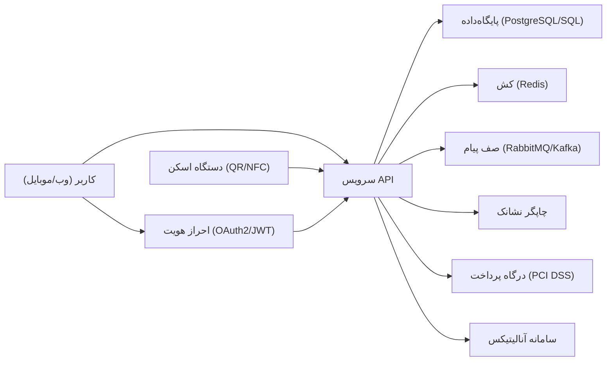

# خلاصه اجرایی  
طراحی یک سامانه جامع مدیریت همایش شامل وب‌سایت، اپلیکیشن موبایل و تجهیزات اسکن نیازمند بررسی نمونه‌های مشابه و استخراج الزامات دقیق است. در این گزارش ابتدا پلتفرم‌ها و اپلیکیشن‌های معروف رویدادها بررسی می‌شوند و سپس نیازمندی‌های عملکردی (ثبت‌نام، صدور بلیط، چک‌این، چاپ نشانک، دسترسی به نشست‌ها، مدیریت سخنران/غرفه و تحلیل آمار) و غیرعملکردی (مقیاس‌پذیری، در دسترس بودن، امنیت و حریم‌خصوصی، دسترس‌پذیری WCAG، بین‌المللی‌سازی، ناظر و لاگ) تعیین می‌شوند. سخت‌افزارهای اسکن (QR، بارکد، NFC، BLE، RFID) و پروتکل‌های مربوط معرفی می‌شوند. معماری نرم‌افزار پیشنهاد شده شامل نمودارهای ساختار، الگوهای طراحی API، احراز هویت (OAuth2/JWT/SSO)، مدل داده‌ها، انتخاب پایگاه‌داده، کش و صف پیام است. همچنین زیرساخت استقرار (ابر یا داخل سازمان)، CI/CD، مانیتورینگ و بازیابی اضطراری و کنترل‌های امنیتی/حریم‌خصوصی مطرح شده و تست‌های لازم و چک‌لیست روز رویداد ارایه می‌گردد. نقشه راه فازبندی (MVP، نسخه‌های بعدی) با برآورد مدت زمان و نقش‌ها ترسیم شده است. استانداردهای مهم نظیر ISO/IEC 27001، PCI-DSS (پرداخت)، GDPR یا معادل ملی و WCAG لحاظ می‌شود.  
    
## نمونه‌های مشابه  
چند نمونه شناخته‌شده جهانی پلتفرم مدیریت رویداد عبارتند از Cvent OnArrival (راه‌حل سازمانی برای همایش‌های ۲۰۰۰+ نفر)، **Nunify** (سامانه تمام‌عمر برای رویدادهای متوسط تا بزرگ)، **Whova** (برنامه شبکه‌سازی برای شرکت‌کنندگان)، **Eventleaf** (راه‌حل کم‌هزینه برای کنفرانس‌های کوچک) و **Eventbrite** (سرویس عمومی فروش بلیت). جدول زیر ویژگی‌های اصلی این محصولات را نشان می‌دهد:  

- *Cvent OnArrival:* مناسب همایش‌های سازمانی بزرگ؛ **رهگیری نشست‌ها** کامل، **چاپ نشانک** پیشرفته، اما هزینه‌ی بالا.  
- *Nunify:* پلتفرم جامع زندگی‌رویداد (ثبت‌نام، چک‌این، تعامل، آمار) برای ۵۰۰–۵۰۰۰ نفر؛ پشتیبانی از **ردیابی نشست** و **چاپ در کیوسک**، حالت آفلاین تست‌شده و ترکیب حضوری/مجازی.  
- *Whova:* تمرکز روی تعامل و شبکه‌سازی؛ **ردیابی پایه نشست** و **چاپ استاندارد** با اپ موبایل قوی (قابلیت جستجو و اطلاع‌رسانی جلسات).  
- *Eventleaf:* مناسب رویدادهای زیر ۱۰۰۰ نفر؛ **ردیابی پایه نشست**، پشتیبانی چند زبانه، قیمت بر مبنای نفر (حدود $0.25–$1 برای هر شرکت‌کننده).  
- *Eventbrite:* برای همایش‌های بلیت‌دار عمومی؛ امکانات **محدود** در ردیابی نشست و نشانک، کارمزد پرداخت ۳.۷٪ + $1.79 به ازای هر بلیت.  

*بهره‌برداری:* این محصولات اغلب برای ثبت‌نام آنلاین، برنامه‌ی نشست‌ها، و اپ موبایل برای شرکت‌کنندگان به کار می‌روند. به عنوان مثال، Nunify در بیش از ۲۰۰ رویداد بزرگ حالت آفلاین و چاپ نشانک بر خط را آزموده است. Whova بارها در همایش‌های بین‌المللی استفاده شده (گزارشات کاربران). همچنین شرکت‌های ایرانی نظیر *پارسی‌ایونت* یا سیستم‌های معرفی‌شده در صنعت همایش، مشابه چنین راهکارهایی را توسعه می‌دهند. **منابع:** اطلاعات فوق مبتنی بر مستندات رسمی محصولات و مقالات فنی مربوط است.  

## نیازمندی‌های عملکردی  
- **ثبت‌نام و صدور بلیت:** کاربر از طریق وب یا اپلیکیشن فرم ثبت‌نام تکمیل می‌کند. در صورت دریافت بلیت غیررایگان، درگاه پرداخت (با رعایت PCI-DSS) استفاده می‌شود. سیستم باید اطلاعات پایه شرکت‌کننده (نام، ایمیل، شرکت/واحد) و انواع بلیت (عمومی، دانشجویی، غرفه‌دار و …) را ذخیره کند. پس از پرداخت، بلیت الکترونیک با شناسه یا QR/NFC یکتا برای کاربر ارسال می‌شود. در صورت خطا در پرداخت، تراکنش قابل پیگیری و برگشتی مدیریت شود.  

- **چک‌این ورود:** در روز رویداد، شرکت‌کننده با نمایش QR کد روی موبایل یا کارت (NFC یا بارکد) در ایستگاه‌های چک‌این اسکن می‌شود. دستگاه‌های ایستگاه می‌توانند تبلت به همراه اسکنر بارکد/NFC باشند. بارکدها باید به گونه‌ای طراحی شوند که به راحتی توسط دوربین موبایل یا اسکنر خوانده شوند (تضاد مناسب و اندازه کافی). با هر اسکن، وضعیت شرکت‌کننده به «حاضر» ثبت شده و فرایند چاپ نشانک (در صورت ارسال حضوری) تریگر می‌شود. حداکثر تأخیر مجاز در پردازش اسکن به‌صورت بلادرنگ (کمتر از چند صد میلی‌ثانیه) است. **پیش‌بینی مقیاس:** به‌عنوان مثال، در یک همایش فرضی ۱۰۰۰ نفره که ۷۰٪ شرکت‌کنندگان در ۳۰ دقیقه اول می‌رسند، نرخ اوج حدود ۱۴۰۰ نفر در ساعت می‌شود. سیستم باید توان پردازش تعداد بالا (مثلاً چند ایستگاه هم‌زمان) را داشته باشد تا از گلوگاه شبکه و صف طولانی جلوگیری شود.  

- **چاپ نشانک:** نمایشگر کیوسک یا پرینتر نشانک (لیبل حرارتی، مثلاً Zebra) پس از چک‌این، نشانک چاپ می‌کند. نشانک‌ها شامل نام شرکت‌کننده، سازمان، کد درج‌شده (بارکد/QR) و اطلاعات نشست‌ها/نقش‌ها هستند. قابلیت چاپ سریع (کمتر از چند ثانیه) و پشتیبانی از درخواست چاپ مجدد (در صورت گم‌شدن، که طبق تجربه ~۳–۵٪ شرکت‌کنندگان رخ می‌دهد) ضرورت دارد.  
   *نمونه‌ای از نشانک‌های چاپ‌شده برای شرکت‌کنندگان همایش (با اطلاعات شخصی و لوگوی رویداد)*.  

- **ورود به نشست‌ها:** در صورت نیاز (مثلاً همایش‌های آموزشی با اهدای امتیاز), باید امکان اسکن نشانک یا کارت NFC برای ورود هر شرکت‌کننده به هر نشست/کارگاه فراهم شود. گزارش حضور هر فرد در جلسات مختلف (برای صدور گواهی) نیز ذخیره می‌شود. در برخی کنفرانس‌های حرفه‌ای، ثبت ورود و خروج هر جلسه به صورت جداگانه الزامی است.  

- **مدیریت سخنرانان و غرفه‌داران:** سامانه باید لیست سخنرانان (بیوگرافی، نشست‌های مربوطه) و زمان‌بندی نشست‌ها را داشته باشد. برای غرفه‌داران، اطلاعات شرکت، مکان غرفه، پرسنل غرفه (و ثبت ورود جداگانه) و قابلیت ثبت لید (اسکن کارت بازدیدکننده توسط غرفه‌دار) فراهم شود. این داده‌ها در جلسه کنار همایش قابل استفاده است.  

- **گزارش‌گیری و تحلیل:** داشبورد مدیریتی باید آمار بلادرنگ (تعداد کل چک‌این‌شده‌ها، تعداد حاضر هر نشست، نرخ انصراف نشست‌ها و نمودار تردد ساعتی) را نشان دهد. امکان خروجی‌گیری CSV یا گزارش PDF برای تحلیل‌های بعدی (رعایت استانداردهای مثل CE) فراهم باشد. همچنین نمودارهای مربوط به بازگشت هزینه رویداد (ROI)، رضایت‌سنجی و مقایسه آمار نسخه‌های گذشته در ورژن‌های پیشرفته‌تر در نظر گرفته می‌شود. این تحلیل‌ها برای بهبود همایش‌های بعدی اهمیت دارد.  

- **آفلاین و قطع ارتباط:** اتصال اینترنت در محل همایش معمولاً ضعیف است. بنابراین اپلیکیشن موبایل چک‌این باید کاملاً آفلاین عمل کند: داده‌های اسکن‌شده را به صورت محلی صف‌بندی کرده و پس از برقراری اتصال، با سرور همگام‌سازی نماید. این تضمین می‌دهد حتی بدون دسترسی اینترنت نیز ثبت‌نام و ورود انجام شده و هنگام بازیابی ارتباط، اطلاعات تکراری یا از دست‌رفته به درستی همگام می‌شود.  

## نیازمندی‌های غیرعملکردی  
- **مقیاس‌پذیری و در دسترس بودن:** سامانه باید قابلیت رشد داشته باشد (از چند صد تا چند هزار نفر). در صورت برگزاری همزمان چند همایش یا سالن، پشتیبانی از محیط توزیع‌شده (مثلاً چند منطقه جغرافیایی یا چند سرور) لازم است. سطح سرویس (SLA) بالای ۹۹.۹٪ پیشنهاد می‌شود. لود پیوسته کمتر اهمیت دارد؛ بلکه باید در پیک‌های ورود شدید (مثلاً ۱۵ دقیقه اول روز اول) پاسخگو باشد. استفاده از میکروسرویس‌ها و کلاستر کردن اجزای کلیدی (وب/اپ، دیتابیس، اسکنر) توصیه می‌شود.  

- **کارایی (Latency):** زمان پاسخ‌دهی APIها باید برای عملیات چک‌این کمینه باشد (به‌عنوان مثال کمتر از ۱۰۰ میلی‌ثانیه برای ثبت اسکن QR) تا تجربه کاربری مطلوب بماند. برای جلوگیری از تراکم دیتابیس در پیک، استفاده از کش (Redis/Memcached) جهت ذخیره موقت وضعیت ورود و کوئری سنگین (مثل شمارش کل تا کنون) پیشنهاد می‌شود.  

- **امنیت و حریم خصوصی:** تمام ارتباطات باید رمزنگاری‌شده (TLS 1.2/1.3) باشد و داده‌های حساس (مانند اطلاعات مالی، شماره کارت یا داده‌های پرسنلی) حداقل با AES-256 در پایگاه‌داده یا S3 ذخیره شوند. احراز هویت می‌تواند OAuth2 یا SAML (SSO) باشد و توکن‌های JWT برای نشست‌های کوتاه‌مدت استفاده شود. سطوح دسترسی دقیق (RBAC) برای کارمندان و مدیران تعریف شده و نفوذپذیری‌های رایج OWASP پیشگیری گردد. در صورت پردازش پرداخت آنلاین، رعایت استاندارد PCI DSS ضروری است؛ این استاندارد مجموعه ضوابط فنی و عملیاتی را برای حفاظت از داده کارت پرداخت فراهم می‌کند. علاوه بر این، باید با قوانین حریم شخصی مدرن همگام بود: مثلاً مقررات GDPR یا قوانین ملی محافظت داده (مانند «قانون جرایم رایانه‌ای» ایران) که تصریح می‌کنند کاربر باید به طور شفاف از جمع‌آوری داده مطلع و رضایت دهد و حق دسترسی/حذف اطلاعات را دارد. گزارش لاگ و ممیزی (Audit Log) برای رویدادهای حساس (ورود/خروج کاربر، چاپ نشانک، تغییرات برنامه) باید نگهداری شود.  
 
- **دسترس‌پذیری (Accessibility):** رابط وب و موبایل باید طبق استاندارد WCAG 2.1 حداقل سطح AA طراحی شود (رنگ‌های پرکنتراست، پشتیبانی از صفحه‌خوان‌های اسکرین، قابلیت دسترسی با صفحه‌کلید و فونت‌های قابل تغییر). این کار برای کاربران با ناتوانی بینایی یا حرکتی الزامی است. همچنین اپلیکیشن موبایل می‌تواند حالت‌های صفحه‌بزرگ یا متن‌خوانی داشته باشد.  

- **بین‌المللی‌سازی:** زبان پیش‌فرض فارسی است، اما قابلیت افزودن زبان انگلیسی (راست‌به‌چپ و چپ‌به‌راست) یا زبان‌های دیگر باید مدنظر باشد. فرمت تاریخ/زمان و واحد پول (ریال/تومان) متناسب با کاربران قابل تنظیم است.  

## سخت‌افزار و پروتکل‌های اسکن  
- **کد QR و بارکد:** آسان‌ترین روش چک‌این، استفاده از QR یا کدهای دو بعدی است. هر شرکت‌کننده یا کارمند نشانکی با این کد در اختیار دارد و می‌تواند با دوربین موبایل یا اسکنر بارکد آن را وارد سامانه کند. بارکد خطی (مثلاً Code128) یا Aztec/PDF417 هم می‌تواند برای بلیت استفاده شود. گوشی‌های iOS و Android معمولاً به صورت بومی قادر به اسکن QR هستند (یا از کتابخانه‌هایی مانند ZXing/ZXing.Net برای بارکد). [65]  

- **NFC (تگ تماسی):** کارت‌های NFC (رادیویی ۱۳.۵۶ مگاهرتز) بر اساس استاندارد ISO/IEC 14443 کار می‌کنند. می‌توان از کارت‌های مجاور شونده (Proximity Card) یا تگ‌های قابل برنامه‌ریزی استفاده کرد. در این حالت شرکت‌کننده با نزدیک کردن کارت به خواننده (که می‌تواند موبایل NFC‌دار یا دستگاه کارت‌خوان NFC مخصوص باشد) وارد می‌شود. مزیت NFC سرعت بسیار بالا (تپ در حدود ۱ ثانیه) و عدم نیاز به تماس دیداری است. اما هزینه چاپ و تهیه کارت بالاتر و وابستگی به سخت‌افزار NFC خواهد داشت. برای کاربردهای امنیتی یا شلوغ، NFC گزینه خوبی است.  

- **BLE (بلوتوث کم‌مصرف):** پروتکل‌های beacon نظیر iBeacon (اپل) یا Eddystone (گوگل) معمولاً برای مکان‌یابی داخل سالن (نمایش نقشه و اطلاع‌رسانی موقعیت) به کار می‌روند و کمتر برای چک‌این مستقیم مناسب هستند. در عوض می‌توان از بلوتوث برای ارتباطات کوتاه‌برد بین اسکنرها و سرور استفاده کرد (مثلاً اسکنرهای بلوتوث).  

- **RFID UHF/HF:** برای همایش‌های بزرگ گاهی از دستبند یا کارت RFID (زیر و فرکانس‌های ۱۳.۵۶MHz یا UHF ۸۶۰–۹۶۰MHz) استفاده می‌شود تا بدون تماس و در فاصله کمی، حضور ثبت شود. استانداردهای بین‌المللی مانند ISO/IEC 18000-3 (HF) و 18000-6 (UHF) در این حوزه مطرح‌اند. برای پیاده‌سازی RFID معمولاً نیاز به سخت‌افزار ویژه (آنتن و گیرنده‌های RFID) است و هزینه بیشتر است، اما قابلیت خواندن همزمان چند تگ را دارد.  

- **دستگاه‌های پیشنهادی:** برای اسکن بارکد/QR می‌توان از گوشی‌ یا تبلت‌های معمول با دوربین و اپ اختصاصی استفاده کرد. در صورت نیاز به سرعت بیشتر، اسکنرهای دستی یا سوار بر پایه USB/Bluetooth (مانند Zebra DS2200 یا Honeywell Xenon) قابل اتصال به کامپیوتر/تبلت هستند. برای NFC، تلفن‌های اندروید و آیفون (دارای NFC) قابل استفاده‌اند؛ همچنین می‌توان کارت‌خوان‌های USB NFC مانند ACR1255 را به کامپیوتر متصل کرد. برای چاپ نشانک از پرینترهای حرفه‌ای لیبل حرارتی (Zebra ZD410/ZD510, Evolis, Datacard) استفاده شود. 
- **کتابخانه‌ها و ادغام (SDK/API):** اسکن بارکد/QR در موبایل با کتابخانه‌هایی مانند ZXing (Android/Java)، ZBar (iOS/C++), ML Kit (Firebase) یا AVFoundation انجام می‌شود. برای NFC در Android از کلاس NFCAdapter و در iOS از Core NFC بهره می‌برند. ادغام سخت‌افزار اسکنر معمولا به صورت HID (تغییر به کیبورد) یا از طریق SDKهای تولیدکننده انجام می‌پذیرد.  
 
## معماری نرم‌افزار  
معماری پیشنهادی می‌تواند به شکل میکروسرویس یا لایه‌ای باشد. یک جریان معمولی بدین صورت است: اپلیکیشن موبایل و وب‌سایت به یک **API سرور** مرکزی درخواست می‌دهند. این API بر بستر REST (یا GraphQL) پیاده می‌شود. سرویس‌های کلیدی شامل:  
- **احراز هویت/مجوز:** با استفاده از OAuth2 (جریان Authorization Code + PKCE) و JSON Web Token (JWT) می‌توان تأیید هویت و تأیید دسترسی‌ها را مدیریت کرد. OAuth2 یک پروتکل استاندارد صنعت برای مجوزدهی است. امکان ورود SSO با سرویس‌های سازمانی (مثلاً LDAP یا SAML) نیز قابل‌افزودن است.  
- **میکروسرویس‌های وظیفه‌ای:** برای مثال سرویس ثبت‌نام، سرویس چاپ نشانک، سرویس چک‌این، سرویس گزارش و … می‌تواند جدا باشد. سرویس چک‌این وظیفه ثبت اسکن‌های QR/NFC را بر عهده دارد.  
- **دیتابیس:** پایگاه‌داده اصلی (رابطه‌ای مثل PostgreSQL یا MySQL) برای داده ساختاریافته (رویدادها، نشست‌ها، کاربران، بلیت) به کار می‌رود. برای گزارش و آمار به طور مکمل ممکن است از دیتابیس تحلیلی (مانند Elasticsearch یا ClickHouse) بهره‌گیری شود.  
- **کش (Caching):** برای کارایی (مثلاً شمارش سریع حضورها)، از کش در حافظه (Redis) استفاده می‌شود.  
- **صف پیام (Message Queue):** همگام‌سازی چک‌این‌های آفلاین یا ارسال ایمیل به‌صورت ناهمزمان را می‌توان با صف پیام (مثل RabbitMQ یا Kafka) انجام داد. این روش تضمین می‌کند عملیات‌هایی نظیر ارسال ایمیل یا چاپ نشانک در صف قرار گرفته و در صورت عدم دسترس بودن سرویس، دوباره امتحان می‌شوند.  
- **مأموریت‌های دوره‌ای (Cron Jobs):** برای وظایف پس‌زمینه مثل ارسال اطلاعیه ایمیلی، پاک‌سازی داده‌های قدیمی یا پشتیبان‌گیری منظم استفاده می‌شوند.  
- **مدل داده (جدول‌ها):** جدول‌های اصلی عبارتند از:  
  | نهاد           | فیلدهای اصلی                                       |  
  | -------------- | -------------------------------------------------- |  
  | **Company**     | id, نام همایش، تاریخ، مکان، تنظیمات عمومی          |  
  | **Attendee**    | id, نام، ایمیل، موبایل، نوع بلیت، وضعیت پرداخت،   |  
  |                |   کد یکتا (QR/NFC)، وضعیت حضور کلی                   |  
  | **Ticket**      | id, شناسه شرکت‌کننده, نوع بلیت (VIP/سخنران/غرفه) |  
  | **Session**     | id, عنوان، سخنران, زمان شروع/پایان، سالن، ظرفیت     |  
  | **Speaker**     | id, نام، عنوان شغلی، تماس، بیوگرافی               |  
  | **Exhibitor**   | id, نام شرکت، توضیحات، شماره سالن/گروه              |  
  | **CheckInLog**  | id, شناسه شرکت‌کننده، شناسه نشست/رویداد، زمان ورود  |  
  | **Badge**       | id, شناسه شرکت‌کننده، حالت چاپ شده، زمان چاپ       |  

- **نمودار معماری:** در تصویر زیر ساختار کلی اجزا و جریان داده نمایش داده شده است:  

- **الگوی API:** بهتر است از RESTful یا GraphQL برای API ها استفاده شود. مسیرهای (Endpoints) مانند `/register`, `/login`, `/events/{id}/checkin` طراحی می‌شوند. از مستندسازی OpenAPI (Swagger) استفاده شود.  
- **احراز هویت:** استاندارد OAuth2 توصیه می‌شود. پس از دریافت توکن JWT توسط کاربر وارد شده، هر درخواست API بررسی توکن و نقش کاربر می‌شود. همچنین امکان پیاده‌سازی Single Sign-On به کمک SAML یا OpenID Connect (به ویژه برای همایش‌های شرکتی) وجود دارد.  
- **غیرفعال‌سازی همزمانی (Concurrency) و قفل:** در زمان چک‌این شدید، تضمین یکپارچگی داده‌ها مهم است. می‌توان از قفل optimistic در سطح رکورد پایگاه‌داده استفاده کرد تا ثبت همزمان یک شرکت‌کننده توسط دو ایستگاه مجزا تداخلی ایجاد نکند.  

## زیرساخت و استقرار  
- **محل استقرار:** سامانه می‌تواند بر بستر ابر (AWS, Azure, GCP) یا زیرساخت محلی سازمان (On-Premise) نصب شود. ابر با خدمات مدیریت‌شده (مثل RDS، ElasticCache، ELB) مقیاس‌پذیری و در دسترس بودن را ساده می‌کند و نیازی به خرید سرور فیزیکی ندارد. در نسخه On-Prem باید سرورها در دو ناحیه مختلف (Availability Zone) کپی‌برداری شوند.  
- **CI/CD:** از ابزارهای اتوماسیون (Jenkins, GitLab CI, GitHub Actions) برای استقرار خودکار استفاده می‌شود. هر تغییر در کد پس از تست خودکار، به محیط آزمایشی (Staging) منتقل و پس از تأیید به محیط تولید (Production) می‌رود.  
- **مانیتورینگ:** سیستم‌های لاگ و مانیتورینگ (مثل Prometheus+Grafana یا ELK Stack) برای پایش زنده سلامت سرویس‌ها و سرورها تعبیه شود. هشدارها (Alert) برای قطعی سرور، افزایش بار یا خطای سرویس‌دهی تنظیم گردد.  
- **پشتیبان‌گیری و بازیابی:** از بانک اطلاعاتی و داده‌های مهم (فلایرها، لیست شرکت‌کنندگان) نسخه پشتیبان روزانه و هفتگی تهیه شود. استراتژی بازیابی شامل قابلیت **Point-in-Time Recovery** پایگاه‌داده و آزمایش دوره‌ای فرآیند بازیابی است.  
- **آمادگی در برابر فاجعه (DR):** برنامه بازیابی پس از حادثه شامل تهیۀ زیرساخت موازی در مرکز داده دیگر یا ناحیه دیگر در ابر است تا در صورت از دست دادن تمام سرورها، سیستم در عرض زمان تعریف‌شده (مثلاً ۲۴ ساعت) به سرویس‌دهی برگردد.  

## کنترل‌های امنیتی و حریم خصوصی  
- **رمزنگاری و کلیدها:** داده‌های حساس حتماً با الگوریتم‌های قوی (AES-256) رمزگذاری شده نگهداری شوند. ارتباطات تماماً با TLS رمزنگاری شود.  
- **مکانیزم‌های حفاظت:** بر اساس GDPR و استانداردهای امنیتی، **حداقل دسترسی لازم** به کاربران و مدیران اعمال شود و اقدامات امنیتی مانند «احراز هویت دو مرحله‌ای» برای کارمندان اداری مدنظر قرار گیرد.  
- **مدیریت حوادث امنیتی:** در صورت نشت داده یا حمله، باید فرایند واکنش اضطراری وجود داشته باشد (مثلاً قطع سریع سرویس، اطلاع‌رسانی به نهاد نظارتی و کاربران).  
- **پذیرش شرایط و رضایت کاربران:** هنگام ثبت‌نام باید کاربر شرایط حریم خصوصی را خوانده و به جمع‌آوری اطلاعات رضایت دهد. اطلاعات شخصی بدون رضایت او نباید به اشخاص ثالث فروخته شود. فرم رضایت Privacy Policy و Opt-in/Opt-out برای دریافت خبرنامه و تبلیغات باید وجود داشته باشد.  
- **حریم خصوصی فرد:** مطابق GDPR، کاربر حق دسترسی، اصلاح و حذف داده‌هایش را دارد (حق «فراموش شدن»). سیستم باید مکانیزم‌هایی برای اعمال این حقوق فراهم نماید.  
- **بازبینی و ممیزی:** کلیه فعالیت‌های حیاتی (میزان ورود شرکت‌کنندگان به هر سالن، چاپ مجدد نشانک، عملیات پرداخت) لاگ شوند. این لاگ‌ها به عنوان پرونده ممیزی در بازه‌های تعریف‌شده بررسی می‌شوند.  

## تست و چک‌لیست عملیاتی  
- **تست عملکردی:** تست همه فرم‌های ثبت‌نام، خرید بلیت، اسکن نشانک و دسترسی به نشست‌ها با داده‌های تستی. از تست خودکار (Unit/Integration) برای ویژگی‌های اصلی (ثبت نام، ارسال ایمیل، اسکن) استفاده شود.  
- **تست بارگذاری:** بارگذاری همزمان چند صد کاربر (Load Test) در عملیات ثبت‌نام و چک‌این شبیه‌سازی شود. ابزارهایی مانند JMeter یا Locust برای تست اوج ۱۴۰۰ چک‌این در ساعت توصیه می‌شود.  
- **آزمون آفلاین:** قطع آگاهانه اینترنت و آزمون ثبت‌نام و چک‌این چند نفر در حالت آفلاین تا اطمینان از صف‌بندی صحیح داده و همگام‌سازی بعدی.  
- **تست امنیت:** اسکن نفوذ (Vulnerability Scan) و تست نفوذ (Penetration Test) برای APIها و رابط کاربری. برون‌سپاری به شرکت‌های مشاور امنیت الزامی‌ است.  
- **چک‌لیست روز رویداد:**  
  - شبکه و سخت‌افزار: تست Wi-Fi/اینترنت و وجود پشتیبان (مودم 4G). بررسی شارژ باتری اسکنرها و پرینترها.  
  - تجهیزات: راه‌اندازی اولیه اسکنرها و پرینترها، چاپ یک نشانک آزمایشی.  
  - داده‌ها: ایمپورت نهایی لیست شرکت‌کنندگان و بررسی انطباق آن با بلیت‌های ارسالی.  
  - پرسنل: آموزش نهایی تیم چک‌این و پشتیبان؛ شماره تلفن تیم فنی رویت همه.  
  - سناریوهای شکست: تست دستی روند ورود با کاغذ چاپ شده و ثبت دستی حضور (در صورت اشکال اسکن). آماده‌سازی بن‌ها/نشانک‌های قبولی برای تهویه اضطراری صف.  
  
## نقشه راه پیاده‌سازی  
- **MVP (حداقل محصول پذیرفتنی):** شامل وب‌سایت ثبت‌نام پایه، تولید QR بلیت و اسکن ساده در یک ایستگاه (بدون چاپ اتوماتیک). در این فاز تیم حداقل شامل ۲ برنامه‌نویس Backend، ۱ برنامه‌نویس Frontend، ۱ مدیر پروژه و ۱ کارشناس QA است. زمان‌بندی: ~۳ ماه برای توسعه و تست اولیه.  
- **نسخه ۱:** افزودن چاپ خودکار نشانک و اجرای قابلیت آفلاین. مدیریت ساده چند نشست (تقویم و ژورنال)، و داشبورد مقدماتی آمار. تیم شامل یک برنامه‌نویس بیشتر (برای اپ موبایل/وب) و یک طراح UI اضافه می‌شود. زمان: ۲–۳ ماه پس از MVP.  
- **نسخه ۲:** اپ موبایل رسمی، قابلیت چند همایش همزمان (multi-tenant)، گزارش‌گیری پیشرفته (نمودارها و هشدارها)، سفارشی‌سازی نشانک (چاپ رنگی، لوگو)، زیرساخت CDN. اضافه کردن قابلیت احراز هویت یک‌مرحله‌ای با SSO. زمان: ۳–۴ ماه.  
- **نسخه‌های بعدی (v2+):** مدیریت غرفه‌داران (Lead Retrieval)، اکوسیستم یکپارچه‌تر (مثلاً فرم‌های بازخورد)، هوش مصنوعی پایه (پیشنهاد جلسات) و گسترش به راهکار هیبرید (همایش مجازی).  

نقشه زمانی کلی با توجه به منابع می‌تواند به‌صورت جدول فازبندی و نقش‌ها تنظیم شود. ضمن پیش‌بینی عدم قطعیت‌ها (مثلاً تعداد دقیق شرکت‌کنندگان و امکانات سخت‌افزاری سالن نامشخص است)، تقریباً هر فاز با تیم‌های ۴–۵ نفره و ۲۰۰–۴۰۰ نفر-ساعت کار محقق می‌شود.  

## استانداردها و مقررات  
- **استانداردهای امنیت اطلاعات:** ISO/IEC 27001 (مدیریت امنیت اطلاعات)، ISO/IEC 29100 (حریم خصوصی) و استانداردهای نرم‌افزاری متن‌باز (مانند OWASP Top10) در طراحی باید رعایت شوند.  
- **پرداخت الکترونیک:** در صورت نیاز به درگاه پرداخت کارت‌خوان، الزامات PCI-DSS باید برآورده شود؛ این استاندارد هسته امنیت داده‌های کارت را فراهم می‌آورد.  
- **دسترسی‌پذیری:** رعایت WCAG 2.1 AA ضروری است.  
- **حریم خصوصی:** مقررات داخلی مانند قانون جرایم رایانه‌ای (مصوب ۱۳۸۸) بر جمع‌آوری و انتشار داده‌ها نظارت دارد. همچنین اگر کاربران اروپایی یا اطلاعات آن‌ها در سامانه ذخیره شود، GDPR و قوانین حفاظت داده‌های آنها باید رعایت شوند.  

**منابع:** 
معلومات این گزارش از مستندات فنی ارائه شده توسط سرویس‌های معرفی‌شده، استانداردهای بین‌المللی و مقالات صنعتی مرتبط استخراج شده است. رعایت این منابع تضمین‌دهنده پیاده‌سازی صحیح و آینده‌نگر است.