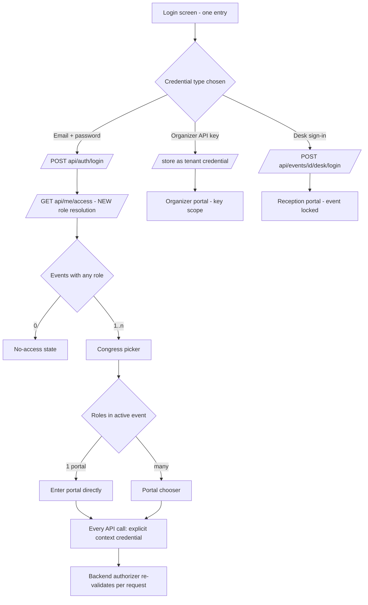

# 01 — Authentication Architecture

**Status:** RECOMMENDED design (planning only). Evidence verified against `backend/app/security.py`, `backend/app/auth.py`, `backend/app/routes/auth.py`, `backend/app/routes/desk.py`, `backend/app/routes/checkin.py`, `web/src/api/client.ts`.

Legend: **[CURRENT]** verified in source · **[DESIGN]** recommended design · **[REQ]** client requirement.

---

## 1. The Five Existing Credential Mechanisms (verified)

| # | Mechanism | Principal | Issuance | Validation | Lifetime | Revocation | Storage (frontend) |
|---|---|---|---|---|---|---|---|
| 1 | **Platform admin token** | Platform operator (infra, not a domain user) | Env var `CONGRESS_PLATFORM_ADMIN_TOKEN` (no default — `config.py:19`) | `X-Admin-Token` header, constant-time compare (`auth.py:23-28`) | Static | Rotate env var | n/a (CLI/ops only) |
| 2 | **Organizer API key** | Organizer tenant (not a person) | `POST /api/organizers` → `secrets.token_urlsafe(32)`, SHA-256 stored (`auth.py:15-20`) | Bearer → hash lookup (`auth.py:31-44`) | No expiry | **None** (no rotation/revocation endpoint) | sessionStorage `congress_organizer_api_key` |
| 3 | **Attendee JWT** | `User` | `POST /api/auth/register|login` (PBKDF2-SHA256, 100k iters — `security.py:11-17`) | HS256 `decode_access_token` + user fetch (`routes/auth.py:56-75`) | 7 days (`security.py:40`) | **None** (stateless; no denylist) | localStorage `congress_attendee_token` |
| 4 | **Desk-operator JWT** | `User` as `DeskOperator` of one event | `POST /api/events/{id}/desk/login` (password + DeskOperator row + not revoked — `desk.py:239-299`) | `type=desk_operator`, `operator_id`, `event_id` claims + DB row + `is_revoked` per request (`desk.py:152-229`) | 7 days (`security.py:87`) | `DeskOperator.is_revoked` — enforced per request | sessionStorage `congress_desk_token_{eventId}` |
| 5 | **Scanner-device JWT** | `ScannerDevice` (not a human) | `POST /api/checkin-points/{id}/token` by organizer (`checkin.py:319-360`) | `type=scanner`, `point_id`, `event_id`, `jti`=device UUID + revocation per request (`checkin.py:225-317`) | 7 days | `ScannerDevice.is_revoked` — enforced per request | `scannerTokenStore.ts` (device-local) |

Security limitations **[CURRENT]**: organizer key has no rotation/expiry; attendee JWT cannot be revoked server-side; desk/scanner JWTs share the same 7-day default with no refresh flow (re-login/re-issue required); attendee token in localStorage is XSS-exposed (accepted PWA trade-off for offline passes).

## 2. The `client.ts:56-83` Credential-Selection Problem

**[CURRENT] exact behavior:** `getApiClient(token?, scope)` falls back to storage when no token is passed. For `scope="any"` it guesses by `window.location.pathname.startsWith("/organizer")`: organizer routes prefer the organizer key, all other routes prefer the attendee JWT, **with cross-fallback both ways** (lines 68-76).

Documented defects:
- **Ambiguity:** on non-organizer routes an attendee token is preferred, but if absent the *organizer key* is silently attached (line 74-75) — e.g. an organizer browsing a public event page may send their master key to public/attendee endpoints.
- **Wrong-credential leakage:** master organizer key can be sent to any endpoint reached from an organizer route under `scope="any"`.
- **Implicit auth state:** ExhibitorPortal (`ExhibitorPortal.tsx:68-71`) works only because an attendee JWT happens to be in localStorage; there is no exhibitor login path.
- **Multi-role switching:** a user who is both organizer (sessionStorage key) and attendee (localStorage JWT) gets whichever credential the pathname heuristic prefers, not the one matching their intent.
- **Desk tokens** bypass this helper entirely (per-page `sessionStorage` read, `OrganizerDesk.tsx:31-37`) — a third, ad-hoc selection path.
- Error handling: 401 and 403 are not distinguished by the client contract; pages interpret errors ad hoc.

## 3. Comparative Analysis (§12)

| Criterion | A — Preserve + explicit context | B — Unified human session | C — Hybrid transition |
|---|---|---|---|
| Security | Keeps least-privilege tokens; risk = legacy confusion during coexistence | Best long-term (one auditable principal); but merges organizer key semantics into user sessions — bigger attack surface per token | A's safety now, B's clarity later |
| Complexity | Low backend; medium frontend (context store) | High (organizer auth must move from tenant-key to user-membership; new session issuance) | Medium |
| Migration risk | Minimal; additive | High — breaks organizer key automation, desk login, all 131 tests' fixtures | Low-Medium, staged |
| Code reuse | 100% of authorizers reused | Rewrites `current_organizer`, `authorized_desk_operator`, client | Reuses authorizers; adds resolution layer |
| Multi-role / multi-event | Solved by explicit context, not by tokens | Native | Native at the end state |
| Revocation | Desk/scanner already per-request; attendee still stateless | Enables unified session revocation | Phase-wise |
| Existing user compatibility | Full | Breaking | Full during transition |

**Recommendation: Approach C — Hybrid Transition**, starting with Approach A's explicit-context contract immediately, converging human auth (attendee + desk operator, both already user-JWT based) toward B, while **permanently keeping** the organizer API key for tenant-level administration and scanner JWTs for devices. Rationale: the organizer key is a tenant credential, not a human session — unifying it adds risk with no client requirement behind it **[ASSUME: "Admin" = Organizer, see D01]**; desk and attendee tokens are already HS256 user-bound and can converge cheaply.

## 4. Target Authentication Design



Rules **[DESIGN]**:
1. **One human identity, multiple scoped credentials.** Desk login stays a separate endpoint (it issues an event-locked credential — a security feature, not a bug).
2. **Scanner credentials never enter human flows.** `type=scanner` tokens are rejected by human authorizers **[CURRENT]** (`checkin.py:294-297` rejects non-scanner; human deps don't decode scanner type into a user).
3. **New read-only endpoint `GET /api/me/access`** **[DESIGN]**: returns `{ user, memberships: [{ event_id, event_name, event_slug, roles[], partner_ids[] }] }` computed from Ticket/DeskOperator(non-revoked)/BoothStaff rows. It *describes*; it never *grants*.
4. Organizer portal remains API-key gated (D01: Admin = Organizer). **[OPEN]** if a true platform-admin UI is later required, it is a new scope, not a reuse of the organizer key.

## 5. Explicit Credential-Resolution Contract (replaces `client.ts:56-83`)

**[DESIGN]** — a typed context object is the *only* source of credentials; `getApiClient(token?, scope)` and all storage heuristics are deleted at cutover.

```ts
// Conceptual contract — NOT implementation
type PortalKind = "organizer" | "attendee" | "reception" | "partner" | "scanner" | "public";

interface AccessMembership {
  eventId: string; eventName: string; eventSlug: string;
  roles: Array<"ATTENDEE" | "RECEPTION" | "PARTNER">;
  partnerIds: string[];            // booths/partners user may represent in this event
}

interface AuthContext {
  identity: { userId: string; email: string; fullName: string } | null;  // null = logged out
  organizerKey: string | null;        // tenant credential, only for organizer portal
  userToken: string | null;           // attendee/partner JWT
  deskTokens: Record<eventId, string>; // event-locked reception credentials
  memberships: AccessMembership[];     // from GET /api/me/access
  activeEventId: string | null;
  activePortal: PortalKind;
}

// THE rule: credential = f(activePortal, activeEventId), nothing else.
function credentialFor(ctx: AuthContext): { header: string | null } {
  switch (ctx.activePortal) {
    case "organizer":  return { header: ctx.organizerKey };
    case "reception":  return { header: ctx.deskTokens[ctx.activeEventId] ?? null };
    case "attendee":
    case "partner":    return { header: ctx.userToken };
    case "public":     return { header: ctx.userToken };   // optional personalization only
    case "scanner":    /* unchanged: device store, never via AuthContext */
  }
}
```

Contract invariants:
- **No fallback chain.** If `credentialFor` returns null → the UI renders that portal's login step; it never substitutes another stored credential.
- **No pathname sniffing.** Portal is explicit application state, not `location.pathname`.
- **Portal switch never widens rights.** Switching portals only changes which credential is attached; every protected endpoint still re-authorizes server-side.
- **Event switch re-resolves credential** (reception token is per-event; partner scoping re-checked server-side per booth).
- **localStorage only for the user JWT** (offline PWA requirement); organizer key + desk tokens stay in sessionStorage; scanner tokens stay in their device store.

## 6. Error & Lifecycle Handling (frontend contract)

| Condition | HTTP | Frontend behavior |
|---|---|---|
| Authentication failure (bad/expired/unknown token) | 401 | Drop the affected credential for that portal only → that portal's login step. Never log out other portals. |
| Authorization failure (valid identity, insufficient rights) | 403 | Keep session; show "not authorized for this resource"; offer portal/event switch. Never retry with a different credential automatically. |
| Revoked reception operator | 401 (`desk.py:196-201`) **[CURRENT]** | Discard desk token for that event; role disappears on next `/me/access`. |
| Revoked scanner device | 401 **[CURRENT]** | Device re-authorization flow (unchanged). |
| Expired user JWT (7d) | 401 | Re-login; offline ticket cache stays readable but marked stale **[CURRENT behavior of `ticketCache.ts`]**. |
| Missing event context | n/a (client) | Block API call; route to congress picker. |
| Logout | n/a | Per-portal: clear that portal's credential. Global "sign out everywhere" clears user JWT + all desk tokens, keeps organizer key only if user explicitly chooses **[OPEN — default: clear all]**. |

## 7. Decisions Summary

- D03 Authentication strategy: **Approach C (hybrid)** — explicit context now; converge attendee+desk on user JWT; organizer key & scanner JWT permanent.
- D04 Credential resolution: **explicit `AuthContext` contract above**; heuristic `getApiClient` deprecated at cutover with a failing lint/test on residual `scope="any"` calls.
- Revocation **[CURRENT]** kept: desk + scanner per-request; attendee revocation deferred as optional hardening (denylist or short TTL + refresh) — flagged, not mandated.
