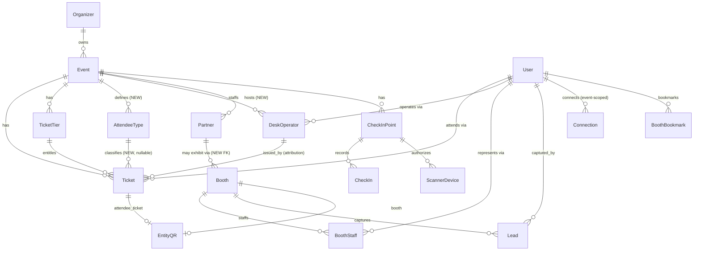

# 01 — Domain Model Architecture

**Status:** RECOMMENDED design (planning only — no implementation, no migrations)
**Evidence base:** `backend/app/models.py` (14 tables), migrations 0001–0011, ADRs 0001–0011, Phase 00 audit.

Legend: **[CURRENT]** verified in source · **[REQ]** client requirement · **[DESIGN]** recommended design · **[ASSUME]** assumption · **[OPEN]** unresolved product decision.

---

## 1. Six Concepts, Explicitly Separated

| Concept | Definition | Current carrier | Verdict |
|---|---|---|---|
| **User Identity** (5.1) | The authenticated human | `User` (global: email, password_hash, full_name, organization, title, `share_contact_with_peers`) — **[CURRENT]** | Correct as-is; never duplicate per event |
| **Event Membership** (5.2) | User ↔ congress association | `Ticket` (attendee membership), `DeskOperator` (reception membership), `BoothStaff` (partner membership) — **[CURRENT]** | Membership is *implicit*, scattered across 3 role tables; sufficient — do NOT add a generic membership table |
| **Role Assignment** (5.3) | Responsibilities within one event | No role entity; role = presence of a row in `Ticket` / `DeskOperator` / `BoothStaff`; Organizer role = possession of tenant API key — **[CURRENT]** | Keep row-presence-as-role; add a read-only **role resolution** API (D02) |
| **Attendee Type** (5.4) | Configurable, event-specific participant category (General, Physician, Student, Speaker, VIP) — **[REQ CR-06]** | **ABSENT** — **[CURRENT]** verified missing | New entity `AttendeeType` + assignment field on `Ticket` (§5) |
| **Ticket Tier** (5.5) | Admission entitlement with quota (`quota`, `reserved_count`, `is_open`) | `TicketTier` — **[CURRENT]** | Unchanged; tier ≠ type; both may coexist on one Ticket |
| **Partner Assignment** (5.6) | Organization a user may represent | `Booth` + `BoothStaff` — **[CURRENT]** | Generalize via Option C (§4): `Partner` entity, Booth stays |

Key invariant: **Attendee Type is not a permission and not a quota.** It is a taxonomy label on the attendee's event participation. TicketTier remains the only quota/inventory construct. No code path may derive authorization from AttendeeType.

## 2. Identity ↔ Membership ↔ Role Boundaries



**[CURRENT]** entities: Organizer, Event, TicketTier, User, DeskOperator, Ticket, EntityQR, CheckInPoint, CheckIn, ScannerDevice, Booth, BoothStaff, Connection, BoothBookmark, Lead.
**[DESIGN NEW]**: `AttendeeType`, `Partner`; new columns `Ticket.attendee_type_id` (nullable FK), `Booth.partner_id` (nullable FK).

## 3. Multi-Role / Multi-Event Scenarios (§6 of brief)

Role resolution rule **[DESIGN]**: for a given `(user, event)` the role set = {`ATTENDEE` if active Ticket exists} ∪ {`RECEPTION` if non-revoked DeskOperator exists} ∪ {`PARTNER` if BoothStaff exists on any booth of the event} ∪ {`ORGANIZER` only via organizer API key, never via User}. All enforced server-side per request; the resolution API only *describes*.

| # | Scenario | Identity | Event ctx | Role ctx | Portal | Backend enforcement | Failure behavior |
|---|---|---|---|---|---|---|---|
| S1 | Attendee in A only | User | A | ATTENDEE | Attendee portal (auto) | `CurrentUserDep` + ticket-scoped queries | — |
| S2 | Reception in A only | User | A | RECEPTION | Reception portal (auto) | `authorized_desk_operator` (event binding, revocation check) | 403 if not DeskOperator for A |
| S3 | Attendee + Reception in A | User | A | {ATTENDEE, RECEPTION} | Explicit chooser, both offered | Each portal's own dep; desk ops additionally require desk JWT | Choosing portal never grants the other role's rights |
| S4 | Organizes A, attends B | User + Organizer key | A/B | ORGANIZER(A via key), ATTENDEE(B) | Organizer portal for A (key gate), Attendee portal for B | `OwnedEventDep` vs `CurrentUserDep` | Cross-use → 401/403 |
| S5 | Partner X in A, Partner Y in B | User | A/B | PARTNER(X@A), PARTNER(Y@B) | Partner portal per event/partner context | `authorized_booth_staff` per booth | Booth of Y@B queried with A context → 403/404 |
| S6 | Multiple partners, one event | User | A | PARTNER(P1), PARTNER(P2) | Partner picker inside portal | per-booth `BoothStaff` row | No cross-partner leak (`uq_booth_staff`, 403 isolation tested) |
| S7 | Tickets in 3 congresses opens My Congress | User | unset→choose | ATTENDEE ×3 | **Congress picker** first, then tab shell for chosen event (D08) | All attendee APIs are implicitly event-scoped via ticket | No aggregate cross-event views of protected data |
| S8 | Reception revoked, attendee active | User | A | {ATTENDEE} (RECEPTION removed) | Attendee portal only | `desk.py:196-201` revocation → 401 on desk JWT; ticket unaffected | Old desk token rejected 401 "access has been revoked" — **[CURRENT, tested]** |
| S9 | Bookmarked portal URL, access lost | User | A | none for that resource | Redirect to login/chooser | Resource-level 401/403 (e.g. revoked operator, removed staff) | Frontend shows "access lost" state; never silent data |

## 4. Partner vs Exhibitor Decision (D06)

Evidence **[CURRENT]**: `Booth` (event_id, name, slug, location, description, website_url, brochure_url), `BoothStaff(booth_id,user_id)`, `Lead.booth_id` FK with `uq_booth_ticket_lead`, public endpoint `GET /api/public/events/{slug}/booths/{booth_id}`. Lead capture, isolation, CSV export, bookmarks — all keyed on **booth**.

| Option | Description | Pros | Cons / migration cost |
|---|---|---|---|
| **A — Partner = UI label for Exhibitor** | Rename labels only | Zero schema change; zero risk | Cannot represent partners without booths; CR-09 "partner listing" tied to exhibition; likely fails client's broader partner concept |
| **B — Partner as broad entity, Booth optional child** | New `Partner` (event-scoped org: name, type[exhibitor/sponsor/institutional/scientific], description, website, logo); `Booth.partner_id` nullable FK; staff/leads gradually re-keyable | Matches client vocabulary; supports boothless partners; event-specific partnership | Largest change: staff assignment & lead queries keyed on booth today |
| **C — Minimal intermediate extension** *(recommended)* | Add `Partner` entity (event-scoped, `partner_type`, profile fields). `Booth.partner_id` nullable → existing booths backfilled 1:1. `BoothStaff` unchanged (booth-scoped); partner-level access = union of user's booth-staff rows for that partner's booths | Preserves every existing guarantee (lead isolation `leads.py:50-79`, CSV, bookmarks, public booth pages); no destructive rename; boothless partners listable publicly; incremental | Partner-level staff not modeled yet (deferred); two-step hierarchy adds one join |

**Recommendation: Option C.** It satisfies public partner discovery, event-specific partnerships, representative authorization, and 100% preservation of booth/lead behavior, at minimal migration cost. Escalation to Option B later is a pure extension (move staff to partner level) without reversing C.

## 5. Configurable Attendee Type (D07)

**[REQ CR-06]**, **[CURRENT]** absent (verified: no type field on User/Ticket; TicketTier is quota-only).

Conceptual schema **[DESIGN]**:

```
AttendeeType
  id            uuid PK
  event_id      uuid FK events.id, index        -- event-scoped, tenant-isolated via event
  name          string(100)                     -- UniqueConstraint(event_id, name)
  description   text default ''
  display_order int default 0                   -- organizer-controlled ordering
  is_active     bool default true, index        -- deactivate without deleting history
  created_at    timestamptz

Ticket.attendee_type_id  uuid NULL FK attendee_types.id, index  -- NEW nullable column
```

Rules: assignment at registration (self, optional, only active types of that event) and desk registration (operator picks); organizer CRUD gated by `OwnedEventDep`; deactivation preserves existing tickets (nullable FK, never cascade-delete); check-in admission policies remain **tier-based** (`CheckInPoint.allowed_tier_ids` unchanged) — type does not affect admission in MVP; analytics may group by type (additive, non-breaking).

Relationships: type ⊥ tier (orthogonal), type ⊥ permissions. Future extensibility: per-type registration fields, per-type badge styling — out of MVP.

Data-integrity test cases (design targets):
1. Create two types with same name in one event → 409/validation error (unique constraint).
2. Same type name in two different events → both allowed (event scoping).
3. Register with a deactivated type → 400/409 rejected.
4. Deactivate a type with 50 assigned tickets → all 50 tickets retain the type label; new assignment blocked.
5. Organizer B attempts to create/read/assign types on Organizer A's event → 404 (tenant masking via `OwnedEventDep`).
6. (Boundary) Ticket created without type → NULL allowed, registration still succeeds.

## 6. Proposed Data Changes Summary

| Change | Kind | Backward compat | Migration need |
|---|---|---|---|
| `AttendeeType` table | additive | full | 1 new migration |
| `Ticket.attendee_type_id` nullable FK | additive | full (NULL = untyped) | same migration |
| `Partner` table | additive | full | 1 new migration |
| `Booth.partner_id` nullable FK + 1:1 backfill | additive | full | same migration |
| Role-resolution read endpoint | additive API | full | none |

No existing table is renamed, dropped, or re-keyed. No QR regeneration. No credential changes.
