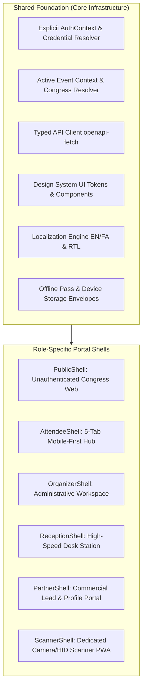
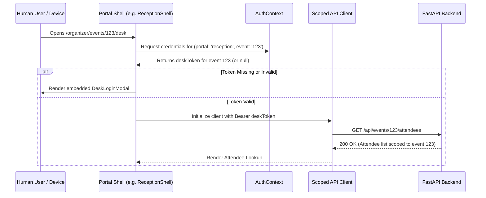
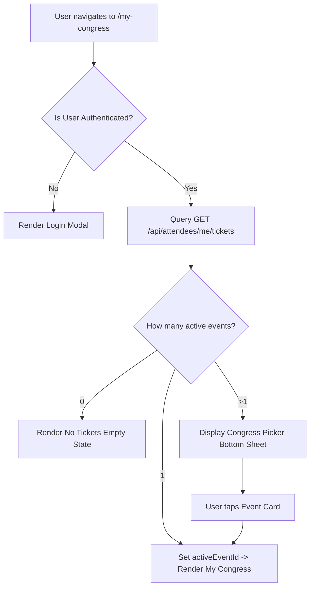

# 02 — Frontend Architecture & Portal Shell Blueprint

**Status:** ARCHITECTURAL DESIGN (Planning Only — Implementation Prohibited)  
**Role:** Principal Frontend Architect + Senior UX Systems Engineer  
**Baseline Inputs:** Phase 00 Baseline Audit, Phase 01 Decisions (D01–D10), React 19 + TypeScript codebase in `web/`

---

## 1. Executive Summary & Architectural Model

The Congress Management Platform frontend evolves from a flat, page-centric route collection with heuristic credential binding into a **modular, role-partitioned Single Page Application (SPA) & Progressive Web App (PWA)** built on React 19, TypeScript, Vite, and Tailwind CSS.

### Core Architectural Principle
The frontend represents **one unified codebase** serving **five distinct interface experiences** plus one specialized offline scanner client:



### Anti-Patterns Explicitly Rejected
1. **No Multiple Repository Split:** We do not split the web frontend into 4 or 5 separate npm packages or repositories. A single Vite SPA preserves code sharing (UI kit, API types, i18n, offline storage) with zero deployment orchestration overhead.
2. **No Monolithic Component with Role Conditionals:** We do not create a single mega-page littered with `if (role === 'attendee')` branches. Each portal has its own dedicated shell, layout tree, and feature controllers.
3. **No Frontend-Only Security Assumptions:** A portal shell is an **information architecture and UX boundary**, not a security boundary. Every protected user action re-authenticates and re-authorizes strictly against backend FastAPI dependencies (`OwnedEventDep`, `AuthorizedDeskDep`, `AuthorizedBoothDep`, `CurrentUserDep`).
4. **No Rebuilding Working Infrastructure:** The existing high-contrast QR generation, offline pass cache (`ticketCache.ts`), peer vCard export (`network.py`), offline scanner engine (`scannerEngine.ts`), and Persian/English localization (`i18n.ts`) are 100% reused and encapsulated into clean feature modules.

---

## 2. Portal Shell Architecture

Each portal shell encapsulates navigation, header controls, active context, error handling, and responsive adaptivity for its intended audience.

| Shell | Target Audience | Auth & Credential Contract | Event Context | Primary Navigation |
|---|---|---|---|---|
| **PublicShell** | Prospective attendees, public visitors | None required. Optional Attendee JWT for bookmarking & personalization | Resolved from URL slug (`/e/:slug`) | Top navbar (desktop) / Drawer (mobile): Overview, Speakers/Schedule, Partners, Register |
| **AttendeeShell** | Registered conference delegates & attendees | Required: Human Attendee JWT (`localStorage`). Fails closed to login dialog | Active Congress (`activeEventId` / `/c/:slug/*`). Resolved via single ticket or Congress Picker | **Persistent 5-Tab Navigation**: My Congress, My Network, My Ticket, My Profile, Congress Details |
| **OrganizerShell** | Congress Directors & Tenant Administrators | Required: Master Organizer API key (`sessionStorage`). Key gate fallback | Event Switcher dropdown + Event Workspace tabs | Sidebar (desktop) / Header Menu (mobile): Event List, Overview, Tiers & Types, Check-in Gates, Reception Staff, Partners & Booths, Analytics |
| **ReceptionShell** | Front-desk operators & registration staff | Required: Event-scoped Desk Operator JWT (`sessionStorage`) or Admin Key | Locked to assigned event (`eventId` in token) | High-speed task bar: Fast Registration, Live Attendee Lookup, Minted Pass Counter, Logout |
| **PartnerShell** | Commercial sponsors & exhibition booth staff | Required: Human JWT with `BoothStaff` assignment row (`localStorage`) | Bound to assigned Booth & Event | Partner Header / Tabs: Company Profile, Booth Standee, Lead Scanner (if booth), Lead Feed & Qualification, CRM CSV Export |
| **ScannerShell** | Gate inspectors & hardware scanning guns | Required: Dedicated `ScannerDevice` JWT (`jti` device bound) or Master Key | Locked to Check-In Point (`pointId`) | Minimalist fullscreen HUD: Camera viewport, Offline queue indicator, Sound feedback toggle, Device Revoke |

---

## 3. Detailed Portal Shell Specifications

### 3.1 PublicShell
- **Intended Users:** Unregistered visitors, public attendees exploring the congress agenda, visitors scanning booth standees before registering.
- **Layout Structure:**
  - Sticky Top Header with congress identity, date/venue pill, language switcher (FA/EN), and primary CTA button ("Register" / "Login").
  - Content Outlet (`<Outlet />` or hero sections).
  - Responsive Footer with organizer attribution and platform links.
- **State Handling:**
  - Loading: Skeleton hero and pulse card place-holders.
  - 404 Not Found: Friendly congress-not-found page with link to `/` platform home.
- **Direct Links:** Deep links to `/e/:slug` and `/e/:slug/booths/:boothId` render directly inside `PublicShell` without requiring login.

### 3.2 AttendeeShell (The 5-Tab Experience)
- **Intended Users:** Authenticated delegates attending one or more congresses.
- **Layout Structure:**
  - **Top Bar (Compact):** Active Congress Title Pill (tappable to open Congress Picker if multi-event), Connection/Sync status indicator (Online / Offline Cached), Language toggle, Quick-logout icon.
  - **Main Scroll Area:** Single viewport height on mobile with `-webkit-overflow-scrolling: touch`, bottom padding `pb-20` (80px) to guarantee content never sits under the fixed bottom nav.
  - **Persistent Bottom Navigation (Mobile):** Exactly 5 destinations:
    1. My Congress (`/c/:slug/my-congress` or `/my-congress`)
    2. My Network (`/c/:slug/my-network` or `/my-network`)
    3. My Ticket (`/c/:slug/my-ticket` or `/my-tickets`)
    4. My Profile (`/c/:slug/my-profile` or `/my-profile`)
    5. Congress Details (`/c/:slug/details`)
  - **Desktop Adaptation:** Left rail navigation (RTL right rail) with expanded icon + label buttons, persistent congress badge, and attendee avatar card.
- **State Handling:**
  - Unauthenticated: Renders embedded `AttendeeLoginDialog` with registration link; never redirects to a broken blank screen.
  - Offline Mode: Shows subtle amber pill `"Offline Pass (Secure Local Storage)"` using existing `ticketCache.ts`.
  - Multi-Congress: Shows Congress Switcher Sheet if attendee holds tickets for multiple active events.

### 3.3 OrganizerShell
- **Intended Users:** Event directors and congress administrators managing event configuration.
- **Layout Structure:**
  - Persistent Organizer Key Header showing tenant name, active organizer badge, security notice ("Stored strictly in browser sessionStorage"), and "Switch Tenant / Clear Key" button.
  - Event Context Breadcrumbs: `Organizers > [Congress Name] > [Workspace Section]`.
  - Desktop: Two-column layout with left navigation hierarchy (Events list, Settings, Analytics).
  - Mobile: Collapsible accordion navigation bar with high-contrast touch targets.
- **State Handling:**
  - Missing/Invalid API Key: Renders `OrganizerKeyGate` modal; blocks all underlying API queries.
  - 404 Tenant Isolation: Masks foreign events with standard not-found state (preserving backend tenant masking).

### 3.4 ReceptionShell
- **Intended Users:** Front-desk receptionists, volunteer registrars, and organizers operating registration stations.
- **Layout Structure:**
  - Full-width operational layout optimized for 10-inch tablets and desktop monitors.
  - **Header:** Station Title (`میز پذیرش`), Active Operator Badge (`اپراتور: علی رضایی`), Assigned Congress Name, Station Status (Live / Network Lag), and Logout button.
  - **Main Workspace:** Split pane or rapid toggle:
    - Left/Top: Rapid Walk-in Registration Form (minimal keystroke auto-focus).
    - Right/Bottom: Live Attendee Search and QR Minting Card Drawer.
- **State Handling:**
  - Unauthenticated: Embedded `DeskLoginModal` requiring email + password + event assignment.
  - Revocation: If backend returns 401 `"Front desk operator access has been revoked"`, immediately clears `sessionStorage` token, renders high-contrast alert dialog, and blocks further registration.

### 3.5 PartnerShell
- **Intended Users:** Commercial sponsors, booth representatives, and exhibition staff.
- **Layout Structure:**
  - **Header:** Organization Name (`شرکت دانش‌بنیان سینا`), Partner Category Badge (`غرفه‌دار طلایی` / `حامی مالی`), Booth Location pill (`غرفه B-12`), and User profile summary.
  - **Navigation Bar (Shallow Tabs):**
    - Tab 1: Organization Profile & Digital Brochure
    - Tab 2: Booth Lead Scanner (Camera QR reader + manual code fallback)
    - Tab 3: Live Qualified Leads Feed (Filter by HOT/WARM/COLD)
    - Action: One-Click CRM CSV Export (sanitized against formula injection)
- **Capability-Gated Rendering:**
  - If Partner has no physical booth (`booth_id === null` — e.g. sponsor-only partner), Tab 2 (Lead Scanner) is cleanly omitted or displays a clear capability banner, avoiding confusing fake-booth artifacts.
- **State Handling:**
  - 403 Forbidden: If user is not in `booth_staff` for this booth, renders `PartnerUnauthorizedView` with contact organizer prompt.

### 3.6 ScannerShell (Operational Gate Client)
- **Intended Users:** Check-in gate inspectors and volunteers scanning QR passes.
- **Layout Structure:** Full-screen camera HUD with USB HID physical gun keyboard listener, scan result drawer (Green ADMITTED / Red REJECTED / Amber DUPLICATE), and offline buffer badge (`۵ اسکن در صف همگام‌سازی`).
- **Preservation:** Completely preserved from `GateScanner.tsx` and `scannerEngine.ts`.

---

## 4. Frontend Component & Module Structure

The recommended project structure organizes code by **architectural role and domain feature**, strictly separating shared UI components from portal shells and domain stores:

```
web/src/
├── app/                        # Application bootstrap & top-level router
│   ├── App.tsx                 # Root React component with providers
│   ├── routes.tsx              # Declarative route configuration
│   └── main.tsx                # Browser entry point & PWA register
│
├── auth/                       # Explicit Authentication Infrastructure (D03/D04)
│   ├── AuthContext.tsx         # Central typed auth provider & hooks
│   ├── credentialResolver.ts   # Explicit credentialFor(portal, event) logic
│   ├── types.ts                # UserIdentity, AccessMembership, PortalKind
│   └── guards/                 # Route guards (RequireAuth, RequireRole)
│       ├── AttendeeGuard.tsx
│       ├── OrganizerGuard.tsx
│       ├── ReceptionGuard.tsx
│       └── PartnerGuard.tsx
│
├── api/                        # Typed API Client & Contract
│   ├── client.ts               # Context-aware openapi-fetch factory
│   ├── schema.d.ts             # Generated backend OpenAPI definitions
│   └── errors.ts               # Standardized API error formatters
│
├── layouts/                    # Portal Shell Layouts
│   ├── PublicLayout.tsx        # Public website header/footer shell
│   ├── AttendeeShell.tsx       # 5-tab mobile-first attendee container
│   ├── OrganizerLayout.tsx     # Organizer console navigation shell
│   ├── ReceptionLayout.tsx     # High-speed desk station container
│   ├── PartnerLayout.tsx       # Partner & exhibition portal container
│   └── ScannerLayout.tsx       # Fullscreen HUD gate scanner shell
│
├── portals/                    # Portal Top-Level Route Controllers
│   ├── public/
│   │   ├── PublicEventPage.tsx
│   │   └── PublicBoothPage.tsx
│   ├── attendee/
│   │   ├── MyCongressPage.tsx      # Tab 1: Personalized home & partners
│   │   ├── MyNetworkPage.tsx       # Tab 2: Peer networking & vCard
│   │   ├── MyTicketPage.tsx        # Tab 3: High-contrast QR pass
│   │   ├── MyProfilePage.tsx       # Tab 4: Attendee profile & consent
│   │   └── CongressDetailsPage.tsx # Tab 5: Event agenda & venue guide
│   ├── organizer/
│   │   ├── OrganizerEventsPage.tsx
│   │   ├── OrganizerEventDetailPage.tsx
│   │   └── OrganizerAnalyticsPage.tsx
│   ├── reception/
│   │   └── ReceptionStationPage.tsx
│   └── partner/
│       └── PartnerWorkspacePage.tsx
│
├── features/                   # Testable, Decomposed Business Domain Features
│   ├── attendee-types/         # Configurable Attendee Types (CR-06)
│   │   ├── AttendeeTypeList.tsx
│   │   ├── AttendeeTypeModal.tsx
│   │   └── useAttendeeTypes.ts
│   ├── partners/               # Partner Discovery & Lead Retrieval (CR-09, D06)
│   │   ├── PartnerDirectory.tsx    # Inside My Congress
│   │   ├── PartnerCard.tsx
│   │   ├── BoothLeadScanner.tsx
│   │   ├── LeadQualificationDrawer.tsx
│   │   └── LeadCsvExportButton.tsx
│   ├── tickets/                # Ticket Minting & Pass Display
│   │   ├── TicketQrCard.tsx
│   │   ├── TicketTierSelector.tsx
│   │   └── OfflinePassBanner.tsx
│   ├── desk-operations/        # Fast Walk-in Registration (CR-05)
│   │   ├── RapidRegistrationForm.tsx
│   │   ├── LiveAttendeeSearch.tsx
│   │   └── MintedPassSummaryModal.tsx
│   ├── checkin-points/         # Gates & Admission Policies
│   │   ├── GatePointList.tsx
│   │   └── AdmissionPolicyEditor.tsx
│   └── networking/             # Peer-to-Peer Networking
│       ├── ConnectionCard.tsx
│       ├── PeerScanModal.tsx
│       └── ContactConsentToggle.tsx
│
├── components/ui/              # Atomic Design System (Tokens in index.css)
│   ├── Button.tsx
│   ├── Card.tsx
│   ├── Badge.tsx
│   ├── Dialog.tsx
│   ├── Input.tsx
│   ├── Select.tsx
│   ├── Tabs.tsx
│   └── SkipLink.tsx
│
├── lib/                        # Cross-Cutting Infrastructure Utilities
│   ├── i18n.ts                 # Bilingual translation dictionaries (FA/EN)
│   ├── ticketCache.ts          # Tamper-evident owner-scoped offline pass cache
│   ├── scannerEngine.ts        # Camera/HID engine with offline queue
│   ├── scannerStorage.ts       # IndexedDB/localStorage scan events store
│   └── audioFeedback.ts        # Audio beeps for success/duplicate/error
│
└── tests/                      # Frontend Unit & Integration Tests
```

---

## 5. Explicit Authentication & Credential Integration (Resolving `client.ts:56-83`)

### 5.1 The Explicit Credential Contract
In Phase 01, Decision **D04** mandated replacing the pathname-guessing heuristic with an **unambiguous, typed function**:

$$\text{Credential} = f(\text{ActivePortal}, \text{ActiveEventId})$$

Every API call made by a feature hook or page controller either explicitly passes its portal scope or executes within a scoped client provided by its shell.



### 5.2 Storage Separation Invariant
To prevent cross-portal credential poisoning:
1. **Attendee User JWT:** Stored exclusively in `localStorage['congress_attendee_token']` to support offline PWA access across app reloads.
2. **Desk Operator JWT:** Stored exclusively in `sessionStorage['congress_desk_token_${eventId}']`. Automatically destroyed when the browser tab is closed.
3. **Organizer Master API Key:** Stored exclusively in `sessionStorage['congress_organizer_api_key']`. Never written to `localStorage`.
4. **Scanner Device Token:** Stored in device token storage (`scannerTokenStore.ts`). Completely isolated from human user identities.

---

## 6. Event Context Resolution & Multi-Event Switching

### 6.1 Context Resolution Rules
1. **URL-Driven Context:** When a route includes `:slug` or `:eventId` (e.g. `/c/:slug/my-congress`, `/organizer/events/:eventId`), the route parameter is the **authoritative source of event truth**.
2. **Direct Alias Fallback:** When an attendee navigates to root `/my-congress` or `/my-tickets`:
   - If attendee holds tickets for **exactly 1 congress**, the application automatically sets that congress as active and renders its content without friction.
   - If attendee holds tickets for **multiple congresses**, the application displays the **Congress Picker Bottom Sheet** (`CongressPickerDrawer`), prompting the user to select which congress workspace to view.
   - If attendee holds **0 tickets**, the empty state guides them to public congresses or registration.



---

## 7. State Management Architecture & Cache Invalidation

We reject heavyweight state libraries (such as Redux or Zustand) because the application's complexity resides in **asynchronous server state** and **offline resilience**, not complex client-side UI graphs.

### 7.1 State Categorization
1. **Route/URL State:** Active tab index, active congress slug, search query filters (`?q=`), lead rating filter (`?rating=HOT`). Managed by `react-router-dom` (`useParams`, `useSearchParams`).
2. **Authentication & Session State:** Current User identity, loaded memberships, active portal, credential map. Managed by React Context (`AuthContext`).
3. **Server State (Data Caching):** Event profiles, ticket tiers, attendee types, attendee list, bookmarked booths, captured leads. Fetched via lightweight custom hooks with `AbortController` cancellation.
4. **Local Form & Draft State:** Rapid walk-in registration inputs, lead qualification notes, modal open/close toggles. Managed via local `useState` / `useReducer` inside feature components.
5. **Persistent Offline Storage:**
   - Attendee Pass Envelope: Managed by `ticketCache.ts` in `localStorage` with HMAC-like envelope verification and TTL enforcement.
   - Scanner Queue: Managed by `scannerStorage.ts` in `IndexedDB` / `localStorage` for offline batch sync.

### 7.2 Cache Invalidation Lifecycle Matrix

| Event / Trigger | Affected State | Invalidation Action |
|---|---|---|
| **User Logs Out (Attendee)** | User JWT, ticket cache, attendee profile | Purge `ATTENDEE_TOKEN_STORAGE`, call `clearOwnerScopedTickets()`, reset `AuthContext.identity` to null |
| **Desk Operator Logs Out** | Desk token for active event | Remove `sessionStorage['congress_desk_token_${eventId}']`, reset desk state |
| **Organizer Clears Key** | Master API key, cached event list | Remove `sessionStorage['congress_organizer_api_key']`, redirect to key gate |
| **Active Event Switched** | Active event data, ticket details, leads feed | Reset event server caches, re-fetch for new `eventId`, preserve user identity |
| **Portal Switched (Multi-role)** | Active portal UI shell, active credentials | Switch shell view; re-verify permissions for target portal; preserve underlying tokens |
| **Operator Access Revoked** | Desk token (401 response from backend) | Clear event desk token immediately; display modal: "Operator access revoked by organizer" |
| **Ticket Minted / Reserved** | Ticket inventory count, attendee tickets list | Invalidate `GET /api/attendees/me/tickets` and `TicketTier.reserved_count` |
| **Lead Captured / Qualified** | Booth leads list, CSV export payload | Trigger `refreshLeads()` query invalidation in `PartnerWorkspace` |
