# 02 — Route Architecture & Component Decomposition Blueprint

**Status:** ARCHITECTURAL DESIGN (Planning Only — Implementation Prohibited)  
**Role:** Principal Frontend Architect + Systems Refactoring Specialist  
**Prerequisite:** Phase 00 Baseline Audit, Phase 01 Decisions (D01–D10)

---

## 1. Route Map: Current Baseline vs Target Architecture

The target routing architecture introduces structured, event-aware URLs while maintaining **100% backward compatibility** with existing printed physical barcodes, cached PWA links, and operational bookmarks.

```mermaid
graph TD
    subgraph Legacy_Routes ["Legacy URL Inventory (Phase 00)"]
        L1["/"]
        L2["/e/:slug"]
        L3["/e/:slug/booths/:boothId"]
        L4["/my-tickets"]
        L5["/my-network"]
        L6["/scan/:pointId"]
        L7["/booth/:boothId"]
        L8["/organizer"]
        L9["/organizer/events/:id"]
        L10["/organizer/events/:id/desk"]
        L11["/organizer/events/:id/analytics"]
    end

    subgraph Target_Architecture ["Target Route Architecture"]
        T1["/ (Public Platform Home)"]
        T2["/e/:slug (Public Congress Landing)"]
        T3["/e/:slug/booths/:boothId (Public Booth Standee)"]
        T4["/c/:slug/my-congress (Tab 1: Home & Partners)"]
        T5["/c/:slug/my-network (Tab 2: Peer Networking)"]
        T6["/c/:slug/my-ticket (Tab 3: Digital Pass & QR)"]
        T7["/c/:slug/my-profile (Tab 4: Identity & Privacy)"]
        T8["/c/:slug/details (Tab 5: Event Guide)"]
        T9["/organizer (Tenant Events Dashboard)"]
        T10["/organizer/events/:eventId (Workspace)"]
        T11["/organizer/events/:eventId/desk (Reception Station)"]
        T12["/organizer/events/:eventId/analytics (Analytics)"]
        T13["/booth/:boothId (Partner Lead Workspace)"]
        T14["/scan/:pointId (Gate Scanner PWA)"]
    end

    L1 --> T1
    L2 --> T2
    L3 --> T3
    L4 -. "ALIAS / CANONICAL" .-> T6
    L5 -. "ALIAS / CANONICAL" .-> T5
    L6 ==> "KEEP BYTE-IDENTICAL" ==> T14
    L7 ==> "KEEP BYTE-IDENTICAL" ==> T13
    L8 --> T9
    L9 --> T10
    L10 --> T11
    L11 --> T12
```

---

## 2. Legacy URL Compatibility Matrix

Every legacy route from Phase 00 is evaluated against physical print risk, offline client caching, and operational continuity:

| Legacy Route | Physical / External Dependency | Migration Decision | Technical Justification | Target Implementation |
|---|---|:---:|---|---|
| `/` | Bookmarks, Search engines | **KEEP** | Standard platform landing page | Render `PublicPlatformHome` via `PublicLayout` |
| `/e/:slug` | **Printed banners, posters, flyers** | **KEEP** | High risk. Embedded in physical event marketing materials. Must render public congress details | Render `PublicEventPage` via `PublicLayout` |
| `/e/:slug/booths/:boothId` | **Printed roll-up standees in exhibition halls** | **KEEP** | Extreme risk. Physical standee QRs are already printed for on-site scanning | Render `PublicBoothPage` via `PublicLayout` |
| `/scan/:pointId` | **Gate scanner device shortcuts, PWA homescreen icons** | **KEEP BYTE-IDENTICAL** | **Inviolable safety rule.** Scanner PWA devices have this exact URL bookmarked. Any redirect breaks offline service workers or causes handshake latency at gates | Render `GateScannerPage` directly |
| `/booth/:boothId` | **Exhibitor badges, exhibitor welcome emails** | **KEEP BYTE-IDENTICAL** | High risk. Exhibitor staff navigate directly to their booth ID. Acts as both preserved route and canonical Partner workspace | Render `PartnerWorkspacePage` via `PartnerShell` |
| `/my-tickets` | Attendee browser history, PWA shortcuts | **ALIAS** | Render `MyTicketPage` (Tab 3) directly. If multiple events, resolve via active congress context; if single event, render pass instantly | Dual-route: both `/my-tickets` and `/c/:slug/my-ticket` point to Tab 3 |
| `/my-network` | Attendee browser history, peer badges | **ALIAS** | Render `MyNetworkPage` (Tab 2) directly. Preserves existing links while binding to active congress | Dual-route: both `/my-network` and `/c/:slug/my-network` point to Tab 2 |
| `/organizer` | Organizer console bookmarks | **KEEP** | Canonical tenant dashboard | Render `OrganizerEventsPage` via `OrganizerLayout` |
| `/organizer/events/:id` | Organizer event settings bookmarks | **KEEP** | Canonical congress configuration workspace | Render decomposed `OrganizerEventWorkspace` |
| `/organizer/events/:id/desk` | Reception station shortcuts | **KEEP** | Canonical front-desk operational station. Desk operators access this URL daily | Render `ReceptionStationPage` via `ReceptionLayout` |
| `/organizer/events/:id/analytics` | Director analytics shortcuts | **KEEP** | Canonical event analytics page | Render `OrganizerAnalyticsPage` via `OrganizerLayout` |

---

## 3. Existing Component Reuse & Refactoring Map

The platform already has 9,326 lines of page code and dozens of verified utilities. We do not discard or rewrite working logic:

```mermaid
graph TD
    subgraph Raw_Pages ["Existing Large Pages"]
        OED["OrganizerEventDetail.tsx (1,981 lines)"]
        GS["GateScanner.tsx (1,409 lines)"]
        EXP["ExhibitorPortal.tsx (1,016 lines)"]
        OD["OrganizerDesk.tsx (771 lines)"]
        PE["PublicEvent.tsx (850 lines)"]
        MT["MyTickets.tsx (400 lines)"]
        MN["MyNetwork.tsx (540 lines)"]
    end

    subgraph Extracted_Modules ["Extracted Domain Modules"]
        M1["features/attendee-types/ (CR-06)"]
        M2["features/partners/ (CR-09, D06)"]
        M3["features/desk-operations/ (CR-05)"]
        M4["features/checkin-points/"]
        M5["features/tickets/"]
        M6["features/networking/"]
    end

    subgraph Clean_Shells ["Target Portal Shells"]
        S1["portals/attendee/ (5-Tab Shell)"]
        S2["portals/reception/ (Desk Station)"]
        S3["portals/partner/ (Lead Portal)"]
        S4["portals/organizer/ (Event Console)"]
        S5["portals/scanner/ (Preserved HUD)"]
    end

    OED --> M1 & M2 & M4 & S4
    EXP --> M2 & S3
    OD --> M3 & S2
    PE --> M5
    MT --> M5 & S1
    MN --> M6 & S1
    GS --> S5
```



---

## 4. Component Decomposition Blueprint

### 4.1 Decomposing `OrganizerEventDetail.tsx` (1,981 Lines)

#### Functional Responsibilities Currently Entangled:
1. Event Metadata & Publishing State (Overview).
2. Ticket Tiers quota, capacity decrement, and status management.
3. Check-In Gate creation, policy selection (`MULTI_ENTRY`, `SINGLE_ENTRY`), and device token minting.
4. Exhibition Booth creation, slug validation, and booth staff assignment by email.
5. Desk Operator provisioning, temporary password display, and access revocation.

#### Target Decomposition:
```
features/organizer/
├── EventOverviewSection.tsx        # Event details, starts/ends dates, venue, slug (200 lines)
├── TicketTierManager.tsx           # Tiers table, Quota modal, capacity counters (250 lines)
├── AttendeeTypeManager.tsx         # [NEW CR-06] Category CRUD, display order, active toggle (180 lines)
├── CheckInGateManager.tsx          # Gates table, admission policies, scanner token modal (300 lines)
├── DeskStaffManager.tsx            # [CR-05] Operator table, create modal, instant revocation (220 lines)
├── PartnerBoothManager.tsx         # Booths table, staff assignment by email, standee QR preview (280 lines)
└── hooks/
    ├── useEventWorkspace.ts        # Central event data fetching and state sync
    └── useGateManagement.ts        # Device revocation and token generation actions
```

#### State Ownership & Separation:
- **Shared Event State:** Owned by `useEventWorkspace(eventId)`: provides `{ event, loading, error, refreshEvent }`.
- **Domain Sub-States:** Each decomposed sub-component independently manages its own modal toggles, validation errors, and mutation loading states. An error in creating a booth does not freeze the ticket tiers table.

---

### 4.2 Decomposing `ExhibitorPortal.tsx` (1,016 Lines)

#### Functional Responsibilities Currently Entangled:
1. Booth metadata & brochure link rendering.
2. Badge camera scanning & manual secret code fallback.
3. Lead qualification rating (`HOT`, `WARM`, `COLD`), follow-up action tags, and notes.
4. Lead search filtering and table pagination.
5. CRM CSV export with client-side formula sanitization.

#### Target Decomposition:
```
features/partners/
├── PartnerProfileCard.tsx          # Company details, brochure download, standee info (150 lines)
├── BoothLeadScanner.tsx            # Camera viewport + manual secret input drawer (220 lines)
├── LeadQualificationDrawer.tsx     # Rating radio pills, preset tags, notes textarea (200 lines)
├── LeadFeedTable.tsx               # Filterable leads list, search input, status badges (250 lines)
├── LeadCsvExportButton.tsx         # Sanitized CSV download trigger (80 lines)
└── hooks/
    ├── useBoothLeads.ts            # Fetching, searching, filtering, and auto-refresh
    └── useLeadCapture.ts           # Scan mutation and qualification update handlers
```

---

### 4.3 Isolating `GateScanner.tsx` (1,409 Lines)

#### Strategy:
`GateScanner.tsx` is an **operationally hardened, mission-critical field asset**. It has 18 verified matrix tests and passes offline batch ingest.
- **Rule:** Do NOT refactor or decompose the internal scanner state machine or scanning loop during this redesign.
- **Action:** Move `GateScanner.tsx` into `portals/scanner/GateScannerPage.tsx` without touching its internal hooks (`useScannerEngine`, `scannerStorage`, `audioFeedback`). Preserve all camera and HID gun listeners byte-for-byte.

---

### 4.4 Refactoring `OrganizerDesk.tsx` (771 Lines)

#### Functional Responsibilities Currently Entangled:
1. Desk operator authentication and session management.
2. Walk-in attendee registration and user creation.
3. Live attendee search and ticket status lookup.
4. Ticket detail card display and pass re-printing.

#### Target Decomposition:
```
features/desk-operations/
├── DeskOperatorHeader.tsx          # Operator badge, event name, network status, logout (90 lines)
├── RapidRegistrationForm.tsx       # Name, optional email, attendee type, tier, submit button (180 lines)
├── LiveAttendeeSearch.tsx          # Instant search input, results list, status pills (200 lines)
├── MintedPassSummaryModal.tsx      # High-contrast pass display, print button, done action (150 lines)
└── hooks/
    ├── useDeskSession.ts           # Desk token lifecycle, revocation detection, attribution
    └── useDeskRegistration.ts      # Rapid pass minting mutation with duplicate detection
```

---

## 5. API Integration Dependencies by Component

| Component / Feature | HTTP Method & Endpoint | Backend Authorizer | Target Portal |
|---|---|---|:---:|
| `PublicEventPage` | `GET /api/public/events/{slug}` | None (Public) | Public |
| `PublicBoothPage` | `GET /api/public/events/{slug}/booths/{boothId}` | None (Public) | Public |
| `MyCongressPage` (Tab 1) | `GET /api/attendees/me/tickets`, `GET .../bookmarks/booths`, `GET .../partners` | `CurrentUserDep` | Attendee |
| `MyNetworkPage` (Tab 2) | `POST /api/attendees/me/network/scan`, `GET .../network`, `GET .../vcard` | `CurrentUserDep` | Attendee |
| `MyTicketPage` (Tab 3) | `GET /api/attendees/me/tickets` | `CurrentUserDep` | Attendee |
| `MyProfilePage` (Tab 4) | `GET /api/auth/me`, `GET/PATCH /api/attendees/me/network/privacy` | `CurrentUserDep` | Attendee |
| `CongressDetailsPage` (Tab 5)| `GET /api/public/events/{slug}` | None (Public) | Attendee |
| `AttendeeTypeManager` | `POST/GET/PATCH /api/events/{id}/attendee-types` | `OwnedEventDep` | Organizer |
| `DeskStaffManager` | `GET/POST /api/events/{id}/desk/operators`, `POST .../revoke` | `OwnedEventDep` | Organizer |
| `RapidRegistrationForm` | `POST /api/events/{id}/desk-registrations` | `AuthorizedDeskDep` | Reception |
| `LiveAttendeeSearch` | `GET /api/events/{id}/attendees?q=...` | `AuthorizedDeskDep` | Reception |
| `BoothLeadScanner` | `POST /api/booths/{boothId}/leads/scan` | `AuthorizedBoothDep` | Partner |
| `LeadQualificationDrawer` | `PATCH /api/booths/{boothId}/leads/{leadId}` | `AuthorizedBoothDep` | Partner |
| `LeadCsvExportButton` | `GET /api/booths/{boothId}/leads/export-csv` | `AuthorizedBoothDep` | Partner |
| `GateScannerPage` | `GET /api/checkin-points/{id}/manifest`, `POST .../scans/batch` | `AuthorizedCheckInPointDep` | Scanner |

---

## 6. Portal Ownership & Implementation Risk Classification

| Module / Area | Primary Risk | Impact | Mitigation Strategy |
|---|---|:---:|---|
| **Gate Scanner Preservation** | Accidental regression of offline scanning or USB gun listeners | **CRITICAL** | Zero decomposition of `GateScanner.tsx` internal engine. Wrapped in dedicated `ScannerLayout` |
| **Printed QR URL Preservation** | Scanning physical banner fails with 404 or redirect drop | **CRITICAL** | Legacy routes `/e/:slug/booths/:boothId` and `/booth/:boothId` preserved byte-identical |
| **Desk Operator Revocation** | Revoked receptionist continues issuing unauthorized passes | **HIGH** | `useDeskSession` checks 401 response interceptor on every call and immediately terminates session |
| **Attendee Pass Offline Cache** | Pass cache cleared or corrupted when app updates | **HIGH** | `ticketCache.ts` envelope validation preserved with zero schema changes |
| **Organizer Event Detail Refactor**| Breaking form submissions or modal flows across 5 tabs | **MEDIUM** | Incremental extraction: one tab at a time with independent unit tests |
| **Partner Booth vs Sponsor Support** | Sponsor-only partner crashes lead scanner | **LOW** | Capability check `booth_id !== null` before rendering lead scanner tab |
