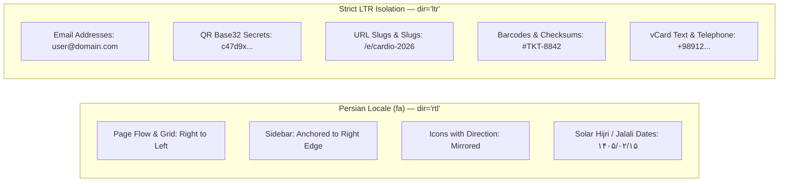
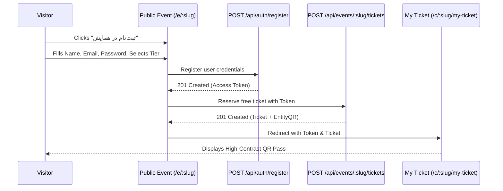

# 02 — User Experience Blueprint & Interaction Specifications

**Status:** ARCHITECTURAL DESIGN (Planning Only — Implementation Prohibited)  
**Role:** Senior UX Systems Engineer + Product Accessibility Architect  
**Scope:** Responsive Wireframes (320px–1440px), Bottom Navigation, RTL/Localization, WCAG 2.2 AA, Screen State Matrix, and 18 Mandatory User Journeys

---

## 1. Mobile-First Wireframes & Screen Compositions

### 1.1 Attendee Portal: Tab 1 — My Congress (Mobile 390px vs Desktop 1440px)

#### Mobile Viewport (390px):
```
┌───────────────────────────────────────┐
│ [≡] کنگره بین‌المللی قلب ۱۴۰۵   [FA|EN]│ <- Compact Header (48px)
├───────────────────────────────────────┤
│ ┌───────────────────────────────────┐ │
│ │ روز دوم از ۳ • سالن همایش‌های رازی│ │ <- Event Status Pill
│ └───────────────────────────────────┘ │
│ ┌───────────────────────────────────┐ │
│ │ سلام، دکتر سارا جلالی              │ │ <- Personalized Welcome
│ │ [پزشک متخصص]  [دسترسی کامل VIP]   │ │ <- Attendee Type & Tier
│ │ وضعیت: ● پذیرفته شده در گیت اصلی │ │
│ └───────────────────────────────────┘ │
│                                       │
│ [ 🎫 مشاهده کارت ورود ] [ 🤝 اسکن همکار ]│ <- Quick Action Primary CTAs
│                                       │
│ ▼ حامیان و غرفه‌های کنگره (Partner Directory) │
│ [همه] [غرفه‌داران] [حامیان مالی] [موسسات] │ <- In-Place Filter Chips
│ ┌───────────────────────────────────┐ │
│ │ شرکت مهندسی پزشکی پارس [غرفه A-12]│ │ <- Partner Card
│ │ پیشرو در تولید تجهیزات پایش قلب   │ │
│ │ [دریافت کاتالوگ] [★ نشان کردن]    │ │
│ └───────────────────────────────────┘ │
│                                       │
│ (Padding 80px for Bottom Nav)         │
├───────────────────────────────────────┤
│ [کنگره من] [ارتباطات] [کارت من] [پروفایل] [جزئیات]│ <- Fixed Bottom Nav (64px)
└───────────────────────────────────────┘
```

#### Desktop Viewport (1440px):
```
┌──────────────┬────────────────────────────────────────────────────────┐
│ کنگره قلب ۱۴۰۵│ پیشخوان همایش > کنگره من                   [دکتر جلالی] [خروج]│
├──────────────┼────────────────────────────────────────────────────────┤
│              │ ┌────────────────────────────────────────────────────┐ │
│ 🏛️ کنگره من  │ │ خوش آمدید، دکتر سارا جلالی                           │ │
│              │ │ رده شرکت‌کننده: پزشک متخصص | وضعیت: پذیرفته شده در گیت│ │
│ 🤝 ارتباطات من│ └────────────────────────────────────────────────────┘ │
│              │                                                        │
│ 🎫 کارت ورود │ ┌──────────────────────┐ ┌───────────────────────────┐ │
│              │ │ کارت ورود دیجیتال    │ │ سرنخ‌ها و غرفه‌های نشان‌شده│ │
│ 👤 پروفایل من│ │ [پیش‌نمایش QR کد]     │ │ ۲ شرکت ذخیره شده          │ │
│              │ └──────────────────────┘ └───────────────────────────┘ │
│ ℹ️ جزئیات    │                                                        │
│              │ ▼ فهرست جامع حامیان تجاری و غرفه‌ها                     │
│ ──────────── │ [جستجو در شرکت‌ها...] [فیلتر رسته فعالیت...]             │
│ زبان: فارسی  │ [گرید ۳ ستونه کارت‌های شرکای تجاری با دکمه کاتالوگ]      │
└──────────────┴────────────────────────────────────────────────────────┘
```

---

### 1.2 Reception Portal: Rapid Registration Workstation (Tablet 768px / Desktop 1024px+)

```
┌────────────────────────────────────────────────────────────────────────┐
│ 🏛️ میز پذیرش: کنگره بین‌المللی قلب ۱۴۰۵   [اپراتور: مریم کاظمی]  [● آنلاین] [خروج]│
├────────────────────────────────────┬───────────────────────────────────┤
│ 📋 ثبت‌نام فوری و صدور آنی کارت     │ 🔍 جستجوی آنی شرکت‌کنندگان        │
├────────────────────────────────────┼───────────────────────────────────┤
│ نام و نام خانوادگی: *              │ [جستجو با نام، کد ملی یا ایمیل...] │
│ [دکتر کامران علوی               ]  ├───────────────────────────────────┤
│                                    │ نتایج یافت‌شده (۳):                │
│ آدرس ایمیل (اختیاری):              │ ┌───────────────────────────────┐ │
│ [k.alavi@med.ac.ir              ]  │ │ دکتر کامران راد — پزشک متخصص  │ │
│                                    │ │ وضعیت: بلیت فعال [چاپ مجدد]   │ │
│ سازمان / دانشگاه:                  │ └───────────────────────────────┘ │
│ [دانشگاه علوم پزشکی تهران       ]  │ ┌───────────────────────────────┐ │
│                                    │ │ کامران رضایی — دانشجو         │ │
│ نوع شرکت‌کننده: *                  │ │ وضعیت: صادر نشده [صدور کارت]  │ │
│ [پزشک متخصص ▼                  ]   │ └───────────────────────────────┘ │
│                                    │                                   │
│ رده بلیت / جایگاه: *               │ ───────────────────────────────── │
│ [پذیرش آزاد حضوری (سهمیه: ۴۵) ▼]   │ آخرین کارت صادر شده:              │
│                                    │ ┌───────────────────────────────┐ │
│ [  ✓ ثبت و صدور فوری کارت ورود  ]  │ │ صادر شده برای: دکتر کامران علوی│ │
│ (کلید میانبر: Ctrl+Enter)          │ │ متصدی: مریم کاظمی             │ │
│                                    │ │ [پیش‌نمایش QR] [چاپ با پرینتر]│ │
│                                    │ └───────────────────────────────┘ │
└────────────────────────────────────┴───────────────────────────────────┘
```

---

## 2. Attendee Bottom Navigation Bar Specification

### 2.1 Mechanical & Dimensional Rules
- **Height:** Exactly 64px on standard mobile screens + `env(safe-area-inset-bottom, 0px)` on iOS Home Bar devices.
- **Elevation / Border:** Top border `1px solid var(--border-default)`, background `var(--surface-panel)` with `backdrop-filter: blur(8px)`.
- **Z-Index:** `z-40` (sits above normal scrolling flow; drawers and modal dialogs use `z-50`).
- **Touch Target Invariant:** Each of the 5 tabs receives an active tap box of minimum $48 \times 48$ px, strictly exceeding the WCAG 2.2 AA $24 \times 24$ px and Apple HIG $44 \times 44$ px standards.

### 2.2 Behavior at Extremely Narrow Viewports (320px — iPhone SE 1st Gen)
At 320px screen width, dividing by 5 yields 64px per slot.
- Text labels use font-size `10px` (`text-[10px]`) with `leading-tight`.
- Persian labels are optimized to concise single-line strings:
  - `کنگره من` (10px)
  - `ارتباطات` (10px — shortened from `ارتباطات من` on $\le 360$px screens)
  - `کارت من` (10px — shortened from `کارت ورود من` on $\le 360$px screens)
  - `پروفایل` (10px)
  - `جزئیات` (10px — shortened from `اطلاعات کنگره` on $\le 360$px screens)
- Zero horizontal scrolling or label clipping occurs. Icons scale to $20 \times 20$ px.

### 2.3 Keyboard & Accessibility Semantics
- Container tag: `<nav aria-label="پیمایش اصلی شرکت‌کننده" role="navigation">`.
- List structure: `<ul role="menubar" className="grid grid-cols-5 h-full">`.
- Links: `<NavLink to="..." role="menuitem" aria-current={isActive ? "page" : undefined}>`.
- Keyboard navigation: Left/Right arrow keys traverse adjacent tabs in correct RTL/LTR order; Enter/Space activates.

---

## 3. Responsive Adaptations Across 7 Target Viewports

| Viewport Width | Device Archetype | Navigation Placement | Layout Structure | Form Columns | Dialog / Drawer Behavior |
|---|---|---|---|:---:|---|
| **320px** | iPhone SE (1st gen) | Fixed Bottom Nav (compact labels) | Single column vertical stack | 1 col | Fullscreen modal overlay |
| **375px** | iPhone 8 / SE2 / SE3 | Fixed Bottom Nav (standard labels) | Single column vertical stack | 1 col | Bottom Sheet drawer |
| **390px** | iPhone 12/13/14/15 | Fixed Bottom Nav + Safe-Area Inset | Single column vertical stack | 1 col | Bottom Sheet drawer |
| **430px** | iPhone 14/15 Pro Max | Fixed Bottom Nav + Safe-Area Inset | Single column with generous cards | 1 col | Bottom Sheet drawer |
| **768px** | iPad Mini (Portrait) | Compact Top Bar or Split Bar | 2-column dashboard layout | 2 col | Centered Modal dialog (520px) |
| **1024px** | iPad Pro / Small Laptop | Side Navigation Rail (RTL Right) | 2-column or split workstation | 2 col | Centered Modal dialog (640px) |
| **1440px** | Desktop Workstation | Full Sidebar + Context Header | 3-column / Master-Detail layout | 2-3 col | Centered Modal or Slide-out Drawer |

---

## 4. RTL / LTR & Localization Rules

The application supports Persian (`fa`, default) and English (`en`).



### Specific Formatting Rules:
1. **Bidirectional Text Isolation:** Every dynamic email, QR secret, or phone number renders inside `<span dir="ltr" className="font-mono text-left inline-block">` to prevent layout corruption in Persian text blocks.
2. **Calendar Localization:**
   - Locale `fa`: Render dates formatted via Solar Hijri (Jalali) formatter (`formatLocalizedDate(date, 'fa')` in `i18n.ts`).
   - Locale `en`: Render Gregorian date string (`formatLocalizedDate(date, 'en')`).
3. **Numerals:** Standard UI counts use localized digits in Persian (`۱۴ ارتباط`); barcode checksums, terminal inputs, and USB scanner keys use strictly ASCII digits `[0-9]`.
4. **Icon Mirroring:** Back arrows, chevron indicators, and forward icons are mirrored in RTL via CSS `transform: scaleX(-1)`. Brand icons (QR code, user avatar, briefcase) remain unmirrored.

---

## 5. Accessibility Blueprint (WCAG 2.2 AA)

1. **Non-Color Status Indicators:**
   - Admitted status: Green background + Checkmark Icon `✓` + Explicit text label `پذیرفته شده`.
   - Rejected status: Red background + Cross Icon `✗` + Explicit text label `رد شده (علت: عدم تطابق رده)`.
   - Duplicate scan: Amber background + Warning Icon `⚠` + Explicit text label `اسکن تکراری`.
2. **Color Contrast Verification:**
   - Primary text (`var(--text-primary)`) on Surface: Contrast ratio $\ge 7:1$ (exceeds 4.5:1).
   - Secondary text (`var(--text-secondary)`): Contrast ratio $\ge 4.6:1$.
   - Interactive button surfaces (`var(--action-primary)`): Contrast ratio $\ge 4.5:1$ against white text.
3. **Focus Visibility:** Every button, input, tab, and link exhibits a visible high-contrast outline on focus: `focus-visible:ring-2 focus-visible:ring-action-primary focus-visible:ring-offset-2`.
4. **Screen Reader Live Regions:** Rapid walk-in registration, QR scan feedback, and lead qualification updates declare `aria-live="polite"` to announce outcomes to screen reader users without interrupting speech.

---

## 6. Mandatory Screen State Matrix

Every major portal view defines explicit rendering rules for all 8 lifecycle states:

| Screen / Feature | 1. Loading | 2. Normal | 3. Empty | 4. Error | 5. Unauthorized (401/403) | 6. Expired Session | 7. Success Action | 8. Offline Mode |
|---|---|---|---|---|---|---|---|---|
| **My Congress** (Tab 1) | Pulse skeleton cards | Participant card + Partner directory | Welcome card + "No partners registered" | Error banner + Retry button | Redirect to Attendee Login | Session expired dialog | Toast: "Booth bookmarked" | Amber banner: viewing offline |
| **My Network** (Tab 2) | Shimmer contact list | List of peer connections + vCard | "No connections yet" guide card | Error banner + Retry | Prompt login | Re-login prompt | Toast: "Peer connection saved" | Read-only cached connections |
| **My Ticket** (Tab 3) | Shimmer pass card | High-contrast QR + status | "No active tickets" link to event | Error banner + Retry | Prompt login | Cached pass remains visible | Toast: "Pass printed" | Amber banner: "Offline Pass Verified" |
| **My Profile** (Tab 4) | Form input skeletons | User details + Privacy toggle | N/A (identity exists) | Form error feedback | Prompt login | Re-login prompt | Green alert: "Preferences saved" | Read-only profile view |
| **Reception Station** | Pulse table rows | Search bar + Register form | "No attendees match query" | Alert banner + Retry | Red banner: "Access Revoked" | Modal: "Desk session expired" | Modal: "Ticket #123 minted!" | Block registration; show offline warning |
| **Partner Workspace** | Pulse lead feed | Lead table + Camera scanner | "No leads captured yet" | Error alert | "Not assigned to this booth" | Modal: "Session expired" | Green drawer: "Lead qualified" | Queue scans in local buffer |
| **Gate Scanner** | Initializing camera | Camera viewport + HUD | "Point at attendee badge" | Camera error + fallback | Audio buzz + Red REJECTED | Re-authenticate prompt | Audio ding + Green ADMITTED | Store scan in offline sync queue |

---

## 7. Mandatory User Journeys (J01 to J18)

### J01: First-Time Attendee Self-Registration
1. **Starting Context:** Visitor opens public event page `/e/cardio-2026`.
2. **Identity & Role:** Unauthenticated visitor.
3. **Entry Route:** `/e/:slug`.
4. **Main UI:** `PublicEventPage` -> "ثبت‌نام در همایش" CTA -> `RegisterAndReserveModal`.
5. **User Actions:** Inputs Full Name, Email, Password, Organization, and selects free Ticket Tier.
6. **API Dependencies:** `POST /api/auth/register` -> `POST /api/events/{slug}/tickets`.
7. **Success State:** User created, JWT issued into `localStorage`, Ticket minted with `EntityQR`.
8. **Failure State:** Tier sold out (409) or email already registered (409).
9. **Recovery:** Shows inline error message; offers login if account exists.
10. **Navigation Outcome:** Redirects seamlessly to `/c/cardio-2026/my-ticket` (Tab 3).



---

### J02: Returning Attendee Opens My Congress
1. **Context:** Registered attendee returns to congress on mobile browser.
2. **Identity:** Authenticated Attendee (valid JWT in `localStorage`).
3. **Entry Route:** `/my-congress`.
4. **Main UI:** `AttendeeShell` -> `MyCongressPage` (Tab 1).
5. **User Actions:** Opens site; auto-resolves single active congress; views today's schedule and saved booths.
6. **API Dependencies:** `GET /api/attendees/me/tickets`, `GET /api/attendees/me/bookmarks/booths`.
7. **Success State:** Tab 1 loads with attendee status and partner directory.
8. **Failure State:** Network disconnected.
9. **Recovery:** Renders offline fallback with cached pass shortcut.
10. **Outcome:** Stays on Tab 1.

---

### J03: Attendee Presents QR Ticket at Gate
1. **Context:** Attendee approaches entrance checkpoint.
2. **Identity:** Authenticated Attendee.
3. **Entry Route:** Bottom navigation -> Tab 3 (`/c/:slug/my-ticket`).
4. **Main UI:** `MyTicketPage` with full-screen QR Code toggle.
5. **User Actions:** Taps QR to maximize brightness; presents to scanner.
6. **API Dependencies:** `GET /api/attendees/me/tickets` (or local `ticketCache.ts`).
7. **Success State:** Gate scanner beeps; gate displays Admitted.
8. **Failure State:** Phone in airplane mode.
9. **Recovery:** `ticketCache.ts` envelope renders valid cached QR code seamlessly.
10. **Outcome:** Attendee enters venue.

---

### J04: Attendee Connects With Peer Attendee
1. **Context:** Two attendees meet during coffee break.
2. **Identity:** Attendee A (`Dr. Sarah`).
3. **Entry Route:** Tab 2 (`/c/:slug/my-network`).
4. **Main UI:** `MyNetworkPage` -> "+ ثبت ارتباط جدید" button.
5. **User Actions:** Scans Attendee B's QR badge with camera (or enters secret `c47d...`); adds private note ("گفت‌وگو درباره پروژه تحقیقاتی").
6. **API Dependencies:** `POST /api/attendees/me/network/scan` -> `PATCH /api/attendees/me/network/{id}`.
7. **Success State:** Peer contact card appears with name, organization, and vCard download link.
8. **Failure State:** Scanned code is invalid or not an attendee badge.
9. **Recovery:** Inline error: "کد نامعتبر است — لطفاً کارت ورود همکار را اسکن کنید."
10. **Outcome:** Connection stored in list.

---

### J05: Attendee Browses Partners Inside My Congress
1. **Context:** Attendee wants to explore exhibition sponsors without leaving their attendee hub.
2. **Identity:** Attendee.
3. **Entry Route:** Tab 1 (`/c/:slug/my-congress`).
4. **Main UI:** Partner Directory section inside Tab 1.
5. **User Actions:** Taps filter chip "غرفه‌داران"; scrolls to "شرکت پارس طب"; taps "نشان کردن غرفه" (Bookmark).
6. **API Dependencies:** `POST /api/attendees/me/bookmarks/booths/{boothId}`.
7. **Success State:** Star turns gold; booth added to saved booths carousel.
8. **Failure State:** Network error.
9. **Recovery:** Reverts star state; shows toast alert.
10. **Outcome:** Booth bookmarked in-place without page reload.

---

### J06: Attendee Switches Active Congress (Multi-Event)
1. **Context:** Attendee is registered for Congress A (Cardiology) and Congress B (Oncology).
2. **Identity:** Attendee with multiple tickets.
3. **Entry Route:** `/c/cardio-2026/my-congress`.
4. **Main UI:** Top bar event pill -> Taps congress name.
5. **User Actions:** Opens `CongressPickerDrawer`; selects "کنگره سالانه انکولوژی".
6. **API Dependencies:** None (switches client context and navigates URL).
7. **Success State:** URL switches to `/c/onco-2026/my-congress`; Tab 1 re-renders with Oncology data.
8. **Failure State:** User lacks ticket for selected event.
9. **Recovery:** Displays error and keeps current event active.
10. **Outcome:** Seamless event context cutover.

---

### J07: Organizer Creates a Reception Operator (CR-05)
1. **Context:** Organizer wants to authorize a front-desk receptionist.
2. **Identity:** Organizer Admin (API key in `sessionStorage`).
3. **Entry Route:** `/organizer/events/:eventId` -> Tab "پرسنل پذیرش" (`#operators`).
4. **Main UI:** `DeskStaffManagement` -> "+ افزودن اپراتور میز پذیرش".
5. **User Actions:** Enters operator full name ("مریم کاظمی") and email ("m.kazemi@desk.local"); submits form.
6. **API Dependencies:** `POST /api/events/{eventId}/desk/operators`.
7. **Success State:** Backend creates user (or binds existing), generates temporary password, creates `DeskOperator` row.
8. **UI Response:** One-time alert dialog displays generated credentials for the operator.
9. **Failure State:** Email already assigned as desk operator for this event (409).
10. **Outcome:** New operator appears in table with status `دسترسی فعال`.

---

### J08: Reception Operator Logs In
1. **Context:** Reception staff arrives at front desk on event morning.
2. **Identity:** Desk Operator (no organizer API key).
3. **Entry Route:** `/organizer/events/:eventId/desk`.
4. **Main UI:** `DeskLoginModal`.
5. **User Actions:** Enters assigned email and password.
6. **API Dependencies:** `POST /api/events/{eventId}/desk/login`.
7. **Success State:** Token (`type=desk_operator`) stored in `sessionStorage['congress_desk_token_${eventId}']`.
8. **Failure State:** Invalid credentials (401) or operator revoked (403).
9. **Recovery:** Error banner displayed; input fields cleared.
10. **Outcome:** Enters Reception Station workspace.

---

### J09: Reception Operator Registers Walk-In Attendee
1. **Context:** Physician arrives at venue without prior online registration.
2. **Identity:** Reception Operator.
3. **Entry Route:** Reception Station (`/organizer/events/:eventId/desk`).
4. **Main UI:** Rapid Walk-In Form (`RapidRegistrationForm`).
5. **User Actions:** Types Name ("دکتر فرهاد کمالی"), selects Attendee Type ("پزشک متخصص"), selects Tier ("پذیرش حضوری"), presses `Ctrl+Enter`.
6. **API Dependencies:** `POST /api/events/{eventId}/desk-registrations`.
7. **Success State:** Backend mints User, Ticket with operator attribution (`issued_by_operator_id`), and EntityQR.
8. **UI Response:** `MintedPassSummaryModal` immediately appears with QR pass; prints physical badge.
9. **Failure State:** Quota exhausted for selected tier (409).
10. **Outcome:** Ready for next attendee in under 5 seconds.

---

### J10: Reception Operator Encounters Duplicate Registration
1. **Context:** Walk-in attendee has already registered online earlier.
2. **Identity:** Reception Operator.
3. **Entry Route:** Rapid Walk-In Form.
4. **User Actions:** Operator enters attendee's email and attempts to mint a new pass.
5. **API Dependencies:** `POST /api/events/{eventId}/desk-registrations`.
6. **Failure State:** Backend returns 409 Conflict `"Attendee already has an active ticket for this congress"`.
7. **UI Handling:** Instead of a generic error, the interface triggers automatic Attendee Lookup for that email.
8. **Recovery:** Displays existing ticket card with option: `مشاهده کارت موجود و چاپ مجدد`.
9. **Outcome:** Duplicate ticket prevented; existing pass reprinted.

---

### J11: Organizer Revokes Reception Access
1. **Context:** An operator finishes their shift or is terminated.
2. **Identity:** Organizer Admin.
3. **Entry Route:** `/organizer/events/:eventId` -> `#operators`.
4. **User Actions:** Organizer clicks "لغو دسترسی" (Revoke) next to operator's name.
5. **API Dependencies:** `POST /api/events/{eventId}/desk/operators/{operatorId}/revoke`.
6. **Success State:** Database sets `is_revoked = True` on `DeskOperator`.
7. **Immediate Effect on Operator Station:** Next API request from that operator returns 401 `"Front desk operator access has been revoked"`.
8. **Operator UI:** `sessionStorage` desk token immediately purged; screen locks to revoked notice.
9. **Outcome:** Total revocation enforced server-side.

---

### J12: Partner Representative Logs In
1. **Context:** Exhibition booth staff arrives at commercial booth.
2. **Identity:** Partner Representative (`BoothStaff`).
3. **Entry Route:** `/booth/:boothId`.
4. **Main UI:** `PartnerShell` login modal.
5. **User Actions:** Enters personal user credentials.
6. **API Dependencies:** `POST /api/auth/login` -> `GET /api/booths/{boothId}`.
7. **Success State:** Backend validates `BoothStaff` row for this booth; renders booth workspace.
8. **Failure State:** User is not authorized for this booth (403 Forbidden).
9. **Recovery:** Renders `PartnerUnauthorizedView` ("شما نماینده مجاز این غرفه نیستید").
10. **Outcome:** Access granted to booth leads.

---

### J13: Partner Representative Scans and Qualifies a Lead
1. **Context:** Delegate visits exhibition stand.
2. **Identity:** Authorized Booth Staff.
3. **Entry Route:** `/booth/:boothId` -> Tab "اسکنر سرنخ".
4. **Main UI:** `BoothLeadScanner`.
5. **User Actions:** Scans delegate's QR badge; sets rating to `HOT`; selects tags `["درخواست پیش‌فاکتور", "جلسه دمو"]`; enters note ("نیاز به ۵ دستگاه برای بیمارستان مهر").
6. **API Dependencies:** `POST /api/booths/{boothId}/leads/scan` -> `PATCH /api/booths/{boothId}/leads/{leadId}`.
7. **Success State:** Lead saved with contact information and tags; audio feedback plays.
8. **Outcome:** Lead added to live CRM feed.

---

### J14: Sponsor-Only Partner Views Portal (No Physical Booth)
1. **Context:** Gold Sponsor representative accesses partner portal.
2. **Identity:** Partner Representative for a sponsor without a physical booth.
3. **Entry Route:** Partner Workspace.
4. **Main UI:** `PartnerLayout`.
5. **System Detection:** Detects `booth_id === null` (sponsor-only partner).
6. **UI Adaptation:** Lead Scanner tab is hidden; workspace displays Corporate Profile, Logo Asset management, and Promotional brochure upload.
7. **Outcome:** Zero confusing fake-booth artifacts shown.

---

### J15: Multi-Role User Switches Between Portals
1. **Context:** User is both a Congress Organizer and a registered Attendee.
2. **Identity:** User with dual roles.
3. **Entry Route:** Portal Switcher Menu in header.
4. **User Actions:** Taps "تغییر سامانه" -> selects "سامانه شرکت‌کنندگان".
5. **System Action:** Switches UI shell from `OrganizerShell` to `AttendeeShell`; sets `activePortal = 'attendee'`; credential resolver selects user JWT.
6. **API Dependencies:** Re-fetches `/api/attendees/me/tickets`.
7. **Outcome:** Seamless role transition without logging out or clearing keys.

---

### J16: Unauthorized User Opens Protected Deep Link
1. **Context:** Attendee pastes organizer URL `/organizer/events/123` into browser.
2. **Identity:** Regular Attendee.
3. **Entry Route:** `/organizer/events/:eventId`.
4. **System Action:** `OrganizerGuard` checks `sessionStorage` for organizer API key.
5. **System Handling:** Key is missing; renders `OrganizerKeyGate` modal; no event data is loaded.
6. **Outcome:** Protected data remains secure.

---

### J17: Existing Printed Booth QR is Scanned
1. **Context:** Attendee scans physical roll-up banner QR code at exhibition hall.
2. **Identity:** Any device / Attendee.
3. **Entry Route:** `/e/:slug/booths/:boothId` (or legacy `/booth/:boothId`).
4. **System Action:** Preserved URL routing handles request directly.
5. **Main UI:** `PublicBoothPage` renders company description, location, and brochure download.
6. **Outcome:** Works 100% reliably on all phones without redirection failures.

---

### J18: Session Expires During Active Desk Operation
1. **Context:** Reception operator leaves station idle over lunch; token expires.
2. **Identity:** Desk Operator.
3. **User Actions:** Operator clicks "ثبت و صدور بلیت".
4. **API Dependencies:** Backend returns 401 Unauthorized.
5. **System Handling:** Interceptor detects desk token expiration; locks form with `SessionExpiredModal`.
6. **Recovery:** Operator enters password to re-authenticate; uncommitted form draft is **preserved** and re-submitted automatically.
7. **Outcome:** Operator work is not lost.
