# Phase 03 — Implementation roadmap

Status: planning package for Phase 04 independent review; NOT implementation authorization or release readiness. All workstreams after T0 require a later explicit assignment. Earlier Phase 00–02 decisions are proposed amendments, not silently overwritten.

## Fixed contracts for this roadmap

- AR-01: canonical `/partner/:partnerId`, event-owned Partner with zero/many Booths. Add PartnerStaff for profile/workspace authority; exact BoothStaff remains the only lead authority. Backfill one Partner per Booth, never infer company merges. `/booth/:boothId` remains a direct compatibility entry with explicit booth authorization, no redirect requirement or fake Booth.
- AR-02: Organizer key is a tenant credential, not User identity. First migration retains separate organizer key gate and per-event desk login. User login can describe attendee/partner/reception eligibility but cannot issue a desk session or organizer access. Retain credentials separately; switching may require the destination login. Organizer↔User association/session convergence is a later approved milestone, not this backlog.
- AR-03: canonical `/reception/:eventId`, ReceptionShell outside OrganizerLayout. Operator mode uses only that event's desk JWT. Organizer operational mode, if deliberately chosen, uses only organizer key; it is never an automatic fallback. Legacy desk URL renders the same independent station as an alias, not a redirect.
- AR-04: performance and 320px behavior are targets, not measurements. Profile editing, scientific content and event branding are approval-blocked additions. Printing exists as browser print; hardware/badge printers are not promised. Existing reusable temporary global password is not one-use. Cache is plaintext owner/shape/TTL checked, not signed or authoritative admission.
- AR-05: pure explicit client authority union: anonymous, user, organizer, desk(event), scanner(point,event). Portal name/decoded claims are not proof of server permission. Anonymous public/auth requests carry no Authorization; bookmarking uses separate protected APIs. Preserve existing storage keys and typeless User JWTs. Current issued desk/scanner tokens already fail User auth because their subjects are non-UUID; add explicit type checks as defense in depth, not a claim of proven token escalation.
- AR-06: nullable category assignment and immutable `attendee_type_name_at_issue` snapshot on Ticket; unique (event,user) makes Ticket the current participation record. No Order table or tier repurposing. Active same-event types only; optional assignment; NULL backfill; no post-issuance reassignment in this migration. Types never affect admission/quota/permission.
- Desk generation hardening: additive DeskOperator.session_version default 0. New tokens include version; absent version accepted only when row version is 0; increment on revoke and reactivation, compare on each request. Legacy active sessions remain usable until expiry unless revoked/reactivated. Reject generation mismatch with 401. No changes to scanner token/queue formats.
- New Partner assignments bind EXISTING User by normalized email; absent user 409 with instruction to register through existing public User registration first. Do not silently create another undisclosed password. Existing legacy booth/desk provisioning is preserved; account recovery, invitation and forced-password-change redesign is separately approval-blocked, not hidden in shell migration.
- Partner membership removal atomically removes that user's BoothStaff under that Partner; legacy booth staff grants synchronize profile membership, while single-booth unassignment removes only that booth's lead grant. Never grant all Partner booths implicitly.
- Partner migration precedes AttendeeType migration on one serialized chain after desk generation migration. Proposed revisions are next available, not fixed numeric filenames; inspect actual head before creating them. No renumbering 0011.
- `/api/me/access` initially reports booth_ids and empty partner_ids, then enriches after Partner APIs. It is descriptive, no Organizer role, excludes revoked desk/ inactive ticket eligibility. `/api/partners/me` is NOT added: use access discovery for selection and `GET /api/partners/{partner_id}` for context, avoiding duplicate collection APIs.
- Network lists reuse existing all-event API and filter Connection.event_id to active event; each mutation still references only visible event-scoped connection. No new aggregate overview API.
- Offline My Ticket and aliases resolve event from owner-scoped cached tickets without requiring online access discovery. Unknown online context must not wipe another account's cache. Preserve existing TTL/logout behavior, clearly distinguish presentation from valid server session.

## Stable task inventory and hard dependencies

IDs below are definitive; T0 is P03-T00. Proposed new modules must be named during implementation according to repository conventions, not mistaken for existing files. The backlog supplies the full mandatory template for every row.

| ID | Workstream | Concrete outcome | Hard prerequisites |
|---|---|---|---|
| P03-T00 | WS-00 | Reviewed authorized local Git baseline and clean-checkout proof | Separate human commit approval |
| P03-T01 | WS-00 | Explicit human-token family and exact authorization error contracts | T00 |
| P03-T02 | WS-01 | Desk token generation prevents revoke/reactivate resurrection | T01 |
| P03-T03 | WS-01 | Pure explicit-authority API factory and typed context | T01 |
| P03-T04 | WS-01 | Anonymous public and login/register request cutover | T03 |
| P03-T05 | WS-01 | Organizer requests use only explicit tenant authority | T03 |
| P03-T06 | WS-01 | Attendee and existing booth requests use only User authority | T03 |
| P03-T07 | WS-01 | Desk requests select event credential explicitly with status handling | T02,T03 |
| P03-T08 | WS-01 | Scanner transport uses explicit existing device/admin authority | T03 |
| P03-T09 | WS-01 | Remove heuristic helper after all callsites migrate | T04,T05,T06,T07,T08 |
| P03-T10 | WS-01 | Descriptive current-row access discovery | T01 |
| P03-T11 | WS-02 Partner | Partner/PartnerStaff expansion and populated Booth backfill | T02 |
| P03-T12 | WS-02 Partner | Organizer Partner create/list/update contracts | T11 |
| P03-T13 | WS-02 Partner | Existing-user Partner assignments and exact Booth grants/revocation | T12 |
| P03-T14 | WS-02 Partner | Booth creation/link and legacy staff synchronization | T13 |
| P03-T15 | WS-02 Partner | Authorized Partner read and public Partner directory | T14 |
| P03-T16 | WS-01 | Access discovery includes Partner capability IDs | T10,T15 |
| P03-T17 | WS-02 Type | AttendeeType and Ticket historical-label expansion | T11 |
| P03-T18 | WS-02 Type | Organizer type CRUD and public/desk active-type discovery | T17 |
| P03-T19 | WS-02 Type | Optional same-event category assignment at ticket issuance | T18 |
| P03-T20 | WS-05 | Organizer AttendeeType administration UI | T05,T18 |
| P03-T21 | WS-03 | Shared context boundary, async states and navigation primitives | T09,T10 |
| P03-T22 | WS-03 | Truthful portal chooser and credential-specific entry flows | T21,T16 |
| P03-T23 | WS-04 | AttendeeShell with exactly five primary destinations | T21 |
| P03-T24 | WS-04 | My Ticket reuses QR and offline cache in event context | T23,T19 |
| P03-T25 | WS-04 | My Network scopes display/mutations and vCard to selected event | T23 |
| P03-T26 | WS-04 | My Congress status and existing saved Booth actions | T24 |
| P03-T27 | WS-04 | Partner directory inside My Congress, no sixth tab | T26,T15 |
| P03-T28 | WS-04 | Read-only My Profile and existing privacy preferences | T23,T19 |
| P03-T29 | WS-04 | Congress Details from real event metadata only | T23 |
| P03-T30 | WS-04 | Active congress picker and legacy attendee aliases | T24,T25,T26,T28,T29 |
| P03-T31 | WS-05 | Organizer shell preserves event management and tenant gate | T21,T05 |
| P03-T32 | WS-05 | Extract working tier manager without quota changes | T31 |
| P03-T33 | WS-05 | Extract working point/policy manager without scanner rewrite | T31 |
| P03-T34 | WS-05 | Reception operator manager with truthful credential lifecycle | T31,T02 |
| P03-T35 | WS-05 | Partner admin and explicit staff/Booth capability management UI | T31,T12,T13,T14 |
| P03-T36 | WS-05 | Preserve analytics filtering/polling/export in organizer shell | T31 |
| P03-T37 | WS-06 | Independent ReceptionShell and canonical route | T21,T07 |
| P03-T38 | WS-06 | Reception email/password entry and assigned-event identity | T37 |
| P03-T39 | WS-06 | Authorized event attendee search and detail | T38 |
| P03-T40 | WS-06 | Walk-in issuance with separate category/tier selectors | T39,T19 |
| P03-T41 | WS-06 | Retrieve existing QR and browser print without reminting | T39 |
| P03-T42 | WS-06 | Duplicate 409 recovery requires explicit existing-ticket selection | T40,T41 |
| P03-T43 | WS-06 | Revocation/expiry blocks operations, preserves draft, no auto-resubmit | T42,T02 |
| P03-T44 | WS-06 | Legacy desk URL aliases independent ReceptionShell | T43 |
| P03-T45 | WS-07 | PartnerShell and canonical resource-authorized entry | T21,T15,T16 |
| P03-T46 | WS-07 | Partner/Event and explicitly authorized Booth chooser | T45 |
| P03-T47 | WS-07 | Sponsor-only read-only profile with zero lead capability | T46 |
| P03-T48 | WS-07 | Existing manual Booth lead capture within selected Booth | T46 |
| P03-T49 | WS-07 | Existing lead qualification, notes and tags extraction | T48 |
| P03-T50 | WS-07 | Booth lead list/filter and sanitized CSV export extraction | T49 |
| P03-T51 | WS-07 | Camera badge input feeds existing lead scan contract | T48 |
| P03-T52 | WS-07 | Existing /booth/:boothId direct compatibility entry | T47,T50 |
| P03-T53 | WS-08 | Public event layout with actual metadata and Booth deep links | T04,T21 |
| P03-T54 | WS-08 | Public partners/sponsors sections from directory contract | T53,T15 |
| P03-T55 | WS-08 | Public reservation and explicit portal login entry integration | T53,T19,T22,T30 |
| P03-T56 | WS-08 conditional | Approved event logo/cover/accent content contract and UI | T53,T17 + product approval |
| P03-T57 | WS-04 conditional | Approved global organization/title profile editing | T28 + product approval |
| P03-T58 | WS-07 conditional | Approved Partner profile editing with restricted fields | T47 + product approval |
| P03-T59 | WS-08 conditional | Approved scientific program/speaker decision and task-addendum gate | T00 + product schema/content approval; feature tasks require reviewed addendum |
| P03-T60 | WS-09 | API credential and cross-event/partner security regression gate | T09,T16,T19,T43,T52 |
| P03-T61 | WS-09 | Real-browser portal journeys and deep-link/history gate | T20,T27,T30,T32,T33,T34,T35,T36,T44,T51,T52,T54,T55 |
| P03-T62 | WS-09 | Seven-viewport EN/FA accessibility acceptance gate | T61 |
| P03-T63 | WS-09 | Scanner/PWA offline/restart/update/device compatibility gate | T08,T61 |
| P03-T64 | WS-09 | Populated migration and application rollback rehearsal | T14,T19,T60 |
| P03-T65 | WS-09 | Clean-checkout staging and pilot Go/No-Go report | T60,T61,T62,T63,T64,T66 |
| P03-T66 | WS-09 | Native scanner scope decision and preserved-client compatibility evidence | T00 + release-scope approval |

Dependency shorthand Tnn in this table means P03-Tnn, never an independent task ID. All 67 rows must exist in the backlog. P03-T59 is a decision-gate task only, NOT permission to implement an unknown program data model; after approval it produces a separately reviewed finite task addendum. No placeholders/program UI are delivered under it.

## Workstream sequence

1. WS-00 reviewed integration and contract baseline.
2. WS-01 authority-specific transport, desk lifecycle hardening and current access discovery.
3. WS-02 independently verifiable Partner and AttendeeType packages, serialized migrations; WS-03 shared boundary may proceed once T09/T10 pass.
4. WS-06 independent reception entry first as a useful vertical shell; category integration waits for T19.
5. WS-04 five-tab attendee increment and WS-05 working organizer managers on delivered contracts.
6. WS-07 sponsor/multi-Booth Partner workspace, then WS-08 public directory/reservation integration.
7. WS-09 incremental security/browser/migration gates and final pilot gate. Checks accompany every task, not only this stage. Conditional enhancements stay blocked until approval.

## Dependency graph (hard edges; every task represented)

```mermaid
flowchart TD
 T00[P03-T00 approved baseline] --> T01[P03-T01 auth contract]
 T01 --> T02[P03-T02 desk generations]
 T01 --> T03[P03-T03 authority client]
 T01 --> T10[P03-T10 access discovery]
 T03 --> T04[P03-T04 anonymous cutover]
 T03 --> T05[P03-T05 organizer cutover]
 T03 --> T06[P03-T06 user cutover]
 T03 --> T07[P03-T07 desk cutover]
 T02 --> T07
 T03 --> T08[P03-T08 scanner transport]
 T04 --> T09[P03-T09 remove heuristics]
 T05 --> T09
 T06 --> T09
 T07 --> T09
 T08 --> T09
 T02 --> T11[P03-T11 Partner migration]
 T11 --> T12[P03-T12 Partner CRUD]
 T12 --> T13[P03-T13 exact grants]
 T13 --> T14[P03-T14 Booth synchronization]
 T14 --> T15[P03-T15 Partner reads]
 T10 --> T16[P03-T16 enriched discovery]
 T15 --> T16
 T11 --> T17[P03-T17 Type migration]
 T17 --> T18[P03-T18 Type discovery/CRUD]
 T18 --> T19[P03-T19 issuance category]
 T18 --> T20[P03-T20 Type admin UI]
 T05 --> T20
 T09 --> T21[P03-T21 shared boundary]
 T10 --> T21
 T21 --> T22[P03-T22 truthful chooser]
 T16 --> T22
 T21 --> T23[P03-T23 five-tab shell]
 T23 --> T24[P03-T24 My Ticket]
 T19 --> T24
 T23 --> T25[P03-T25 My Network]
 T24 --> T26[P03-T26 My Congress]
 T26 --> T27[P03-T27 embedded partners]
 T15 --> T27
 T23 --> T28[P03-T28 Profile read]
 T19 --> T28
 T23 --> T29[P03-T29 Details]
 T24 --> T30[P03-T30 congress/aliases]
 T25 --> T30
 T26 --> T30
 T28 --> T30
 T29 --> T30
 T21 --> T31[P03-T31 OrganizerShell]
 T05 --> T31
 T31 --> T32[P03-T32 tiers]
 T31 --> T33[P03-T33 gates]
 T31 --> T34[P03-T34 operators]
 T02 --> T34
 T31 --> T35[P03-T35 Partner admin]
 T12 --> T35
 T13 --> T35
 T14 --> T35
 T31 --> T36[P03-T36 analytics]
 T21 --> T37[P03-T37 ReceptionShell]
 T07 --> T37
 T37 --> T38[P03-T38 login/event]
 T38 --> T39[P03-T39 lookup]
 T39 --> T40[P03-T40 walk-in]
 T19 --> T40
 T39 --> T41[P03-T41 QR/print]
 T40 --> T42[P03-T42 duplicate recovery]
 T41 --> T42
 T42 --> T43[P03-T43 session recovery]
 T02 --> T43
 T43 --> T44[P03-T44 desk alias]
 T21 --> T45[P03-T45 PartnerShell]
 T15 --> T45
 T16 --> T45
 T45 --> T46[P03-T46 context chooser]
 T46 --> T47[P03-T47 sponsor]
 T46 --> T48[P03-T48 manual capture]
 T48 --> T49[P03-T49 qualify]
 T49 --> T50[P03-T50 list/export]
 T48 --> T51[P03-T51 camera input]
 T47 --> T52[P03-T52 booth compatibility]
 T50 --> T52
 T04 --> T53[P03-T53 public event]
 T21 --> T53
 T53 --> T54[P03-T54 public partners]
 T15 --> T54
 T53 --> T55[P03-T55 registration/login]
 T19 --> T55
 T22 --> T55
 T30 --> T55
 T53 --> T56[P03-T56 branding approval gate]
 T17 --> T56
 T28 --> T57[P03-T57 profile-edit approval gate]
 T47 --> T58[P03-T58 Partner-edit approval gate]
 Approval[Product content approval] --> T59[P03-T59 program decision gate]
 T00 --> T59
 T09 --> T60[P03-T60 security gate]
 T16 --> T60
 T19 --> T60
 T43 --> T60
 T52 --> T60
 T30 --> T61[P03-T61 browser journeys]
 T36 --> T61
 T44 --> T61
 T52 --> T61
 T55 --> T61
 T20 --> T61
 T27 --> T61
 T32 --> T61
 T33 --> T61
 T34 --> T61
 T35 --> T61
 T51 --> T61
 T54 --> T61
 T61 --> T62[P03-T62 responsive/a11y]
 T08 --> T63[P03-T63 scanner compatibility]
 T61 --> T63
 T14 --> T64[P03-T64 rollback rehearsal]
 T19 --> T64
 T60 --> T64
 T00 --> T66[P03-T66 native scope gate]
 T60 --> T65[P03-T65 pilot gate]
 T61 --> T65
 T62 --> T65
 T63 --> T65
 T64 --> T65
 T66 --> T65
```

Conditional T56–T59 are not automatic release dependencies unless the approved release scope includes their deliverables; then T65 must add their acceptance gates. Required feature tasks T20,T27,T32,T33,T34,T35,T51,T54 must also be completed and their evidence reviewed at T65 even when not on the longest hard prerequisite chain. The backlog's T65 completion checklist enumerates all unconditional tasks.

## Milestones and Go/No-Go

| Milestone | Required tasks | Observable outcome / evidence | Security and compatibility | Go/No-Go / rollback |
|---|---|---|---|---|
| M0 reproducible baseline | T00 | Approved local SHA, intended files including 0011/docs, canonical fresh run and separate checkout | No lost work/secrets; current QR and contracts pinned | No-Go without approval/reproducibility; preserve worktree and archive, no destructive cleanup |
| M1 explicit authority | T01–T10 | Public/auth traffic anonymous; credentials deterministic; desk old token never revives | Legacy typeless User sessions retained; desk version-0 compatibility; scanner queues unchanged | No-Go on substitution or status ambiguity; revert application transport as coherent commit while retaining additive schema |
| M2 independent reception entry | T21,T37,T38,T39,T41 plus M1 | `/reception/:eventId` signs in without organizer key, event lookup returns existing QR | Owning desk only, no organizer UI; legacy station still works until T44 | No-Go on wrong-event exposure; route rollback to legacy UI, never credential fallback |
| M3 domain packages | T11–T20 | Sponsor without Booth and optional historical category supported by API/migration tests | Composite event FKs; BoothStaff lead isolation and tier quota unchanged | No-Go on QR/backfill drift; keep expand schema, roll application forward/back without dropping data |
| M4 complete attendee and administration | T22–T36 | Five tabs, in-place partners, per-event ticket/network/profile/details; working admin managers | No sixth tab; offline My Ticket usable; tenant masks retained | No-Go on mobile nav/context/cache failures; feature route rollback preserving old URLs |
| M5 operational portals/public cutover | T40–T55 | Complete reception duplicate/re-auth, sponsor/multi-Booth lead workflows, public registration | No auto-resubmit, explicit Booth grants, printed URLs retained | No-Go on loss of manual capture, legacy URLs, or stale capabilities |
| M6 pilot acceptance | T60–T66 plus all unconditional tasks | New exact full-stack/browser/device/migration/viewport evidence and clean-checkout SHA | Native limitations explicitly scoped; no unit-only release claim | No-Go on any mandatory missing gate; no deployment authorized by plan |

Recommended FIRST implementation milestone is M0, not frontend scaffold. First product-visible increment after M1 is M2, because it reuses mature event-bound reception contracts and exposes the most important independent-portal distinction without waiting for the new Partner model or attendee taxonomy.

## Critical path and parallelism

Three equal-length longest structural release paths share T00 → T01 → T02 → T11 → T12 → T13 → T14 → T15 → T16 → T45 → T46 → T48 → T49 → T50 → T52, then T61 → T62 → T65, T61 → T63 → T65, or T60 → T64 → T65 (18 task nodes each). These are dependency paths, not duration estimates. T22 is a separate chooser branch, not an edge into T46. The explicit-client/shell/reception and category chains are additional convergence prerequisites shown in the DAG; no calendar/effort claims are inferred.

Safe parallel opportunities: evidence/test design across feature modules; T10 alongside T03 after T01; Type API work after serialized migrations while Partner read work proceeds; attendee feature modules and existing organizer managers after shells/contracts. Unsafe without integration owner: concurrent edits to main router, client/auth context, models, generated schema, translations, or migration head. T04–T08 share client callsite concerns: agree factory interface once, assign disjoint pages, integrate sequentially and run cutover gate once. T11 and T17 must not mint competing Alembic heads. Prefer one owner for OrganizerEventDetail extractions (T20,T32–T35), not parallel surgical edits to the same large file.

## Blocking decisions

- Commit authorization and reviewed T0 manifest (mandatory).
- Partner organization terminology amendment to GLOSSARY (planned under T12; no glossary edit in Phase 03).
- Optional attendee global profile editing T57, Partner editing T58, branding T56, program/speaker content T59: default is read-only/real existing metadata, not fake controls. Each conditional task is BLOCKED until its stated approval.
- Native scanner release scope T66: existing native implementation has protected-auth, durable-storage and camera gaps; if native release is mandatory, a separately approved remediation backlog is required and T65 is BLOCKED until real-device gates pass. This plan never declares native parity from Dart logic tests.
- Invitation/password recovery convergence: not in this implementation scope. Preserve desk password behavior truthfully; require existing accounts for new Partner grants. Client approval and separate security design are needed before broadening account lifecycle.

## Task-size review

Tasks isolate one observable feature or security invariant. API+UI+migration are separated at stable contracts. T11 and T17 necessarily span model+migration+populated-fixture tests because those form one data invariant; no frontend/scanner work is included. T13 is one transactional membership lifecycle; T14 is one legacy-write compatibility boundary. T59 cannot be an executable unknown-schema feature: it is explicitly a decision gate that produces no application code. Other blocked tasks define exact field/API boundaries before approval, preventing a weak agent from inventing business policy. T60–T66 are separate verification/release boundaries, not a single giant final test task.
