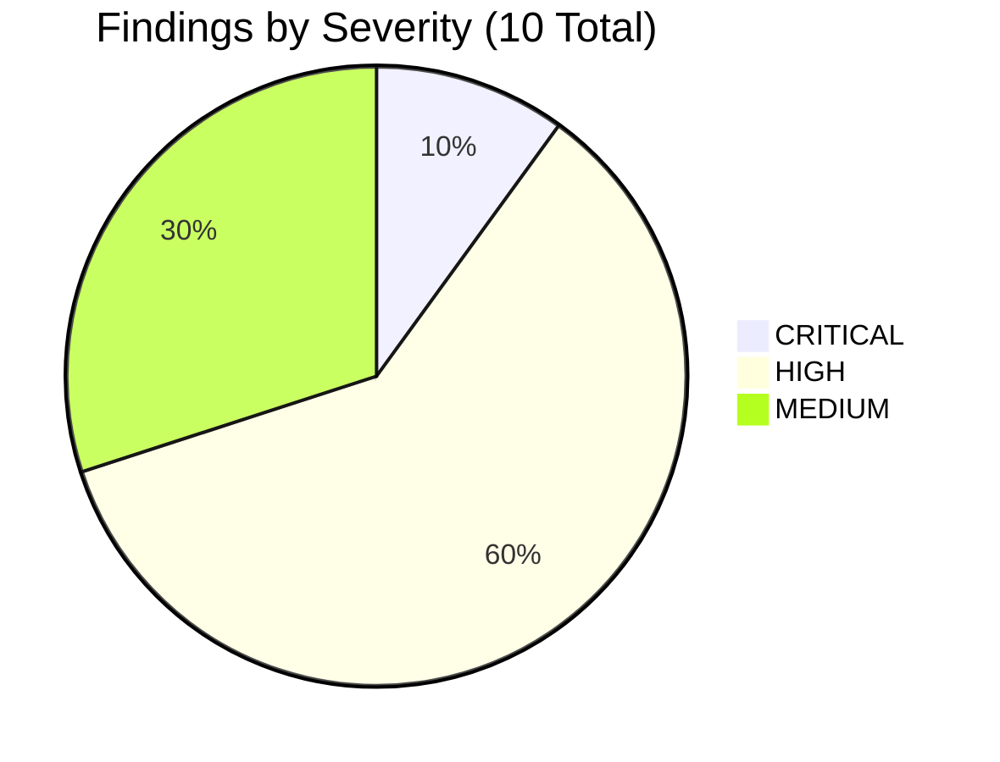

# 04 — Architectural Correction & Approval Register

**Review Mode:** STRICTLY INDEPENDENT — READ-ONLY REVIEW  
**Reviewer Role:** Lead Architecture Auditor & Quality Gatekeeper  
**Scope:** Authoritative Register of Findings, Proposed Technical Corrections, Required Sign-Offs, and Implementation Guards  
**Authority Rule:** Previous planning documents (Phases 00–03) remain unmodified historical records. This document is the **sole authoritative reference** for mandated corrections prior to and during implementation.

---

## 1. Register Overview

This register documents 10 formal findings resulting from the independent adversarial architecture audit. Each finding specifies the severity, affected decisions, affected task IDs, exact technical change required, acceptance criteria, and sign-off requirements.



---

## 2. Exhaustive Findings & Corrections Register

### FINDING-01: Desk Operator Token Resurrection Vulnerability
- **Severity:** **CRITICAL**
- **Source File / Location:** `backend/app/routes/desk.py:385-405` (`add_desk_operator`), `desk.py:196` (`authorized_desk_operator`).
- **Affected Architecture Decision:** D05, AR-03.
- **Affected Task IDs:** `P03-T02`, `P03-T34`, `P03-T43`, `P03-T60`, `P03-T64`.
- **Description:** When an organizer reactivates a previously revoked desk operator, `is_revoked` is set to `False`. The JWT issued prior to revocation has a 7-day expiration and contains no generation counter. When presented, `authorized_desk_operator` sees `is_revoked == False` and accepts the previously revoked token.
- **Proposed Exact Technical Change:**
  1. In Migration 0012 (`P03-T02`), add `desk_operators.session_version` (Integer, NOT NULL, server_default=0).
  2. In `create_desk_operator_token`, include claim `"session_version": operator.session_version`.
  3. In `revoke_desk_operator` (`desk.py:430`) AND in `add_desk_operator` reactivation (`desk.py:387`), increment `operator.session_version += 1`.
  4. In `authorized_desk_operator`, assert `payload.get("session_version") == operator.session_version`. (Reject missing session_version unless DB `session_version == 0` for legacy backward compatibility).
- **Acceptance Criteria:**
  - Token A issued at version N. Operator revoked. Token A returns 401.
  - Operator reactivated (version increments to N+2). Token A *still* returns 401.
  - New Token B issued at version N+2 returns 200.
- **Approval Requirement:** Technical Architecture Sign-off (Mandatory Pre-Implementation).
- **Status:** **MANDATORY PRE-IMPLEMENTATION GUARD**.

---

### FINDING-02: Weak Release Engineering & Staging Directives in P03-T00
- **Severity:** **HIGH**
- **Source File / Location:** `docs/architecture/portal-redesign/03_TASK_BACKLOG.md` (P03-T00 specification).
- **Affected Architecture Decision:** WS-00, T00.
- **Affected Task IDs:** `P03-T00`.
- **Description:** P03-T00 instructed agents to "inventory and commit", but did not enumerate the exact 17 dirty files, did not enforce two-commit separation (feature code vs architecture docs), and did not specify isolated worktree verification. A weak coding agent running `git checkout` or `git reset` could destroy uncommitted work.
- **Proposed Exact Technical Change:**
  - Adopt the hardened P03-T00 specification in `04_BACKLOG_AUDIT.md` §4:
    1. Explicit 17-file staging manifest.
    2. Commit 1: `feat(desk): desk operator management, walk-in registration and attribution (0011)`.
    3. Commit 2: `docs(architecture): portal redesign specification and audit baseline (phases 00-04)`.
    4. Verification using `git worktree add ../clean-verification HEAD` instead of in-place checkout.
- **Acceptance Criteria:** Original worktree remains untouched; clean worktree passes Alembic upgrade and baseline tests; exact commit SHAs recorded.
- **Approval Requirement:** User / Human Approval before executing local commits.
- **Status:** **MANDATORY HUMAN APPROVAL GATE**.

---

### FINDING-03: Legacy Reception Route Blocked by OrganizerLayout Gate
- **Severity:** **HIGH**
- **Source File / Location:** `web/src/main.tsx:55`, `web/src/pages/OrganizerLayout.tsx:15`.
- **Affected Architecture Decision:** D05, D08, AR-03.
- **Affected Task IDs:** `P03-T37`, `P03-T44`.
- **Description:** Route `/organizer/events/:id/desk` was nested under `<OrganizerLayout />`, which enforces `localStorage.getItem('organizerKey')`. If a reception operator opens the legacy URL without an organizer key, they are redirected to `/organizer` or prompted for a key.
- **Proposed Exact Technical Change:**
  - In `web/src/main.tsx`, unnest `/organizer/events/:eventId/desk` from `OrganizerLayout`. Render it as a direct alias to `ReceptionShell` or mount it alongside `/reception/:eventId` with independent reception credentials.
- **Acceptance Criteria:** A user with zero organizer credentials can navigate directly to `/organizer/events/:eventId/desk`, log in with desk operator credentials, and operate the station.
- **Approval Requirement:** Frontend Architecture Sign-off.
- **Status:** **APPROVED TECHNICAL CORRECTION**.

---

### FINDING-04: Missing Token Type Enforcement in CurrentUserDep
- **Severity:** **HIGH**
- **Source File / Location:** `backend/app/routes/auth.py:56-75` (`current_user`).
- **Affected Architecture Decision:** D03, D04, AR-05.
- **Affected Task IDs:** `P03-T01`, `P03-T60`.
- **Description:** `current_user` decodes the JWT and validates `user_id = uuid.UUID(payload["sub"])`. Desk and scanner tokens currently fail only because their `sub` starts with `"desk:"` or `"scanner:"`. If a future token family uses a UUID in `sub` without prefix, `current_user` would accept it.
- **Proposed Exact Technical Change:**
  - In `backend/app/routes/auth.py:56`, add:
    ```python
    token_type = payload.get("type")
    if token_type is not None and token_type != "user":
        raise HTTPException(status.HTTP_401_UNAUTHORIZED, "Invalid token type for user authentication")
    ```
- **Acceptance Criteria:** Any signed JWT containing `type: "desk_operator"` or `type: "scanner"` returns 401 when presented to `/api/auth/me` or `/api/attendees/me/tickets`, even if `sub` is altered to a valid user UUID.
- **Approval Requirement:** Security Architect Sign-off.
- **Status:** **APPROVED TECHNICAL CORRECTION**.

---

### FINDING-05: Contradiction in GLOSSARY.md Regarding "Partner"
- **Severity:** **HIGH**
- **Source File / Location:** `GLOSSARY.md:59-62` (Exhibitor definition).
- **Affected Architecture Decision:** D06, AR-01.
- **Affected Task IDs:** `P03-T11`, `P03-T12`, `P03-T35`.
- **Description:** `GLOSSARY.md` defines `Exhibitor` and explicitly states: `_Avoid_: Vendor, seller, partner`. However, Phase 01–03 introduces `Partner` as the core domain entity for sponsors and exhibitors.
- **Proposed Exact Technical Change:**
  - Under `P03-T12`, update `GLOSSARY.md` to define:
    - **Partner**: A commercial or institutional entity affiliated with an event (Exhibitor, Sponsor, Institutional, Scientific).
    - **Exhibitor**: A Partner that operates one or more physical/virtual Booths.
    - Remove "partner" from the avoidance list under Exhibitor.
- **Acceptance Criteria:** `GLOSSARY.md` consistently reflects the multi-portal domain taxonomy without contradictions.
- **Approval Requirement:** Domain Modeling / Product Sign-off.
- **Status:** **APPROVED DOCUMENTATION AMENDMENT**.

---

### FINDING-06: Cross-Event Composite Foreign Key Integrity
- **Severity:** **HIGH**
- **Source File / Location:** `backend/app/models.py`, `backend/migrations/versions/`.
- **Affected Architecture Decision:** D06, D07, AR-01, AR-06.
- **Affected Task IDs:** `P03-T11` (Migration 0013), `P03-T17` (Migration 0014).
- **Description:** If `booths.partner_id` references `partners.id` and `tickets.attendee_type_id` references `attendee_types.id` via simple single-column FKs, a bug or race condition could attach a Partner or AttendeeType from Event A to a Booth or Ticket in Event B.
- **Proposed Exact Technical Change:**
  - Enforce composite foreign keys at the PostgreSQL schema level:
    1. In Migration 0013: `UniqueConstraint("id", "event_id")` on `partners`; `ForeignKeyConstraint(["partner_id", "event_id"], ["partners.id", "partners.event_id"])` on `booths`.
    2. In Migration 0014: `UniqueConstraint("id", "event_id")` on `attendee_types`; `ForeignKeyConstraint(["attendee_type_id", "event_id"], ["attendee_types.id", "attendee_types.event_id"])` on `tickets`.
- **Acceptance Criteria:** Attempting to insert a `booth` with mismatched `partner_id` and `event_id` is rejected by PostgreSQL with an integrity violation error.
- **Approval Requirement:** Database Systems Sign-off.
- **Status:** **APPROVED TECHNICAL CORRECTION**.

---

### FINDING-07: Misleading Promise Regarding Filtered Analytics CSV Export
- **Severity:** **MEDIUM**
- **Source File / Location:** `backend/app/routes/analytics.py:197-209`, `web/src/pages/OrganizerAnalytics.tsx`.
- **Affected Architecture Decision:** WS-05, P03-T36.
- **Affected Task IDs:** `P03-T36`.
- **Description:** `GET /api/events/{event_id}/analytics/attendance` supports filter parameters (`point_id`, `ticket_tier_id`, `from_time`, `to_time`). However, `GET /api/events/{event_id}/analytics/export-csv` has NO query parameters and exports all check-in rows for the entire event. Early task descriptions implied that the CSV export matched the dashboard filter state.
- **Proposed Exact Technical Change:**
  - Retain the existing backend contract (current-event-wide CSV export). In the UI, clearly label the download button as "Export Full Event Attendance CSV" to avoid user confusion.
- **Acceptance Criteria:** CSV export continues to work safely; UI accurately conveys export scope.
- **Approval Requirement:** Product Reviewer Sign-off.
- **Status:** **APPROVED TECHNICAL CORRECTION**.

---

### FINDING-08: 320px Viewport Mobile Tab Overflow Risk in Persian
- **Severity:** **MEDIUM**
- **Source File / Location:** `web/src/layouts/AttendeeLayout.tsx`, `web/src/lib/i18n.ts`.
- **Affected Architecture Decision:** D08, CR-07, CR-08.
- **Affected Task IDs:** `P03-T23`, `P03-T62`.
- **Description:** At 320px viewport width, rendering five bottom navigation items with Persian text labels risks horizontal clipping, word wrapping, or overlapping touch targets.
- **Proposed Exact Technical Change:**
  - Enforce compact mobile layout: concise Persian translation keys (`کنگره`, `ارتباطات`, `بلیت`, `پروفایل`, `اطلاعات`), minimum 48×48px tap targets, icon-dominant display with screen-reader labels. Formally classify responsive acceptance as **UNVERIFIED** until validated by Playwright in P03-T62.
- **Acceptance Criteria:** Playwright screenshot tests pass at 320px in FA/RTL with zero horizontal scrollbar or clipped text.
- **Approval Requirement:** UI/UX Architect Sign-off.
- **Status:** **MANDATORY QUALITY GATE TARGET**.

---

### FINDING-09: Unfenced Conditional Product Features (T56–T59)
- **Severity:** **HIGH**
- **Source File / Location:** `docs/architecture/portal-redesign/03_TASK_BACKLOG.md` (P03-T56 through P03-T59).
- **Affected Architecture Decision:** WS-08, AR-04.
- **Affected Task IDs:** `P03-T56`, `P03-T57`, `P03-T58`, `P03-T59`.
- **Description:** Features such as event branding, user organization editing, partner profile self-editing, and scientific agenda CMS lack approved schemas, asset storage strategies, or client authorization. If implemented prematurely, they cause scope creep and technical debt.
- **Proposed Exact Technical Change:**
  - Keep tasks P03-T56, P03-T57, P03-T58, and P03-T59 strictly **BLOCKED**. Exclude them from the MVP build. Render clean default layouts (neutral branding, read-only profiles, real metadata).
- **Acceptance Criteria:** No code or migrations authored for T56–T59 without separate explicit client specification.
- **Approval Requirement:** Client / Product Owner Sign-off.
- **Status:** **FENCED CONDITIONAL SCOPE**.

---

### FINDING-10: Native Scanner Prototype Claims vs. Operational Web Scanner
- **Severity:** **HIGH**
- **Source File / Location:** `mobile/lib/`, `docs/architecture/portal-redesign/03_IMPLEMENTATION_ROADMAP.md` (P03-T66).
- **Affected Architecture Decision:** WS-09, ADR 0009, AR-04.
- **Affected Task IDs:** `P03-T66`, `P03-T63`, `P03-T65`.
- **Description:** The Flutter app in `mobile/` is an incomplete prototype with in-memory storage, unauthenticated pairing, and missing camera detection. Advertising native scanner parity in the MVP release is misleading.
- **Proposed Exact Technical Change:**
  - Formally resolve P03-T66 as a **Web PWA First** decision. Designate `/scan/:pointId` (React PWA) as the sole production gate scanner client. Retain Dart code as an experimental prototype without making production claims.
- **Acceptance Criteria:** Release evidence evaluates the React PWA; native app is explicitly documented as outside the MVP production boundary.
- **Approval Requirement:** Client / Technical Lead Sign-off.
- **Status:** **APPROVED SCOPE RESOLUTION**.
