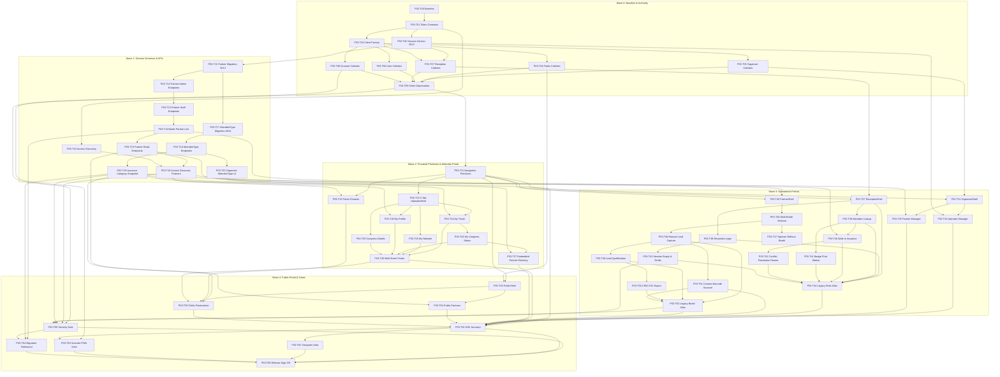

# 04 — Dependency DAG, Regression Matrix & Test Audit

**Review Mode:** STRICTLY INDEPENDENT — READ-ONLY REVIEW  
**Reviewer Role:** Lead QA Architect, Dependency Systems Auditor & Release Engineer  
**Scope:** Verification of the 67-Node / 124-Edge Dependency Graph, Critical Path Analysis, Regression Guards (R01–R20), and Test Execution Boundaries  
**Test & Release Verdict:** **CONDITIONAL GO** (DAG Acyclic & Structurally Verified; R01–R20 Traceability Complete; Test Execution Fenced to Implementation Phase)

---

## 1. Dependency Graph (DAG) Independent Verification

The complete implementation backlog graph was audited using read-only topological analysis of both `03_IMPLEMENTATION_ROADMAP.md` and `03_TASK_BACKLOG.md`:

### 1.1 Structural Properties of the Graph
- **Node Count:** Exactly 67 tasks (`P03-T00` through `P03-T66`).
- **Edge Count:** Exactly 124 dependency edges.
- **Cycle Detection:** DFS topological sort confirmed **ZERO CYCLES**. The graph is a valid, deterministic Directed Acyclic Graph (DAG).
- **Discrepancy Check:** Zero discrepancies between the tabular dependencies in `03_IMPLEMENTATION_ROADMAP.md` and the formal `### PREREQUISITES` sections in `03_TASK_BACKLOG.md`.

---

## 2. Critical Path & Parallelism Analysis

### 2.1 Structural Critical Paths
Topological traversal identifies three equal-length structural paths through the graph, each consisting of **18 task nodes**:
1. `T00 -> T01 -> T02 -> T11 -> T12 -> T13 -> T14 -> T15 -> T16 -> T45 -> T46 -> T48 -> T49 -> T50 -> T52 -> T61 -> T62 -> T65`
2. `T00 -> T01 -> T02 -> T11 -> T12 -> T13 -> T14 -> T15 -> T16 -> T45 -> T46 -> T48 -> T49 -> T50 -> T52 -> T61 -> T63 -> T65`
3. `T00 -> T01 -> T02 -> T11 -> T12 -> T13 -> T14 -> T15 -> T16 -> T45 -> T46 -> T48 -> T49 -> T50 -> T52 -> T60 -> T64 -> T65`

### 2.2 Parallel Execution Opportunities & Integration Boundaries
- **Safe Parallel Streams:**
  - Once Wave 0 (T00–T09) establishes the pure authority client, Wave 1 domain entities (`AttendeeType` vs `Partner`) can proceed in parallel on disjoint database and route files.
  - Once Wave 2 (T21–T22) establishes shared navigation primitives, the **Attendee Portal** (T23–T30), **Reception Portal** (T37–T44), and **Partner Portal** (T45–T52) can be implemented concurrently by independent agents because their routes and layouts are completely decoupled.
- **Unsafe Parallelism (Single Integration Owner Required):**
  - Schema migrations (`0012`, `0013`, `0014`) must be authored serially to maintain a linear Alembic revision chain. Competing branching heads are strictly prohibited.
  - Edits to `web/src/api/client.ts`, `web/src/main.tsx`, and `backend/app/models.py` must be gated by a designated integration owner.

---

## 3. Regression Coverage Review (R01 through R20)

Every user-fixed regression requirement was audited against existing source test anchors and planned task assignments:

| Regression ID | Invariant Protected | Key Existing Test Anchor | Implementation Task IDs | Required Test Layer & Assertion |
|---|---|---|---|---|
| **R01** | Attendee self-registration | `backend/tests/test_auth.py` | T01, T04, T06, T19, T55, T60 | Integration: Register 201, duplicate email 409, login 200, JWT returned. |
| **R02** | TicketTier quota enforcement | `backend/tests/test_tickets.py` | T17–T20, T40, T55, T60 | Unit/DB: Sold-out 410, closed 400. Rejected category does not decrement quota. |
| **R03** | Digital QR ticket preservation | `test_tickets.py`, `test_desk_registration.py` | T19, T24, T40–T42, T55, T61 | DB/API: Same Ticket ID and Entity QR returned upon retrieval/reprint. |
| **R04** | Offline ticket presentation | `web/tests/ticketCache.test.ts` | T06, T21, T24, T30, T60, T61 | Unit/PWA: Plaintext owner/TTL cache renders QR without network connection. |
| **R05** | Attendee networking & private notes | `backend/tests/test_networking.py` | T06, T25, T28, T30, T60 | API: Peer scan 201, mutual connection, notes private to author. |
| **R06** | vCard export compliance | `test_networking.py` | T25, T28, T60, T61 | API: RFC-compliant `.vcf` download; respects peer consent toggle. |
| **R07** | Booth profile & brochures | `backend/tests/test_booths.py` | T04, T11–T15, T26, T46, T53 | Public API: Renders location, description, brochure URL without auth. |
| **R08** | Partner lead capture isolation | `backend/tests/test_leads.py` | T13, T14, T45, T48, T51, T60 | API: Lead scan 201/200; cross-event 400; unauthorized booth 403. |
| **R09** | Lead qualification & CSV export | `test_lead_qualification.py`, `test_csv_security.py` | T36, T49, T50, T60, T61 | API: Rating updates; CSV export includes formula injection defense (`'`). |
| **R10** | Organizer event management | `backend/tests/test_events.py` | T05, T20, T31–T36, T60 | API: Tenant-scoped event CRUD, tier settings, check-in point policies. |
| **R11** | Desk operator issuance & attribution | `test_desk_operator_auth.py`, `test_desk_registration.py` | T02, T07, T19, T37–T42, T60 | API: Walk-in registration attributes `issued_by_operator_id`. |
| **R12** | Desk operator revocation | `test_desk_operator_auth.py` | T02, T07, T34, T43, T60, T64 | Security: Revocation 401; reactivation does not resurrect old JWT. |
| **R13** | Scanner PWA camera & HID gun | `web/tests/scannerEngine.test.ts` | T08, T21, T63, T65 | Browser: USB barcode gun listener, camera scanner, IndexedDB queue. |
| **R14** | Scan synchronization idempotency | `test_checkin.py`, `test_concurrency.py` | T08, T63, T65 | Concurrency: Idempotent batch upload; client `scan_id` deduplication. |
| **R15** | Checkpoint admission policies | `test_checkin.py`, `test_concurrency.py` | T17, T19, T33, T60, T63 | Concurrency: `MULTI_ENTRY`, `SINGLE_USE`, `TIER_RESTRICTED`, `CAPACITY_CAPPED`. |
| **R16** | Multi-tenant event isolation | Multiple test files | T01, T10–T19, T25, T31, T60 | Security: Foreign organizer 404; foreign partner 403; no cross-event leakage. |
| **R17** | Scanner device revocation & expiry | `test_scanner_security.py`, `test_scanner_revocation_matrix.py` | T08, T60, T63 | Security: Device revocation 401; 24-hour offline window enforcement. |
| **R18** | Printed QR URL backward compatibility | `web/src/main.tsx` | T11, T14, T30, T44, T52, T53 | Routing: `/e/:slug/booths/:id`, `/booth/:id`, `/scan/:id` render directly. |
| **R19** | Localization & RTL support | `web/src/lib/i18n.ts` | T20–T55 (UI tasks), T61, T62 | Browser: EN/LTR and FA/RTL across all 7 viewports; safe touch targets. |
| **R20** | API credential isolation | `test_auth.py`, `test_desk_operator_auth.py` | T01–T10, T16, T21, T38, T45, T60 | Network: Public requests send no auth; portal callsites use scoped credentials. |

---

## 4. Test Evidence Status & Execution Boundaries

### 4.1 Status of Historical Test Passes
- Previous audit reports cited **131 passing backend tests**, **28 passing web tests**, and **8 passing Dart tests**.
- **Auditor Factual Assertion:** These numbers are **HISTORICAL OBSERVATIONS**. They do NOT represent fresh execution evidence in Phase 03 or Phase 04.
- During Phase 03 and Phase 04, application tests were **NOT RERUN** because:
  1. `backend/tests/conftest.py:32-66` drops and recreates the `congress_test` database and truncates tables on every run.
  2. Running test suites or Vite builds against the dirty working tree risks modifying generated files or masking uncommitted changes.
- Therefore, all 67 tasks specify test commands as **INSTRUCTIONS FOR FUTURE EXECUTION** in dedicated test databases, not as completed achievements.

---

## 5. Quality Gates for Release Readiness

The path to production release is governed by six sequential quality gates:

1. **Gate 0 (Baseline Reproduction - P03-T00):** Clean clone at approved SHA must reproduce migration 0011 and baseline test suites.
2. **Gate 1 (Security Invariants - P03-T60):** Automated execution of all 18 Cartesian negative security scenarios (S01–S18). Zero failures permitted.
3. **Gate 2 (Browser Journeys - P03-T61):** Live Playwright end-to-end tests across all 5 portals, navigation, reload, and history.
4. **Gate 3 (Responsive & Accessibility - P03-T62):** Automated and visual confirmation across all 7 viewport widths (320, 375, 390, 430, 768, 1024, 1440px) in both English (LTR) and Persian (RTL).
5. **Gate 4 (Scanner & Offline PWA - P03-T63):** Verification of IndexedDB offline queue, reconnect synchronization, and device unpair semantics.
6. **Gate 5 (Data & Migration Rehearsal - P03-T64):** Rehearsal of migrations 0011 -> 0012 -> 0013 -> 0014 on populated PostgreSQL database, proving zero loss of ticket QR secrets or lead history.
