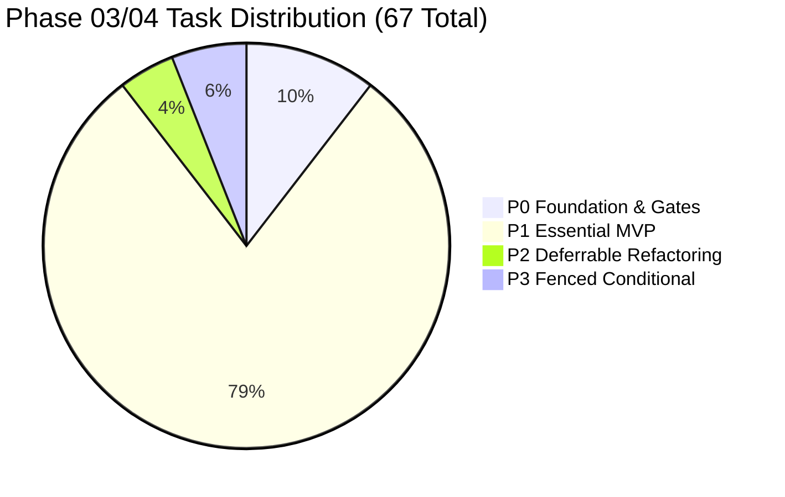

# 04 — MVP Scope, Priorities & Product Decisions

**Review Mode:** STRICTLY INDEPENDENT — READ-ONLY REVIEW  
**Reviewer Role:** Technical Delivery Reviewer & Product Architect  
**Scope:** Definition of Minimal Viable Product (MVP), Prioritization of All 67 Tasks, Milestone Groupings, and Fenced Decisions  
**Verdict:** **APPROVED ARCHITECTURAL SCOPE** (Smallest Safe MVP = 60 Tasks; 3 Tasks Deferrable; 4 Tasks Fenced Pending Product Approval)

---

## 1. Prioritization Taxonomy & Principles

To prevent scope creep and maintain high engineering quality, the 67 implementation tasks are categorized into four strict delivery tiers:

- **P0 — Mandatory Foundation & Quality Gates (7 tasks):** Tasks that MUST be executed before or as non-negotiable gates during the implementation lifecycle. Without P0, the codebase cannot be safely modified or verified.
- **P1 — Essential Client MVP (53 tasks):** Tasks strictly required to deliver the four role-specific portals (`AttendeeShell`, `OrganizerShell`, `ReceptionShell`, `PartnerShell`), the public landing experience (`PublicShell`), the standalone scanner PWA, and required end-to-end integration.
- **P2 — Valuable but Deferrable Refactoring (3 tasks):** Internal modularization of existing working code in `OrganizerEventDetail.tsx` (ticket tiers, check-in points, analytics). These improve maintainability but are NOT functional blockers for client sign-off.
- **P3 — Future / Conditional Scope Fenced (4 tasks):** Features requiring separate product decisions, data modeling, or external assets (event branding, profile editing, scientific agenda CMS). These are **BLOCKED** and excluded from the MVP.

---

## 2. Comprehensive Task Categorization



### 2.1 Tier P0: Foundation & Quality Gates (7 Tasks)
| Task ID | Component | Title | Deliverable / Gate Outcome |
|---|---|---|---|
| **P03-T00** | Release Engineering | Authorize & establish local baseline | Clean baseline SHA, 2-commit separation, worktree validation. |
| **P03-T01** | Security / Auth | Stabilize token family & status contracts | Backend token type verification (`type == "user"`), 401 fail-closed. |
| **P03-T02** | Security / DB | Prevent desk-session resurrection | Migration 0012: `desk_operators.session_version` counter. |
| **P03-T03** | Frontend / API | Pure explicit-authority API boundary | Factory client in `web/src/api/client.ts` without pathname heuristic. |
| **P03-T60** | Quality Gate | API credential & cross-event security gate | Automated Cartesian negative tests (S01–S18 matrix). |
| **P03-T64** | Quality Gate | Populated migration & rollback rehearsal | Tests migrations 0011 -> 0014 on populated PostgreSQL instance. |
| **P03-T65** | Quality Gate | Clean-checkout staging & pilot report | Verifies fresh clone build without dirty worktree dependencies. |

### 2.2 Tier P1: Essential Client MVP (53 Tasks)
- **Authority Callsite Cutover (6 tasks):** `P03-T04` (anonymous), `P03-T05` (organizer), `P03-T06` (attendee/booth), `P03-T07` (reception), `P03-T08` (scanner), `P03-T09` (deprecated client removal).
- **Domain Entities & Migrations (9 tasks):** `P03-T10` (access discovery), `P03-T11` (Partner migration 0013), `P03-T12` (Partner admin endpoints), `P03-T13` (Partner staff), `P03-T14` (Booth-Partner link), `P03-T15` (Partner read APIs), `P03-T16` (access discovery partner enrichment), `P03-T17` (AttendeeType migration 0014), `P03-T18` (AttendeeType endpoints), `P03-T19` (issuance category snapshot), `P03-T20` (organizer AttendeeType UI).
- **Shared Frontend Infrastructure (2 tasks):** `P03-T21` (navigation/auth primitives), `P03-T22` (multi-role portal chooser).
- **Attendee Portal (8 tasks):** `P03-T23` (5-tab AttendeeShell), `P03-T24` (My Ticket QR & offline cache), `P03-T25` (My Network & vCard), `P03-T26` (My Congress & saved booths), `P03-T27` (embedded Partner directory), `P03-T28` (My Profile & privacy toggle), `P03-T29` (Congress Details view), `P03-T30` (active congress picker & aliases).
- **Organizer Portal Core (3 tasks):** `P03-T31` (OrganizerShell & key gate), `P03-T34` (desk operator manager & generation bump), `P03-T35` (partner & staff manager).
- **Reception Portal (8 tasks):** `P03-T37` (ReceptionShell & `/reception/:id`), `P03-T38` (login extraction), `P03-T39` (attendee lookup), `P03-T40` (walk-in issuance with category & tier), `P03-T41` (badge display & browser print), `P03-T42` (duplicate resolution drawer), `P03-T43` (session expiry & safe drafts), `P03-T44` (legacy desk alias cutover).
- **Partner Portal (8 tasks):** `P03-T45` (PartnerShell & `/partner/:id`), `P03-T46` (multi-booth selector), `P03-T47` (sponsor without booth view), `P03-T48` (manual lead capture form), `P03-T49` (lead qualification feed & ratings), `P03-T50` (CRM CSV export), `P03-T51` (camera barcode scanner integration), `P03-T52` (legacy `/booth/:id` alias cutover).
- **Public Portal (3 tasks):** `P03-T53` (PublicShell & landing), `P03-T54` (public partner/sponsor sections), `P03-T55` (reservation modal & login flow).
- **Testing & Scope Verification (4 tasks):** `P03-T61` (E2E browser journeys), `P03-T62` (7-viewport responsive & accessibility gate), `P03-T63` (Scanner PWA offline gate), `P03-T66` (Native scanner scope decision gate).

### 2.3 Tier P2: Deferrable Internal Refactoring (3 Tasks)
| Task ID | Title | Why Deferrable | Risk of Deferral |
|---|---|---|---|
| **P03-T32** | Ticket tier manager decomposition | `OrganizerEventDetail.tsx` already has working tier CRUD. | LOW: Keeps code in parent file; no user-facing difference. |
| **P03-T33** | Check-in point manager decomposition | `OrganizerEventDetail.tsx` already has working gate policy editor. | LOW: Keeps code in parent file; no user-facing difference. |
| **P03-T36** | Analytics dashboard decomposition | `OrganizerAnalytics.tsx` already functions with 10s polling and CSV export. | LOW: Zero regression risk; existing analytics route is intact. |

*Recommendation:* Execute P2 tasks if delivery pace allows; otherwise defer to a post-launch maintenance sprint.

### 2.4 Tier P3: Fenced Conditional Features (4 Tasks)
| Task ID | Feature Title | Prerequisite Product Approval Required | Safe Default if Excluded |
|---|---|---|---|
| **P03-T56** | Event branding (logo, cover, accent color) | Requires approved asset storage schema, upload endpoints, and contrast rules. | **EXCLUDED:** Events render clean default typography and neutral theme. |
| **P03-T57** | Global organization/title profile editing | Requires product policy on whether profile changes alter past printed badges. | **EXCLUDED:** `My Profile` remains read-only for identity; privacy toggle active. |
| **P03-T58** | Partner profile self-editing | Requires RBAC specification for partner representative profile field mutations. | **EXCLUDED:** Partner profile is read-only for representatives; organizer manages. |
| **P03-T59** | Scientific program & speaker CMS | Requires complete domain model (tracks, sessions, speakers, halls, abstracts). | **EXCLUDED:** Congress Details shows event metadata and venue; no fake schedule UI. |

---

## 3. Product Decisions Requiring Explicit Human Sign-Off

Before any conditional task or release decision can transition from BLOCKED to ACTIVE, the following explicit decisions must be registered:

1. **Native Scanner App Release Scope (P03-T66):**
   - *Current State:* The Flutter mobile app in `mobile/` is a prototype with in-memory storage, unauthenticated pairing, and missing camera capture.
   - *Architectural Recommendation:* Formally designate the React PWA (`/scan/:pointId`) as the sole production scanner client for MVP. Explicitly exclude the Flutter app from the web release deployment. Retain Dart code as an experimental client without making production claims.
2. **Event Program & Speaker Agenda (P03-T59):**
   - *Current State:* No backend tables exist for tracks, sessions, keynotes, or speakers.
   - *Architectural Recommendation:* Keep P03-T59 strictly as a schema and scope gate. Do not author placeholder React components that simulate schedule data. If the client requires an agenda, a dedicated Phase 05 design phase must author ADRs and schema migrations.
3. **Editable User Profiles vs. Historical Integrity (P03-T57):**
   - *Architectural Recommendation:* Keep `/api/auth/me` read-only for MVP. Allow attendees to toggle peer contact sharing (`share_contact_with_peers`), but prevent changing full name or organization to avoid mismatches with printed physical badges.

---

## 4. Proposed Milestone Groupings

The 60 essential tasks (P0 + P1) are organized into six logical execution waves:

```
[Wave 0: Baseline & Authority]
  P03-T00 (Commit Baseline) -> P03-T01 (Token Contracts) -> P03-T02 (Session Version 0012)
  -> P03-T03 (Client Factory) -> P03-T04..T08 (Callsites) -> P03-T09 (Client Deprecation)

[Wave 1: Additive Domain Schemas]
  P03-T10 (Access Discovery) -> P03-T11 (Partner Migration 0013) -> P03-T12..T16 (Partner Endpoints)
  -> P03-T17 (AttendeeType Migration 0014) -> P03-T18..T20 (AttendeeType Endpoints & UI)

[Wave 2: Shared Frontend & Attendee Experience]
  P03-T21 (Navigation Primitives) -> P03-T22 (Portal Chooser) -> P03-T23 (5-Tab AttendeeShell)
  -> P03-T24..T30 (My Ticket, Network, Congress, Partners, Profile, Details, Multi-Event Picker)

[Wave 3: Operational Portals (Reception & Partner)]
  P03-T31, T34, T35 (Organizer Shell & Managers)
  -> P03-T37..T44 (Independent Reception Station, Lookup, Walk-in, Conflict Resolution)
  -> P03-T45..T52 (Independent Partner Portal, Multi-Booth, Lead Scan, Qualification, CSV)

[Wave 4: Public Landing & Final Integration]
  P03-T53 (PublicShell) -> P03-T54 (Public Partners) -> P03-T55 (Public Reservation)
  -> P03-T66 (Native Scanner Exclusion Decision)

[Wave 5: Verification & Release Quality Gates]
  P03-T60 (Security Cartesian Suite) -> P03-T61 (Browser E2E Journeys)
  -> P03-T62 (7-Viewport Responsive Gate) -> P03-T63 (Scanner PWA Gate)
  -> P03-T64 (Migration Populated Rehearsal) -> P03-T65 (Clean Checkout Staging Sign-Off)
```

---

## 5. Explicit Exclusions from MVP
The following items are strictly out-of-scope for the MVP release:
- Payment gateway integration or paid ticket transactions (eliminated by ADR 0007).
- Native iOS/Android App Store scanner deployment (eliminated by P03-T66 web-first decision).
- Automatic Universal Single Sign-On across Organizer and Attendee contexts (eliminated by AR-02).
- Hard deletion or destructive archiving of Partner records (eliminated by AR-01 to protect lead audit history).
- Custom CSS/HTML theme builders or arbitrary web fonts (eliminated by P03-T56).
- Speaker submissions, abstract reviews, and scientific schedule management (deferred by P03-T59).
