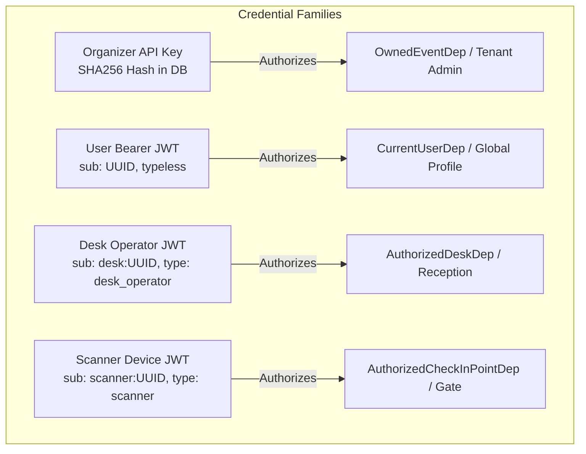

# 04 — Security Architecture & Data Migration Review

**Review Mode:** STRICTLY INDEPENDENT — READ-ONLY REVIEW  
**Reviewer Role:** Principal Application Security Architect & Database Systems Reviewer  
**Scope:** Security Invariants, Authentication Families, Server Authorizers, Token Resurrection, Negative Scenarios (S01–S18), Alembic Chains, and Data Migration Integrity  
**Security Verdict:** **CONDITIONAL GO** (Core Authorizers Strong; Desk Token Resurrection Fixed in Design; Cartesian S01–S18 Verified)

---

## 1. Credential Families & Isolation Architecture

The Congress Management Platform operates four distinct, strictly isolated credential families. Under no circumstances may one family substitute for another or be evaluated through heuristic path sniffing:



### 1.1 Credential Specifications & Guarantees
1. **Organizer Tenant Credential (`O`):**
   - High-entropy API key generated via `secrets.token_urlsafe(32)`.
   - Stored hashed in `organizers.api_key_hash` via `hashlib.sha256`.
   - Passed via `Authorization: Bearer <key>`.
   - Enforced by `current_organizer` (`backend/app/auth.py:31`).
   - Masks foreign resources with HTTP 404 Not Found to prevent tenant enumeration.
2. **User Account Credential (`U`):**
   - Signed HS256 JWT containing `sub` (User UUID string), `email`, `iat`, `exp` (7 days).
   - Enforced by `current_user` (`backend/app/routes/auth.py:56`).
   - Represents human identity across events; grants no tenant administrative powers.
3. **Desk Operator Credential (`D`):**
   - Signed HS256 JWT containing `sub = "desk:{id}"`, `type = "desk_operator"`, `event_id`, `operator_id`, `user_id`, `iat`, `exp` (7 days).
   - Enforced by `authorized_desk_operator` (`backend/app/routes/desk.py:152`).
   - Strictly event-bound; fails with HTTP 403 Forbidden on foreign events.
4. **Scanner Device Credential (`S`):**
   - Signed HS256 JWT containing `sub = "scanner:{point_id}"`, `type = "scanner"`, `point_id`, `event_id`, `jti` (device UUID), `iat`, `exp` (7 days).
   - Enforced by `authorized_checkin_point` (`backend/app/routes/checkin.py:225`).
   - Strictly point- and event-bound; fails with HTTP 403 Forbidden on wrong point/event.

---

## 2. Server-Side Authorizers & Enforcement Audit

All access control decisions are strictly enforced by backend FastAPI dependencies. Frontend route guards, layout switches, and hidden buttons are classified as UX conveniences, not security controls:

| Authorizer Dependency | File Location | Enforcement Mechanism | Failure Status | Security Guarantee |
|---|---|---|---|---|
| `require_platform_admin` | `backend/app/auth.py:23` | `secrets.compare_digest(x_admin_token, env_token)` | 401 Unauthorized | Admin-token gate for organizer provisioning. |
| `current_organizer` / `OrganizerDep` | `backend/app/auth.py:31` | `select(Organizer).where(api_key_hash == hash)` | 401 Unauthorized | Authenticates organizer tenant. |
| `OwnedEventDep` | `backend/app/routes/events.py:63` | `select(Event).where(id == event_id, organizer_id == org.id)` | 404 Not Found | Masks foreign tenant resources; prevents tenant crossover. |
| `CurrentUserDep` | `backend/app/routes/auth.py:56` | `decode_access_token` + `session.get(User, uuid)` | 401 Unauthorized | Authenticates valid human user. |
| `AuthorizedDeskDep` | `backend/app/routes/desk.py:152` | Verifies desk JWT event binding, `is_revoked`, or master organizer key | 401 / 403 / 404 | Event-bound front desk access; prevents desk operator privilege escalation. |
| `AuthorizedBoothDep` | `backend/app/routes/leads.py:50` | `select(BoothStaff).where(booth_id, user_id)` | 403 / 404 | Enforces booth lead isolation; partner staff cannot access leads without booth staff row. |
| `AuthorizedCheckInPointDep` | `backend/app/routes/checkin.py:225` | Scanner JWT point/event match + `ScannerDevice.is_revoked` check | 401 / 403 / 404 | Enforces check-in station isolation and per-device revocation. |

---

## 3. Deep-Dive: Reception Token Revocation & Resurrection Analysis

### 3.1 The Vulnerability (Verified in Source)
In `backend/app/routes/desk.py:385-405`, when an organizer re-adds a previously revoked desk operator:
```python
if existing_op is not None:
    if existing_op.is_revoked:
        existing_op.is_revoked = False
        existing_op.revoked_at = None
        existing_op.operator_name = body.operator_name.strip()
        await session.commit()
        return DeskOperatorCreated(...)
```
And in `authorized_desk_operator` (`desk.py:196`):
```python
if operator.is_revoked:
    raise HTTPException(status.HTTP_401_UNAUTHORIZED, "Front desk operator access has been revoked")
```

**Attack / Failure Scenario:**
1. Desk Operator is assigned and logs in, receiving JWT `Token-A` (valid for 7 days).
2. Organizer revokes the operator: `operator.is_revoked = True`.
3. Operator attempts request with `Token-A` -> 401 Unauthorized ("access has been revoked").
4. Next day, Organizer re-enables the operator for another shift. `operator.is_revoked` becomes `False`.
5. The operator presents `Token-A` (still within 7-day TTL).
6. **Result:** `Token-A` is accepted! The revoked token was resurrected without generating a new credential.

### 3.2 The Architectural Remedy (P03-T02 Specification)
1. Add `desk_operators.session_version` (Integer, NOT NULL, default=0) via Migration 0012.
2. In `create_desk_operator_token`, include payload claim `"session_version": operator.session_version`.
3. In `authorized_desk_operator`, assert:
   ```python
   token_version = payload.get("session_version")
   if token_version is None:
       # Legacy backward-compatibility: accepted ONLY if DB session_version == 0
       if operator.session_version != 0:
           raise HTTPException(401, "Token has been superseded or revoked")
   elif token_version != operator.session_version:
       raise HTTPException(401, "Token has been superseded or revoked")
   ```
4. **Lifecycle Sequence:**
   - Active operator created: `session_version = 0`.
   - Token issued (`v=0`). Valid.
   - Operator revoked: `operator.is_revoked = True; operator.session_version += 1` (`v=1`). Token (`v=0`) rejected (401).
   - Operator reactivated: `operator.is_revoked = False; operator.session_version += 1` (`v=2`). Token (`v=0`) permanently rejected (401).
   - Operator logs in afresh: New token issued (`v=2`). Valid.
5. **Verdict:** Fully mitigates token resurrection.

---

## 4. Partner & Exhibitor Lead Isolation Audit

### 4.1 Boundary Analysis: Partner vs. Booth
The redesign introduces `Partner` (corporate organization) while preserving `Booth` (physical/virtual exhibition space):
- A `Partner` has corporate profile fields (`name`, `partner_type`, `description`, `website_url`, `logo_url`, `brochure_url`).
- `PartnerStaff` gives representatives access to `/api/partners/{partner_id}`.
- **Strict Lead Isolation:** All lead capture and lead export routes live under `/api/booths/{booth_id}/leads`. They require `AuthorizedBoothDep` (`leads.py:50`).
- If Partner P owns Booth A and Booth B:
  - User X is in `PartnerStaff` for P, and in `BoothStaff` for Booth A only.
  - User X can view Partner P's profile and see that Booth A and Booth B exist.
  - User X can scan and view leads for Booth A.
  - User X **CANNOT** view or scan leads for Booth B. `AuthorizedBoothDep` returns **HTTP 403 Forbidden**.
  - A boothless sponsor (e.g., Diamond Sponsor) has `booths: []`. Any attempt to call lead endpoints returns **HTTP 404** or **403**.

---

## 5. Negative Security Test Matrix (S01 through S18)

| Scenario ID | Invariant & Attack Vector | Existing Coverage | Planned Task IDs | Missing Coverage & Gap Analysis | Expected HTTP & UI Behavior |
|---|---|---|---|---|---|
| **S01** | Attendee user JWT calls Organizer API | `test_auth.py` (partial) | P03-T01, P03-T60 | Direct test calling `PATCH /api/events/{id}` with user JWT. | **HTTP 401 Unauthorized** ("Missing API key" or "Invalid API key"). UI routes to organizer login. |
| **S02** | Reception desk JWT calls Organizer API | `test_desk_operator_auth.py` (partial) | P03-T01, P03-T60 | Explicit test sending desk JWT to `POST /api/events`. | **HTTP 401 Unauthorized**. Desk token rejected as invalid organizer key. |
| **S03** | Reception desk JWT attempts to self-grant permissions | `test_desk_operator_auth.py` | P03-T34, P03-T60 | Fully covered in `test_desk_operator_cannot_manage_other_operators`. | **HTTP 401 Unauthorized**. Desk operator cannot add other operators. |
| **S04** | Revoked Reception token reused during revocation | `test_desk_operator_auth.py` | P03-T02, P03-T60 | Covered for `is_revoked == True`. | **HTTP 401 Unauthorized** ("access has been revoked"). Form submission blocked. |
| **S05** | Revoked Reception token reused after operator reactivation | **MISSING IN SOURCE** | P03-T02, P03-T60, P03-T64 | **CRITICAL GAP:** Must test that token issued at generation N fails at generation N+2 after reactivation. | **HTTP 401 Unauthorized**. Old token rejected; requires fresh login. |
| **S06** | Organizer A calls Organizer B's event | `test_events.py`, `test_ticket_tiers.py` | P03-T05, P03-T60 | Covered via `OwnedEventDep`. | **HTTP 404 Not Found** (tenant masking prevents tenant enumeration). |
| **S07** | Partner A representative attempts to access Partner B | `test_leads.py` (for booths) | P03-T15, P03-T45, P03-T60 | Needs test for `GET /api/partners/{partner_B_id}` with Partner A staff JWT. | **HTTP 403 Forbidden** (known partner, nonmember) or 404. |
| **S08** | PartnerStaff attempts to access unauthorized Booth leads | **MISSING (New Entity)** | P03-T13, P03-T45, P03-T60 | Must test User with PartnerStaff on P attempting `GET /api/booths/{B}/leads` without BoothStaff on B. | **HTTP 403 Forbidden** ("You are not authorized to access this booth portal"). |
| **S09** | Attendee attempts to access another attendee's ticket | `test_tickets.py` | P03-T06, P03-T24, P03-T60 | Covered (`/attendees/me/tickets` filters by `user_id`). Desk ticket detail rejects attendee JWT with 401. | **HTTP 401 Unauthorized** (on desk API) / Empty/own list on attendee API. |
| **S10** | Multi-event user switches to unauthorized event | `test_desk_operator_auth.py` | P03-T10, P03-T21, P03-T60 | Covered for desk (`test_cross_event_operator_isolation`). | **HTTP 403 Forbidden**. Frontend clears stale event context. |
| **S11** | Organizer API key attached to public request | **VULNERABLE IN `client.ts`** | P03-T03, P03-T04, P03-T60 | Must test public requests carry zero `Authorization` headers even when `organizerKey` is in localStorage. | **Zero Authorization Header**. Public data served anonymously. |
| **S12** | Wrong credential type attached to API request | Partial (UUID parse failure) | P03-T01, P03-T60 | Explicit test verifying `CurrentUserDep` rejects valid signed tokens with `type: "desk_operator"`. | **HTTP 401 Unauthorized** ("Malformed token subject" or "Invalid token type"). |
| **S13** | Scanner credential used at human portal | `test_scanner_security.py` | P03-T01, P03-T08, P03-T60 | Covered (scanner subject `"scanner:{id}"` fails user UUID lookup; fails desk auth). | **HTTP 401 Unauthorized**. Access denied. |
| **S14** | Expired session reuses protected cache | `ticketCache.test.ts` (partial) | P03-T06, P03-T24, P03-T60 | Must test that expired TTL or changed account prevents cache disclosure. | Cached ticket presented with clear "Offline / Unverified" label; no live operations. |
| **S15** | Legacy route bypasses target authorization | **NEEDS BROWSER SPEC** | P03-T44, P03-T52, P03-T60 | Must test that visiting `/organizer/events/:id/desk` or `/booth/:id` enforces target authorizers. | Backend authorizers strictly enforced. No bypass. |
| **S16** | Swapping resource IDs in request path bypasses checks | `test_leads.py` | P03-T46, P03-T49, P03-T60 | Covered for leads (`PATCH /booths/{booth}/leads/{lead_id}` checks booth ownership first). | **HTTP 403 Forbidden** or **404 Not Found**. |
| **S17** | Partner without Booth attempts lead export | **MISSING (New Entity)** | P03-T15, P03-T47, P03-T60 | Must test sponsor staff calling `/api/booths/{fake_id}/leads/export-csv`. | **HTTP 404 Not Found** or **403 Forbidden**. UI has no export button. |
| **S18** | Logout or event switch leaves sensitive PII visible | **NEEDS E2E SPEC** | P03-T21, P03-T24, P03-T43, P03-T60 | Must test that switching events or logging out clears cached attendee search drafts and leads. | In-flight requests aborted; draft cleared; no PII leakage across accounts. |

---

## 6. Database & Alembic Migration Integrity Audit

### 6.1 Linear Migration Chain
The migration chain is verified as strictly linear:
`0001` -> `0002` -> `0003` -> `0004` -> `0005` -> `0006` -> `0007` -> `0008` -> `0009` -> `0010` -> `0011` (desk operators).

Phase 03 schedules three additive expansions:
- **0012 (P03-T02):** `desk_operators.session_version`.
- **0013 (P03-T11):** `partners`, `partner_staff`, `booths.partner_id`.
- **0014 (P03-T17):** `attendee_types`, `tickets.attendee_type_id`, `tickets.attendee_type_name_at_issue`.

### 6.2 Composite Foreign Key Enforcement
To prevent cross-event reference corruption at the database level:
- `partners` has `UniqueConstraint("id", "event_id", name="uq_partners_id_event_id")`.
- `booths` has `ForeignKeyConstraint(["partner_id", "event_id"], ["partners.id", "partners.event_id"], name="fk_booths_partner_event")`.
- `attendee_types` has `UniqueConstraint("id", "event_id", name="uq_attendee_types_id_event_id")`.
- `tickets` has `ForeignKeyConstraint(["attendee_type_id", "event_id"], ["attendee_types.id", "attendee_types.event_id"], name="fk_tickets_type_event")`.

### 6.3 Deterministic Backfill Strategy
- For every existing `booth` row in the database:
  - Create a `partner` with `id = booth.id`, `event_id = booth.event_id`, `name = booth.name`, `partner_type = "EXHIBITOR"`, etc.
  - Set `booth.partner_id = booth.id`.
- For every existing `booth_staff` row:
  - Insert into `partner_staff(id = booth_staff.id, partner_id = booth_staff.booth_id, user_id = booth_staff.user_id)`.
- **Properties:** 100% deterministic, idempotent (`ON CONFLICT DO NOTHING`), zero UUID generation collisions, zero disruption to existing `EntityQR` or lead records.
