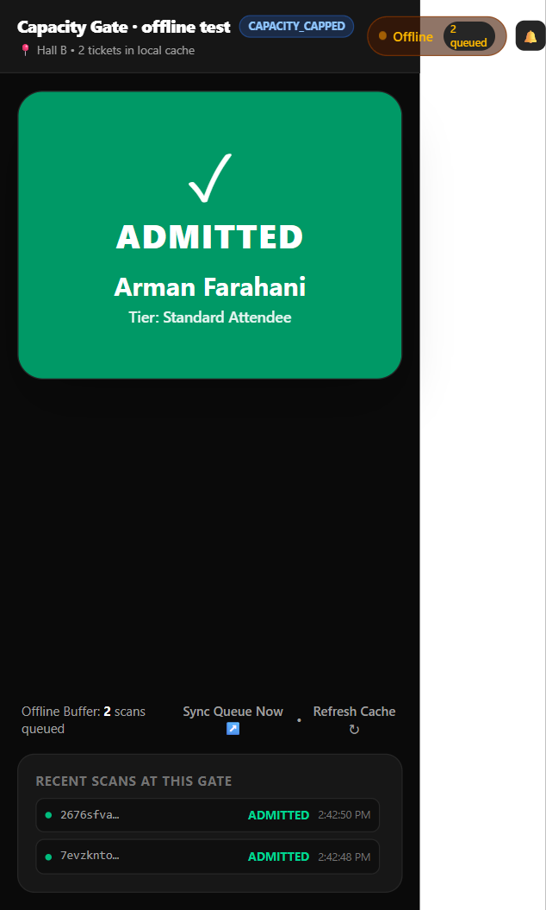

# 01 — Current UI and product-contract audit

Research date: 2026-10-10. Scope: current V1/V2 repository and its 11 routed web surfaces. This is a research-only baseline, not an implementation, accessibility certification, security penetration test, or approval to ship. Recommended direction is [A: refined minimal product](04-DESIGN-DIRECTIONS.md), with Event-scoped editorial presentation, dense staff workspaces and dedicated operations. The proposed [design system](05-DESIGN-SYSTEM.md) is not current functionality.

## Phase 0 validation update — current repository evidence

This 2026-10-10 addendum supersedes the earlier unpopulated-render and blocked-environment statements below. The current source and verified Phase 0 findings are authoritative; details and artifacts are in [PHASE-0-VALIDATION.md](PHASE-0-VALIDATION.md).

- PostgreSQL was started and the local application database upgraded through Alembic revision `0008`. The full Windows verification script passed: mypy 39 files, pytest 88, web tests 5, TypeScript/build, Dart tests 8, and Dart analysis.
- All 11 routes were rendered with synthetic Event, attendee, Booth, Lead, check-in, and Organizer data at 1440×960 and 390×844 CSS pixels. The 22 route captures are in `phase0-evidence/`; Ticket QR marks are blurred in these evidence exports. Initial route states fit their viewport. A separate queued/offline Scanner state overflows at 390px (507px document width). Camera hardware, physical HID, assistive technology, and 360/768/1024 populated screens were not tested.
- Scanner manifest/batch authorization is implemented: missing credentials return 401, attendee JWT returns 403, a valid point token succeeds, and a revoked device token returns 401. The manifest no longer contains attendee email, but still contains attendee names and reusable QR secrets. The older “unauthenticated scanner / email in manifest” findings below are superseded.
- Current high-risk gaps are cross-point/Event scan-ID replay disclosure, local/server scan-result and offline-capacity disagreement, peer email disclosure without consent, and owner-unscoped plaintext Ticket caching. Scanner token onboarding is incomplete across web/mobile. Track these independently from presentation work: [#15](https://github.com/msadrak/congress-platform/issues/15)–[#25](https://github.com/msadrak/congress-platform/issues/25).
- The printed Booth QR still does not resolve to the public Booth profile; the secret-form lookup returned 422. PWA shell, staff recovery, and native Flutter camera/persistent-storage capabilities remain absent.

Older rendered limitations, line references, and implementation states in this source-audit snapshot are historical where they conflict with the bullets above.

## Evidence method and rendered limits

- **CODE:** source behavior identified by the ProductAudit source audit; file/line references below refer to the current checkout. A source implementation is not evidence that an end-to-end flow succeeded.
- **DOC:** specification or ADR intent, not implementation proof. **ISSUE:** live GitHub delivery/verification assertion. **MARKETING:** delivery report or UI copy. **INFERENCE:** source-derived UX/visual judgment or proposed response, not a rendered observation.
- **RENDERED:** The Phase 0 seeded baseline rendered all 11 routes at 1440×960 and 390×844 CSS pixels; all 22 initial route captures fit the page width. A separate offline Scanner state with two queued records expands to 507px at 390px. Captures are under `phase0-evidence/`; no physical camera/HID, native runtime, screen reader, or populated 360/768/1024 run was performed.
- The browser session rendered the current application with a synthetic seeded Event, attendees, Booth, Lead, Check-In, and Organizer. Direct endpoint probes and simulated offline keyboard input supplement the screenshots; neither establishes real hardware or user validation.
- No physical camera/HID scanner, screen reader, assistive technology, real attendee, Flutter device, kiosk, or populated 360/768/1024 CSS-pixel view was tested. No task timing, camera permission, print quality, QR-decode performance or real offline hardware sync was measured.

**Verification:** the audit-only worker did not run a test suite. During Phase 0, the main agent ran `cmd.exe /c "scripts\check.bat"` after PostgreSQL startup and Alembic `0008`; it passed the unified backend/web/mobile pipeline. See [PHASE-0-VALIDATION.md](PHASE-0-VALIDATION.md) for results.

### Actual screenshot evidence

All eleven routes have a populated 1440×960 and 390×844 CSS-pixel capture in [`phase0-evidence/`](phase0-evidence/), linked route-by-route in [PHASE-0-VALIDATION.md](PHASE-0-VALIDATION.md). A separate offline queue state demonstrates the mobile overflow:

The initial route screenshots fit their viewport width; the queued/offline Scanner state reaches 507 CSS pixels. Ticket screenshot QR and identity content is visually redacted. Screenshot states are synthetic and do not verify camera/HID, assistive technology, Flutter or full lifecycle behaviors.

## Required documents and decision evidence

The review uses the required `AGENTS.md`, `SPEC.md`, `SPEC_V2.md`, `GLOSSARY.md`, `REPORT.md`, `docs/CODING_STANDARDS.md`, domain/issue workflow documents and ADRs 0001–0011. Current source outranks an implementation assertion in prose; decisions remain requirements or explicit conflicts until reconciled.

| Document | Baseline and implications |
|---|---|
| `AGENTS.md:5–32,34–61` | FastAPI/PostgreSQL, React web and claimed native scanner; enumerates the same 11 routes. Its PWA/SQLite/ML Kit descriptions are claims contradicted by current packaging/storage. Requires `gh` issue operations and references domain/engineering rules. The required Windows full-stack verification was run in Phase 0; see [PHASE-0-VALIDATION.md](PHASE-0-VALIDATION.md) for its passing result. |
| `SPEC.md:11–28,30–59,64–117,120–145` | Free self-/desk-registration, entity QR, offline browser/native scanning, policies, analytics and UUID-idempotent batches. Performance targets and native/PWA ambitions are not measured delivery. Payment, checkout and billing remain excluded. |
| `SPEC_V2.md:13–31,35–60,66–143,147–167` | Booth setup/isolation, lead capture/qualification/CSV, public brochures/bookmarks, peer connections/notes/vCard. Email/phone peer disclosure is opt-in by intent. Chat, AI matchmaking and paid lead licenses remain excluded. |
| `GLOSSARY.md:7–73,83–89` | Use Event, Organizer, User, Attendee, Ticket, Entity QR, Check-In Point, Admission Policy, Lead, Connection and Booth consistently. Session/Track are vocabulary, not implemented scheduling. Attendee is a role of User in source, not an independent table. |
| `REPORT.md:5–18,22–32,38–60,77–104` | Historical “100% verified,” production-ready, Redis, PWA and native scanner claims. Exactly 11 routes is source-supported; privacy/native/PWA claims need correction. “85 tests passing” is historical, not exercised audit evidence. |
| `docs/CODING_STANDARDS.md:9–30,36–53,59–63` | Keep generated types and zero `any`; use existing deferred-promise/lookup conventions; HTTP-boundary database tests; environment-first configuration; static FastAPI routes before parameterized routes; unique test Event slugs; pure Dart policy logic. Future component extraction must not introduce a parallel convention. |
| `docs/agents/domain.md:5–9,41–51` | Canonical glossary vocabulary and explicit ADR conflicts, not silent reinterpretation. |
| `docs/agents/issue-tracker.md:3–14,30–34` | `gh` CLI, issue comments and labels are required evidence. CLI evidence was retrieved independently of the scout's issue-resource inspection; details below. |

### ADR coverage and current-source reconciliation

| ADR | Decision | Current evidence / consequence |
|---|---|---|
| [0001](../adr/0001-general-congress-platform.md):4–11 | General independent congress, not medically coupled CME | Preserve general Event language. Do not add medical-council validation/CME workflows. Multi-session/track wording is not a shipped schedule. |
| [0002](../adr/0002-multi-tenant-modular-monolith.md):7–14 | Row-scoped multi-tenant modular monolith, PostgreSQL, horizontal scaling/workers | Organizer ownership is implemented (`backend/app/routes/events.py:56–71`); Redis/worker infrastructure is not present in dependency/config/compose evidence. Scaling prose is not load-test proof. |
| [0003](../adr/0003-order-attendee-decoupling.md):4–14 | Buyer/Order, bulk tickets, one-time Claim Links | Not modeled or routed. Conflicts with current direct User→Ticket reservation; no anonymous/bulk claim UI may be represented as available. |
| [0004](../adr/0004-hierarchical-check-in.md):7–14 | Event-scoped points with location/tier/capacity constraints | Points exist; Hall/Session domain features are absent. Configuration does not imply net occupancy or time-window enforcement. |
| [0005](../adr/0005-authenticated-user-ticket-binding.md):4–14 | Authentication binds tickets to User | Implemented ownership, but not the described Claim Link mechanism (`models.py:75–103`; `tickets.py:51–122`). Desk-created account recovery remains unresolved. |
| [0006](../adr/0006-fastapi-react-technology-stack.md):7–20 | Async FastAPI, typed React/OpenAPI, API-driven administration | Implemented transport/type seam (`web/src/api/client.ts:1–54`); pages still orchestrate their own effects. Redis descriptions are not current adapters. |
| [0007](../adr/0007-zero-cost-registration-no-payment-gateway.md):4–14 | Free reservations; eliminate gateways and financial states | Current tiers are free. No pricing, checkout, invoice or payment design belongs in this plan. “Order” wording does not establish an Order model. |
| [0008](../adr/0008-polymorphic-entity-qr-architecture.md):7–14 | 128-bit polymorphic QR registry | Registry and ticket/booth minting exist (`models.py:106–119`; `security.py:60–64`). Hall/Session strings are extensibility, not implemented workflows. Raw booth token lacks public navigation resolution. |
| [0009](../adr/0009-scanner-client-architecture-and-offline-sync.md):7–22 | Unified manifests and UUID-idempotent batches; persistent web/native clients | Web IndexedDB implemented; PWA shell absent; native storage in memory and decoder absent. Retain shared sync semantics while fixing gaps. |
| [0010](../adr/0010-checkpoint-admission-policies.md):7–18 | Time-window SINGLE_USE, entry/exit, capacity policies | Current SINGLE_USE lasts for point lifetime; no exit direction exists; capacity counts cumulative admitted scans. Offline local cap callers use zero. Do not label cumulative admissions as current occupancy. |
| [0011](../adr/0011-exhibitor-lead-retrieval-and-networking.md):9–20 | Shared QR resolution, public Booth navigation, full exhibitor card, peer opt-in email | Leads/qualification/isolation exist; Booth secret→profile navigation absent. Peer email unconditional and connection one-way. These are contract discrepancies, not cosmetic defects. |

## GitHub verification using the required CLI

On the research date, `gh issue list --state all --limit 100 --json number,title,state,closedAt,url,body,labels,comments` succeeded inside the repository. A second structured query inspected labels, comments and unchecked criteria, and `gh issue view 7 --comments --json number,title,state,labels,body,comments` independently retrieved the native-client assertion. No issues were created, commented on or changed.

All 14 returned issues are CLOSED, closed on 2026-10-06, and still labelled `ready-for-agent`. Child issue acceptance lists remain syntactically unchecked. Parent specs #1/#9 have no checkbox list to count; this does **not** mean their criteria were independently verified. Issue closure is project delivery metadata, not proof that the screenshot flows or required capabilities were exercised.

| Live issue | Scope | Unchecked child criteria | Audit interpretation |
|---|---|---:|---|
| [#1](https://github.com/msadrak/congress-platform/issues/1) | V1 parent spec | — | Comment asserts #2–#8 complete; specification evidence only. |
| [#2](https://github.com/msadrak/congress-platform/issues/2) | Event/tier/public/tenant setup | 5 | Source supports creation/public data and isolation. |
| [#3](https://github.com/msadrak/congress-platform/issues/3) | User registration/pass/offline cache | 7 | Source supports reservation/cache; neutral sign-in/save artifact missing. |
| [#4](https://github.com/msadrak/congress-platform/issues/4) | Policies/manifest/idempotent batch | 5 | Core implemented; authorization and policy semantic gaps remain. |
| [#5](https://github.com/msadrak/congress-platform/issues/5) | Desk registration/search/history | 5 | Source-supported; claim/recovery and print need explicit decisions. |
| [#6](https://github.com/msadrak/congress-platform/issues/6) | Browser PWA/IndexedDB/HID | 9 | Browser offline data exists; installable/offline-boot shell not implemented. |
| [#7](https://github.com/msadrak/congress-platform/issues/7) | Native Flutter/ML Kit/SQLite | 8 | Materially contradicted by packaging, in-memory storage and missing decoder. |
| [#8](https://github.com/msadrak/congress-platform/issues/8) | Analytics/filter/export | 6 | Polling, no UI time-window filter, unfiltered CSV, misleading occupancy. |
| [#9](https://github.com/msadrak/congress-platform/issues/9) | V2 parent spec | — | Comment asserts #10–#14 complete; privacy opt-in remains absent. |
| [#10](https://github.com/msadrak/congress-platform/issues/10) | Booth setup/staff/QR/isolation | 6 | Membership works; new staff cannot obtain generated password. |
| [#11](https://github.com/msadrak/congress-platform/issues/11) | Peer networking/vCard | 7 | Manual secret entry, one-way Connection, unconditional email. |
| [#12](https://github.com/msadrak/congress-platform/issues/12) | Public Booth/bookmarks | 5 | Known URL works in source; standee QR navigation is not wired. |
| [#13](https://github.com/msadrak/congress-platform/issues/13) | Lead portal/capture/isolation | 5 | Isolation implemented; camera/HID input promised but absent. |
| [#14](https://github.com/msadrak/congress-platform/issues/14) | Rating/tags/notes/CSV | 6 | Qualification/source export present; download error handling gap. |

For example, [#7's closing comment](https://github.com/msadrak/congress-platform/issues/7#issuecomment-6014276926) says “Implemented and verified in commit c6aef47. All 8 Dart unit tests and full backend/frontend suites passing.” That is a historical assertion, not evidence of ML Kit, SQLite, installed native binaries or a working camera. #14 claims 72 backend tests; `REPORT.md:83–104` claims 85 tests overall. Neither was rerun or adopted as current verification.

## Architecture and visual baseline

**CODE:** `web/src/main.tsx:1–38` eagerly imports 11 page surfaces under one BrowserRouter. OrganizerLayout exposes only the API-key Outlet context; pages otherwise own state, effects and domain requests. `web/src/api/client.ts:1–54` centralizes generated `openapi-fetch` types and bearer selection, not domain orchestration. There is no shared component directory, attendee auth context, route guard, query/cache layer, error boundary, lazy loading, catch-all 404 route or semantic token layer. Current `web/src/index.css:1–10` imports Tailwind and protects controls at 16px.

**RENDERED:** the landing and organizer gate show neutral/light surfaces, emerald primary action, restrained borders and a generic platform identity. The mobile landing devotes substantial height to empty space and emphasizes only organizer entry. **INFERENCE:** populated public/attendee/organizer pages use related light utility styling; Scanner and Exhibitor use dark/high-contrast styling. Exact contrast, mobile table behavior and populated density have not been certified.

The problem is not simply a dated homepage: navigation, auth entry, state vocabulary and task composition are fragmented. Direction A should unify the grammar without flattening a Ticket into a dashboard card or a Scanner into marketing furniture. Event branding assets/colors are not stored today: Event has only name, slug, dates, location and description (`backend/app/routes/events.py:24–52`). Future editorial artwork/theme needs a contract; current-content typographic hierarchy does not.

## All 11 route audit rows

Legend: **P0** release-blocking security/privacy truth; **P1** core journey/operational/accessibility repair; **P2** consistency/presentation. Priorities are recommendations, not approved backlog. Complexity **L/M/H** is relative implementation scope, not elapsed time. Responsive and populated visual notes below are **INFERENCE** unless the rendered column says otherwise. “States” distinguishes source state branches from states exercised in browser.

| Route; purpose and primary actions | Current UI and UX findings | Visual and responsive audit | States / observed scope | Accessibility findings | Reuse / complexity / priority |
|---|---|---|---|---|---|
| **`/` — platform landing.** Understand product; open organizer console. `Home.tsx:3–48`. | Generic hero and repeated organizer CTA; no Event directory, neutral attendee/exhibitor sign-in or Ticket recovery. “Browse events” from empty Tickets lands here although no events are listed (`MyTickets.tsx:98–110`). | Rendered restrained light hero, emerald CTA, large vertical whitespace on narrow capture. Role entry is less clear than visual hierarchy. Mobile headline wraps; validate header squeeze at 360 and large-text reflow rather than infer all devices fit. | Static landing rendered; no loading/data/empty states. Saved desktop/mobile evidence above. | No dialog here. Keyboard focus, contrast, landmark and zoom behavior not exercised; prominent CTA does not solve missing role navigation. | Reuse proposed PublicShell/brand header/Button; **L**, **P1** navigation truth then **P2** visual tightening. No event directory API may be invented. |
| **`/e/:slug` — public Event and free reservation.** Read facts, choose tier, register/login, reserve. `PublicEvent.tsx:33–145,182–296,303–452`. | Auth is coupled to tier selection; successful auth immediately reserves and routes to Tickets. Existing token reserves directly. Shows total quota, not availability (`ticket_tiers.py:18–26` omits reserved_count). No neutral recovery entry; must not imply payment. | Light event-details/reservation composition inferred. Scope expressive typography/art to Event, not controls. At 360/390 preserve facts before action; long description/tier titles and auth dialog need actual populated checks. Branding asset fields absent. | Source loads/failure, closed tiers, pending reservation, auth error and success transition. Only unavailable/not-found shell available; no actual reservation or modal observed. | Fixed overlay lacks dialog semantics, trap/restore focus, Escape and named close. Inline auth error association/live feedback requires review. | EventFacts, TierOption, AuthDialog, Alert; **H** if auth/contracts change, **P1** conversion/a11y; **P2** branding after contract. |
| **`/e/:slug/booths/:boothId` — public Booth profile.** Read company/location, open site/brochure, bookmark. `PublicBooth.tsx:24–84,118–230`. | Optional JWT adds bookmark state. Anonymous prompt says sign in without an action. Standee encodes raw secret while route needs Event slug + Booth UUID; missing resolver prevents intended QR journey. | Light public company card inferred; website/brochchure URLs and long company names must wrap. At phone width keep brochure/bookmark explicit and company context above actions. No rendered populated profile. | Source loading/not-found/error, bookmarked/unbookmarked and anonymous prompt. Error shell only observed; external file availability not checked. | Bookmark state should be announced/pressed; external destinations and file type need clear names. Contrast/target sizes/keyboard not measured. | PublicShell, CompanySummary, ExternalLink, BookmarkButton; **M**, **P1** resolver + actionable auth, **P2** polish. Preserve slug↔Booth Event validation. |
| **`/my-tickets` — personal pass and saved Booths.** Present QR, switch content, revisit company. `MyTickets.tsx:14–90,114–333`. | Cache-first localStorage, then authenticated fetch; plaintext cached email/name/QR secret. Cache renders even without token. No explicit download/save file despite offline copy expectations; saved Booths not cached. Empty browse returns non-directory home. | Pass-first high-contrast QR cards inferred; preserve opaque white plate/quiet zone. At 360 test full pass, names, tier, brightness and safe area; multiple tickets must not bury current pass. | Source unauthenticated, cached/fresh, loading/error, empty, offline and bookmarks. Only unauthenticated rendered; no QR/offline reopening exercised. | QR must have textual credential context and presentation instructions; tab roles/focus/announcement need review. Neither QR scanability nor contrast certified. | AttendeeShell, TicketPass, OfflineNotice, SavedBoothRow; **M**, **P0** local credential exposure decision, **P1** auth/retrieval/state clarity. |
| **`/my-network` — personal Connections.** Enter peer secret, edit private notes, export vCard. `MyNetwork.tsx:33–123,176–388`. | “Scan” is manual text, not camera/HID (`320–378`). Backend creates scanner→peer only (`network.py:78–109`); not mutual. UI/email and vCard always disclose email; no consent model. | Light contact cards inferred; mobile should retain professional identity and primary contact action, then notes. Long email/organization/notes need wrap and readable detail, not compressed columns. | Source no-token, load/error, empty/list, modal pending/error, note editing and export. Only unauthenticated shell observed; no connection/export tested. | Manual overlay has shared dialog failures. Note field label/save outcome and export names require keyboard/screen-reader checks. | AttendeeShell, ContactRow, NoteEditor, credential-entry dialog, DownloadAction; **H** with consent contract, **P0** privacy, **P1** honest input and dialogs. |
| **`/scan/:pointId` — gate operations.** Load manifest, scan camera/HID/manual, evaluate Admission Policy and synchronize the durable queue. `GateScanner.tsx:60–237,241–335,382–608`; `scannerStorage.ts:11–119`. | Point-scoped Scanner JWT or owning Organizer key is now required; manifest includes names/tier/QR secret but not email. A known `scan_id` can still replay across point/Event scope (#20); web/Flutter device credential onboarding is incomplete (#18). CAPACITY_CAPPED lacks the current admitted count; queued records are not reconciled individually against server results (#15/#17). No installable/offline-shell PWA. | Dedicated dark/high-contrast result mode; initial 1440/390 captures fit. The populated offline queue reaches 507px at 390, moving controls offscreen (#23). Hardware/support/performance and glare unreadability remain unmeasured. | Seeded route rendered and captured in `phase0-evidence/scanner-1440.png` and `scanner-390.png`; a separate queued state is `scanner-offline-390.png`. No physical camera/HID scan, native runtime or full production sync was exercised. | Use text/icon as well as color/audio. Rapid result announcements must avoid queue noise; camera controls need names, focus and stop handling. No screen-reader/hardware proof. | OperationsShell, ScanResult, QueueStatus, ManualEntry; **H**, **P1** cross-scope security/credential/capacity/sync gates. Preserve raw secret + UUID retries. |
| **`/booth/:boothId` — exhibitor lead workspace.** Manual capture, search/rating filter, qualify tags/notes, CSV. `ExhibitorPortal.tsx:56–205,252–534,537–672`. | BoothStaff + JWT isolate competitor leads. Capture is manual secret, not camera/HID (`315–370`). “Platform Sign In” goes to home with no sign-in (`207–220`). CSV blobs response without checking HTTP status. | Dark high-contrast workspace inferred; keep density for repeated capture/qualification, not public branding. Mobile table/detail and modal overflow need populated validation; summary rows preferable to squeeze-to-fit. | Source no-token/403, loading/error, empty/list, scan pending/success/error, qualification/save and export. Auth gate only observed; no leads/CSV/competitor case exercised. | Qualification fixed modal lacks focus/semantics/named close; rating/tags must have accessible state beyond color. Dynamic capture/save feedback requires explicit announce strategy. | Workspace/Operations shell, LeadRow, FilterBar, QualificationDialog/Sheet, DownloadAction; **H**, **P1** auth onboarding/input truth/a11y/export. Preserve expected competitor 403. |
| **`/organizer` — API-key entry and Event list/create.** Enter key, select/create Event, clear key. `OrganizerLayout.tsx:5–108`; `OrganizerEvents.tsx:22–79,89–295`. | Stores nonempty key in sessionStorage; child requests validate later. Event create/list only, not edit/archive/delete. Public discovery still known-slug entry. Parent gate obscures descendant routes until key supplied. | Rendered bounded light credential card and emerald button. Populated grid/form inferred. At 360 creation must be label-led single column; safe long Event titles/dates, not decorative card density. | Gate rendered; source list loading/error/empty, inline create pending/error/list refresh and credential clear. Valid/invalid key handling not exercised. | Input is visibly labelled in capture; focus/error association not tested. Inline create form is not a modal and should not gain dialog trapping. | OrganizerShell, CredentialGate, EventRow, InlineCreateForm; **M**, **P1** key validation/actionable errors, **P2** consistent scope/navigation. |
| **`/organizer/events/:eventId` — Event setup hub.** Create tiers/points/Booths, assign reps, preview/print standee, open Desk/Analytics. `OrganizerEventDetail.tsx:78–262,288–1000`. | Four parallel loads, dense create-only resources. No edit/delete APIs. Raw-secret standee has no public resolver (`546–584`). New rep silently receives unknown random password/no invitation although modal promises access (`607–639`; `booths.py:176–205`). | Dense utility sections inferred; scope navigation and clearer task grouping more valuable than enlarged cards. Narrow forms/long lists/QR and staff dialogs need actual populated reflow testing. | Source loading/error, resource empty/list, create pending/error, QR/staff overlays. Organizer gate only rendered; no setup/invite/print observed. | QR and staff overlays have shared dialog defects; forms need grouped labels/validation. Unknown policy consequences must be explained, not hidden behind terminology. | EventWorkspaceNav, ResourceSection, PolicyEditor, QRDialog, StaffAssignmentDialog; **H**, **P1** staff access/QR/operational clarity/a11y; **P2** density polish. |
| **`/organizer/events/:eventId/desk` — front-desk issuance/search.** Minimal walk-in registration, lookup credential/history, print, issue next. `OrganizerDesk.tsx:44–156,179–523`. | Optional email becomes `.local` plus unreachable password (`desk.py:84–103`); no attendee recovery/claim flow. 200ms search and explicit next-attendee refocus exist. `window.print()` prints whole window, no print-specific styles. | Operations-oriented split form/search inferred. At 360 use task-led sequence; on wider screens keep issuance and lookup distinct. QR modals and large search results require real seeded checks; no timing claims. | Source register pending/error/success, search empty/results, minted-pass and credential/history dialogs. Organizer gate only rendered; issuance/search/print not exercised. | Two overlays lack accessible dialog contract; existing next-attendee refocus is useful but not full focus management. Search result status and selection should be keyboard reachable. | DeskOperationsLayout, RegistrationForm, AttendeeSearch, TicketPass, HistoryList; **H** if recovery contract, **P1** recovery/print/dialogs and operator throughput. |
| **`/organizer/events/:eventId/analytics` — attendance reporting.** Read KPIs/gates/catering/hour bars, filter point/tier, export CSV. `OrganizerAnalytics.tsx:29–101,114–433`. | Parallel initial loads, 10-second polling (not push real time). Backend from/to not in UI (`analytics.py:57–66`); CSV ignores active filters. `current_occupancy` is cumulative admissions due to no exit (`137–170`). | Light KPI/chart workspace inferred; needs tabular figures, units, selected scope and factual metric names. Narrow chart labels/filter wrap and accessible record alternatives not observed. | Source initial loading/error, empty measures, filtered/unfiltered and periodic refresh/export. Organizer gate only rendered; no metric data/CSV/refresh checked. | Color bars require labels/textual values; polling must not steal focus/announce every update. Filter labels/export scope need unambiguous language. | EventWorkspaceNav, FilterBar, Metric, labeled BarChart/data table, DownloadAction; **M/H** semantics-dependent, **P1** occupancy/filter/export truth, **P2** presentation. |

All page references above are under `web/src/pages/` unless a backend/storage file is explicitly named. They supplement the router authority `web/src/main.tsx:22–34`; the organizer index and parent shell are one route surface, not two extra routes.

## Cross-cutting contract and security blockers — separate from visual debt

### P1: cross-scope Scanner replay and credential rollout

`backend/app/routes/checkin.py:152–243` now requires a point-scoped Scanner JWT or owning Organizer API key. Live checks returned 401 without credentials, 403 for an Attendee JWT, 200 for a valid point token, and 401 after device revocation. The manifest retains attendee names, tiers, and QR secrets but no email. However, `checkin.py:410–438` globally looks up an existing `scan_id` before verifying point/Event scope; replaying a known ID through another Organizer's valid point token returned the original Check-In status, attendee name and QR secret. Browser device provisioning UI is absent and the Flutter screen sends no token. See [#18](https://github.com/msadrak/congress-platform/issues/18) and [#20](https://github.com/msadrak/congress-platform/issues/20).

Keep the implemented scanner authorization and manifest-email minimization; do not regress them. Before operational use, close the cross-scope replay and client-credential rollout gates, and retain separate offline capacity/reconciliation and cache-privacy decisions. Do not alter Admission Policy, QR payload, durable queue, or sync behavior inside a visual-only change.

### P0: peer privacy promise versus unconditional disclosure

`SPEC_V2.md:27–31` and story 20 require opt-in email/phone. User has email/password/name/organization/title only (`backend/app/models.py:75–84`): no phone, consent/share preferences. `network.py:24–35,87–121,125–187,211–235` returns/exports email unconditionally; `MyNetwork.tsx:229–253` renders it. A privacy toggle UI alone would be fake. Product/API/data/export behavior must be agreed together. Exhibitor full contact disclosure is distinct and intentional under ADR 0011, protected by BoothStaff isolation; do not indiscriminately conflate peer and lead contracts.

### P0/P1: local bearer/QR secrets on shared devices

JWTs are in localStorage (`web/src/api/client.ts:42–54`). Ticket cache contains reusable QR secret plus name/email and can render without a token (`MyTickets.tsx:40–75,93–113,214–263`). Raw Scanner manifests/queue persist in IndexedDB (`scannerStorage.ts:43–95`). No expiry/purge/device-lock/privacy notice is represented. Organizer API keys are sessionStorage (`OrganizerLayout.tsx:7–29`). Define storage/logout/clear-device expectations without silently destroying needed offline passes or queued scans; do not claim cache equals secure storage.

### P1: account access and recovery are incomplete journeys

No standalone login/logout/account/password-reset/privacy route exists. Attendee authentication lives in the Event tier modal; Bookmark, Tickets, Network and Exhibitor gates cannot reach a neutral sign-in. New booth rep assignment creates a User with unknown random password and no delivery (`booths.py:176–205`). Desk placeholder emails and random passwords similarly cannot yield attendee self-access (`desk.py:84–103`). These require real onboarding/recovery decisions, not just corrected link styling. Platform Organizer provisioning stays separate behind `X-Admin-Token` (`organizers.py:10–35`); do not expose it as ordinary attendee signup.

### P1: admission and analytics terminology overstates semantics

- SINGLE_USE is permanent for the Check-In Point (`checkin.py:284–296`), not ADR 0010's time window. Separate meal windows currently need separate points.
- MULTI_ENTRY records repeated admissions, no exit direction. Occupancy cannot fall.
- Server CAPACITY_CAPPED counts all prior admitted scans (`checkin.py:304–316`); browser/mobile callers do not supply global admitted count (`scannerEngine.ts:65–83`; `mobile/lib/services/policy_engine.dart:6–12,55–70`). Offline multi-device capacity is not deterministically enforceable by current implementation.
- Server re-evaluates policy and preserves truth, but browser marks uploaded records synced without reconciling each returned status (`GateScanner.tsx:151–185`). UI must distinguish local decision, queued record, upload acknowledgement and server outcome.
- Analytics polls at 10 seconds; no live push. CSV filter mismatch and cumulative “current occupancy” are behavior/copy defects, not chart restyling.

### P1: QR navigation and input modality claims

Booths mint `entity_type="booth"` (`booths.py:78–124`); printed standee QR is only secret (`OrganizerEventDetail.tsx:559–571`); public profile needs slug/UUID (`main.tsx:30`; `PublicBooth.tsx:10–40`). No resolver joins them. Preserve attendee raw-secret scanner semantics; decide Booth navigation payload/resolution explicitly rather than rewriting all entity identifiers.

My Network and Exhibitor input is manual text, not camera/HID. Only browser Gate Scanner contains actual camera/HID code. No `<1 second`, `<35ms`, `<50ms` or `<80ms` latency claim was exercised in this research.

## Native scanner and installability: delivery drift, not UI parity

| Claimed capability | Current source evidence | Planning classification |
|---|---|---|
| Installable/offline-shell web PWA | `web/package.json:1–29`, `web/public/` only favicon; no manifest/service worker registration. IndexedDB stores data after app load. | Missing capability. Cached manifest does not make the application boot offline. |
| Flutter native app with SQLite and ML Kit | `mobile/pubspec.yaml:1–14` declares http/uuid, no Flutter SDK/camera/ML Kit/SQLite/audio package; no Android/iOS scaffold. | Prototype packaging, not an operational native scanner. |
| Persistent native offline state | `main.dart:5–8` uses `LocalStorageService`; `storage_service.dart:12–52` keeps Maps/Lists in memory. | Restart loses manifests and scans. |
| Native camera scanner | Reticle/text (`camera_scanner_screen.dart:183–224`), no camera widget/decoder; `processCode` (`74–112`) has no production invocation. | Visual scanner UI, not scanning capability. |
| Native staff sign-in/point selection | Unused loginStaff; manual UUID input (`login_point_select_screen.dart:21–40,145–174`). | No authenticated staff point-list journey. |
| Haptics/audio | No implementation call/packages found by source audit. | Do not present native sensory feedback as delivered. |
| Policy/sync prototype | Pure Dart evaluator, adapter, periodic SyncService, queue count and high-contrast outcomes (`policy_engine.dart:1–79`; `sync_service.dart:4–44`; scanner screen `42–112,340–407`). | Reusable logic/UI evidence, not camera/persistence/runtime parity. |

## Shared accessibility and state-system debt

Seven visually modal fixed overlays are source-identified: PublicEvent auth (`303–452`); MyNetwork manual connection (`320–388`); Event Detail standee (`546–588`) and staff (`590–643`); Desk minted pass (`383–433`) and attendee history (`435–520`); Exhibitor qualification (`537–672`). They lack `role="dialog"`, `aria-modal`, title/description association, focus trap/restoration, Escape close and accessible close names. Backdrop close is absent; whether it is desirable depends on unsaved/operational risk. Desk's next-attendee refocus is a limited positive, not a complete dialog contract. Event/Booth/Point/Tier inline creation forms are not dialogs.

Cross-route state patterns should converge around pending, empty, load failure, validation, unauthorized/forbidden/not-found, offline/cached/stale, queued/synced/rejected and downloadable/export error. They currently live in page-local branches, not reusable components. The present absence of a catch-all route is separate from page-specific “Event not found.” Source state existence is not screen-reader or browser evidence.

Contrast ratios, focus visibility/order, names/roles, 200%/400% reflow, reduced motion, large text, RTL/Persian mixed scripts, touch targets and camera/HID QR scanability remain unexercised. The 16px control CSS is useful for mobile input zoom but does not establish responsive accessibility. A shared Dialog, FormField, Alert/status and DownloadAction should enforce substantive behavior, not only consistent border/radius.

## Implemented invariants to preserve

- Organizer bearer API key resolves a hashed token (`backend/app/auth.py:12–47`); Event ownership queries both Organizer and Event, intentionally yielding tenant **404** (`events.py:56–71`). Public Booth verifies membership in slug's Event (`public.py:79–111`).
- BoothStaff membership yields competitor **403** (`leads.py:47–78`; `booths.py:282–318`). Attendee bookmarks/Connection edits remain User-scoped (`booths.py:332–424`; `network.py:155–205`).
- Registration requires email, 8–128-character password and name; salted PBKDF2-SHA256 and seven-day HS256 JWT exist (`auth.py:21–49,80–118`; `security.py:10–55`). This is source evidence, not a broader security certification.
- One User/Event Ticket is modeled/checked; atomic conditional quota update plus Ticket/EntityQR transaction prevents overselling (`models.py:89–103`; `tickets.py:66–122`). Public availability display must not invent a remaining count without a DTO contract.
- EntityQR secrets are 128-bit CSPRNG Base32 (`security.py:60–64`). Keep secret identifiers and URLs distinct; don't turn raw secrets into display metadata.
- Browser IndexedDB persists manifests and `scan_id`-keyed records (`scannerStorage.ts:11–119`). Same client UUID retries replay stored server result (`checkin.py:186–223`); server rechecks Event/policy (`225–355`). Security remediation must not sacrifice offline local evaluation, retry safety or queued scan retention.
- Lead duplicates update `(booth_id,ticket_id)`; peer duplicates update existing notes when supplied (`leads.py:116–181`; `network.py:77–120`). Preserve these semantics through new interaction components.
- Public Booth malformed optional bearer falls back to anonymous bookmark state, not public PII (`public.py:33–51`). Auth UX should respect the difference between public profile access and private save actions.

## Audit conclusion and planning handoff

**Retain:** 11 route URLs; typed OpenAPI transport; free-ticket scope; public known-slug Event access; atomic reservation; attendee credential ownership; tenant/Booth isolation; QR registry; browser offline queue/local policy; UUID-idempotent server sync; desk/search/history; qualification/bookmarks/vCard and CSV capability where source supports it.

**Resolve before claiming secure/complete operation:** Scanner authorization/data minimization, peer consent/export, local-secret handling, rep and desk onboarding, Booth QR resolution, truthful capacity/occupancy/time-window semantics and local/server result reconciliation. Treat these as separate contract/security work, not visual design accomplishments.

**Unify through direction A:** role-specific shells and scope navigation, consistent auth entry, accessible dialogs/forms/state feedback, Event fact/reservation hierarchy, pass-first attendee layout, dense staff records and dedicated operational result zones. Use [05](05-DESIGN-SYSTEM.md)'s proposed semantic tokens and responsive contracts only as future design guidance; no token/color/font/component is already installed by this report.

**Do not invent:** payments, invoices, CME, schedules/speakers/tracks, AI/chat, Order/bulk/Claim Link flows, Redis queues, branding media fields, installed native binaries or privacy controls as current functionality. Current content can gain better hierarchy without pretending those contracts exist.

Next validation belongs to an explicitly authorized implementation/verification stage: provide a running migrated backend and real scoped credentials; seed unique Event slugs with open/closed/full tiers, tickets, assigned/unassigned Booth staff, leads/Connections and point policies; then exercise all populated states at 360/390/768/1024/1440, keyboard/assistive tech, mixed-script content, QR camera/HID, offline reopen/retry/sync, print and filtered exports. This audit did not perform those checks and does not claim their results.
