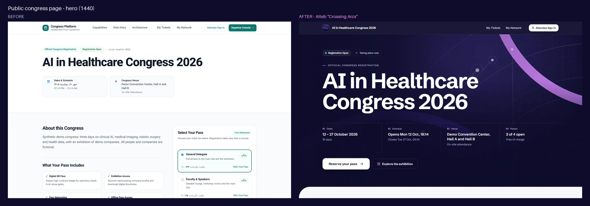
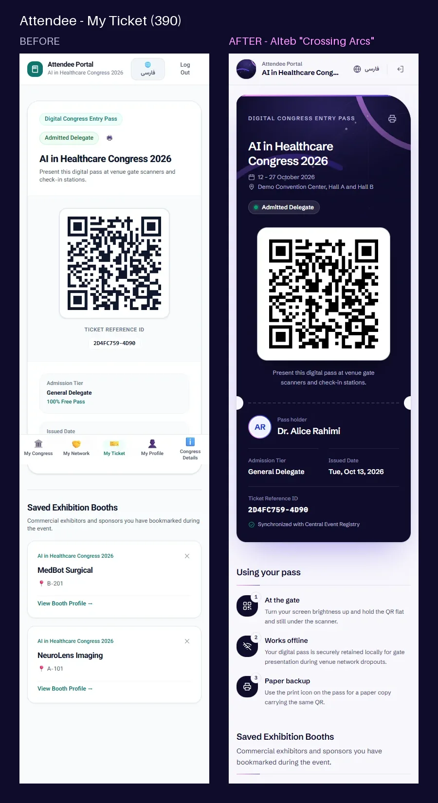
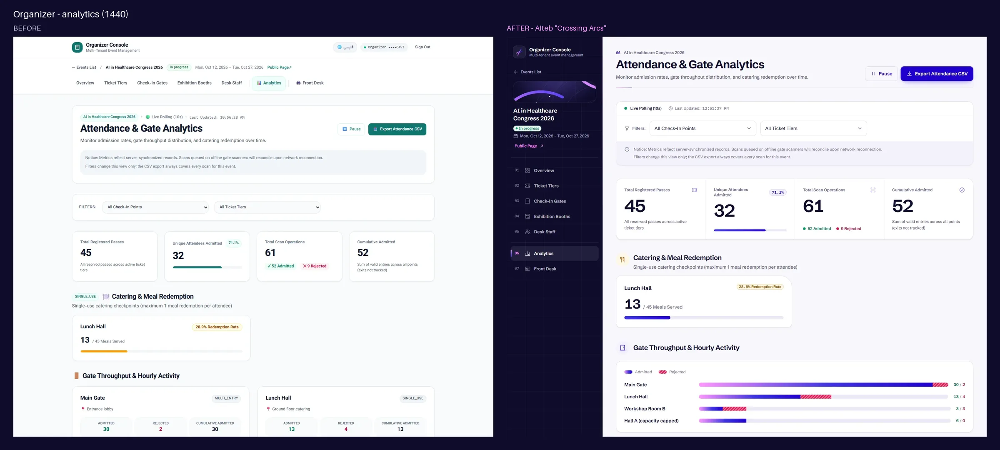
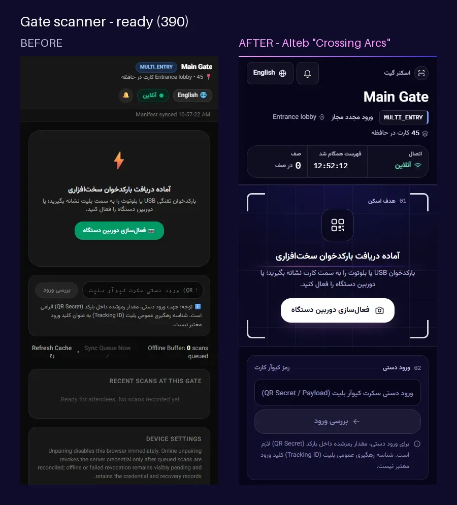

# AIteb Signature Redesign — Result

Branch `integration/task-05h`, based on `8807183`. This change is frontend only: no backend, schema, auth or API-contract changes.

## 1. AIteb brand sources inspected
- https://aiteb.ir/ was inspected in a real browser: rendered screenshots, computed styles, the `:root` custom properties and the Elementor/Astra stylesheets. The page is `lang="fa-IR"` and `dir="rtl"`.
- Official logo files on the site were downloaded and are reused unmodified:
  - `logo-aiteb-english-300-footer-min.png` (300×95 wordmark lockup), now `web/public/brand/aiteb-logo.png`.
  - The full-size site icon `cropped-logo-aiteb-english-300-footer-min.png` (512×512 mark), now `web/public/brand/aiteb-mark.png`. The favicon, apple-touch icon and PWA icons are generated from it.
- What the site shows about the brand:
  - The mark is two crossing curved strokes, orchid to violet, followed by the wordmark "AI Teb".
  - Flat illustrations in indigo and pink, lavender section bands and an indigo partner band.
  - The heading font is Shabnam FD; the English footer logo uses Montserrat 700.
  - The legal entity is "طبیبان روشن‌اندیش هوشمند". No legal text was invented.

## 2. Extracted brand colours
| Token | HEX | Evidence |
|---|---|---|
| AIteb Indigo | `#2000CD` | Wordmark pixels (dominant colour in the logo PNG); most-used accent in the site's computed colours |
| Mark violet | `#3D35DF` | Logo-mark gradient, cool end (pixel sampling) |
| Mark orchid | `#FF97FF` | Logo-mark gradient, warm end (pixel sampling) |
| Headline magenta | `#D6018D` | Site `linear-gradient(90deg, #D6018D, #283BEA)` |
| Headline blue | `#283BEA` | Same gradient, end |
| Lavender surface | `#F2F0FE` | Section background |
| Slate heading | `#486284` | Section `h2` colour |
| Graphite | `#191919` / `#404040` | Body text |

Not adopted: `#fb2056` / `#da1c4b` appear only as Astra theme globals and are not used visibly on the site.

Proposed extensions (not official, derived from the colours above):
- Ink `#0E0C2B` (scale `ink-50…950`) for dark surfaces.
- A brand scale `brand-50…900` built around `#2000CD`.
- Semantic colours: success `#04704F`, warning `#8A4B00`, danger `#B0103F`, info `#1F3BC4`. Each meets AA on white.
- Five per-congress accents derived from the brand colours (see `lib/eventAccent.ts`).

## 3. Typography
All fonts are self-hosted through `@fontsource`, licensed OFL-1.1 and precached for the offline PWA. Google Fonts was removed.
- **Vazirmatn** (variable) for Persian. It comes from the same type family as AIteb's Shabnam, with a full weight range. It becomes the primary font automatically under `dir="rtl"`.
- **Schibsted Grotesk** (variable) for Latin display and UI: an editorial grotesk with tight display tracking.
- **IBM Plex Mono** for ticket IDs, codes, slugs and times.

Text-handling rules:
- Letter-spacing is reset globally in RTL so Persian letters stay joined.
- `.ltr-isolate` keeps emails, URLs and IDs in the right direction inside Persian text.
- `.tabular` gives tabular numerals for figures.

## 4. Design direction — "Crossing Arcs" (پیوند)
The AIteb mark is two arcs crossing: medicine meets technology, and people meet at a congress. The system built from it:
- **Arc corner.** A quarter-arc corner (`shape-arc`) as the signature silhouette. It uses logical properties, so it mirrors in RTL.
- **Fine lines.** Architectural hairlines and a fine grid (`rule-arc`, `bg-meridian`).
- **Ink surfaces** for heroes, docks, rails and the scanner.
- **Restrained gradient.** The brand gradient appears only in thin strokes and small markers.
- **Editorial typography** with numbered section indexes (`01 / 02 …`).
- **Per-congress identity** from a deterministic, generative `CongressSignature` artwork. The API has no event imagery, so no stock photos are used.

## 5. External references and what was taken from them
- **Stripe Sessions:** oversized light display type, date and venue set as metadata columns, and one large brand artwork. Used in the public hero.
- **Figma Config:** a bold field with a black panel of ruled rows. Used for the platform-landing environment list and the scanner status rail.
- **Luma:** calm event lists with metadata above the title, and gradient text used on only one phrase. Used for the exhibitor index and booth lists.
- Earlier research screenshots in `docs/design/evidence/` (Web Summit, Slush, Swapcard, RSNA) were used for exhibitor discovery and schedule density.
- No layout or artwork was copied.

## 6. Shared tokens and components
- **Tokens:** `web/src/index.css`, covering colours, ink and brand scales, shadows, radii, motion keyframes, and the form, skeleton, eyebrow, reveal and press utilities. Reduced motion is honoured globally.
- **Brand components:**
  - `components/brand/Aiteb.tsx`: `AitebLogo`, `AitebAttribution` (fa/en, links to aiteb.ir) and `ArcMotif`.
  - `components/brand/CongressSignature.tsx`.
  - `lib/eventAccent.ts`.
- **Icons:** `components/ui/Icon.tsx`, 70+ line icons drawn for this platform. Directional icons mirror in RTL. Emoji used as icons were removed from every portal.
- **Restyled primitives:**
  - `Button`: new `ink`, `light` and `danger` variants, plus an `xl` size.
  - `Badge`: `ink` and `accent` variants, plus a `dot` option.
  - `Card`: tones and the arc shape.
  - `Dialog`: a bottom sheet on mobile, an arc panel on desktop.
  - `ConfirmDialog`, `StatusPanel`, the skeleton `LoadingBlock` and `SkipLink`.
- **Screenshot tooling:** `scripts/design/capture-screens.mjs` captures the same set of screens before and after. It is read-only against the demo.

## 7. Portals redesigned
| Environment | Highlights |
|---|---|
| Public (`/e/:slug`, booths, `/`) | Ink hero with animated congress artwork; dates, schedule, venue and pass count in numbered metadata columns; status derived from real dates; perforated pass stubs with capacity meters (amber when ≤25% left, hatched when closed); exhibitor index; booth placard with a large stand code; platform landing with the official logo; ink footer with attribution. Persian congresses render fully RTL and dates follow the congress's language. |
| Attendee (5 destinations) | Floating ink dock on phones with a gradient arc over the active item, two-row header on desktop. My Congress shows a cover with live/countdown state. My Ticket is an ink credential with perforation and stub: the QR value is unchanged, black on a white plate with a quiet zone, and never smaller than before. Printing now prints the pass (it printed blank before). Network contact cards; profile privacy switch; split sign-in. |
| Organizer | Ink sidebar (from 1024 px) carrying the event context and numbered sections; scrollable tabs on phones. Events listed with their signature artwork. Tables use tabular numerals and stack into rows on small screens. Analytics uses only real numbers: KPI strip, gate bars in the brand gradient, hourly columns, polling indicator and CSV. |
| Reception | Command-bar search with key hints (`/`, Enter, Esc). Panes adapt to width: stacked on phones, two panes on tablets, three columns on wide screens. Results carry high-contrast status chips; the review panel has a printable pass. Confirmations are instant, with no entrance animation. |
| Exhibitor | Ink booth header with placard and lead tally. Capture dock on phones, sticky capture panel on desktop. HOT/WARM/COLD toggle group that works from the keyboard. Lead cards, filter chips with counts, and an export spinner. |
| Scanner | Dark instrument: gate identity, a status rail (link / manifest / queue), and a reticle with a sweep line. Results take over the scan area in full colour with icon and words: admitted, offline-provisional (amber stripes), already admitted, rejected. They appear in 110 ms and never block the next scan. Precise scan log. Attribution appears only on setup and settings screens. |

## 8. Screenshots
All are real renders of this build against the local demo (synthetic data).
- **Before:** `docs/design/aiteb-redesign/before/` — 45 screens captured before any change.
- **After:** `docs/design/aiteb-redesign/after/` — the same 45 screens, fa and en, from 390 to 1920 px.
- **Interactive states:** `docs/design/aiteb-redesign/after/flows/`.
  - Read-only, never submitted: the registration dialog (en desktop and phone, fa phone), reception review (tablet, desktop, fa phone), and exhibitor qualification and capture dialogs (en and fa).
  - Two real demo gate scans: admitted (Alice at Main Gate, multi-entry) and rejected (Cyrus at Workshop, `TIER_NOT_ALLOWED`).
  - Offline-provisional admission: the browser context was offline and was discarded, so nothing synced.
- **Before/after sheets:** `docs/design/aiteb-redesign/compare/` (12 pairs).

| | |
|---|---|
|  |  |
|  |  |

## 9. Tests and exit codes (final tree)
| Check | Result |
|---|---|
| `npx tsc -b` | exit 0 |
| `npx oxlint src` | 0 errors; the remaining warnings are hook-dependency / set-state-in-effect in logic that was already there |
| `npm test` (unit) | 55 passed, 0 failed |
| `npm run build` | exit 0; precache 56 entries |
| Playwright, full suite (production preview on 127.0.0.1:4190, msedge, `--retries=0`) | **165 passed, 1 skipped** (`scanner-real-api.spec.ts` needs an isolated backend). All other specs intercept the API with synthetic data. |
| `scripts/integration/congress-e2e.mjs --skip-build` (real FastAPI + PostgreSQL in disposable `congress-e2e-*` containers, Postgres unpublished, effective database verified) | **45/45 checks passed** and `scanner-real-api.spec.ts` 1 passed, exit 0. This covers scanner offline queue and sync, idempotent replay, revocation, reception, exhibitor CSV and tenant isolation. |
| `scripts\check.bat` (backend mypy + pytest, web unit + typecheck + build, Dart tests + analyze) | ALL CHECKS PASSED, exit 0 |

The persistent demo database was not reset; port 4174 (another worktree) was not touched.

## 10. Performance and accessibility
- **Layout shift (CLS).** The public congress and booth pages scored 0.24–0.34 because the footer jumped when content arrived. The loading skeletons now fill the viewport; CLS is ≤ 0.04 on every page measured.
- **Load time (LCP)**, production build:

  | Page | Desktop | Throttled mobile (1.6 Mbps, 150 ms, 4× CPU) |
  |---|---|---|
  | Public congress | 0.47 s | 3.7 s |
  | Persian congress | 0.47 s | 4.6 s |
  | Reception | 0.65 s | 2.9 s |

- **Bundle.** The entry bundle went from 950 KB to 426 KB raw. Portals are code-split and public pages ship in the entry bundle; every chunk is precached for the offline scanner.
- **Accessibility:**
  - AA contrast for the palette and all event accents (checked numerically).
  - Visible focus rings, touch targets of at least 44 px, and safe-area padding on fixed bars.
  - Zooming is no longer blocked (`user-scalable=no` was removed).
  - Reduced motion disables the arc draw, scroll reveals and the scanner sweep.
  - Colour is never the only status signal.
- **No horizontal overflow** at 320 px on any captured route, in fa and en.

## 11. Known limitations
- **Logo resolution.** AIteb publishes the wordmark only as a 300×95 PNG, which is sharp up to about 47 px tall at 2× density. No vector logo was found, and none was redrawn.
- **Fonts.** Shabnam (AIteb's site font) is not used; Vazirmatn is used instead, as explained in §3.
- **Hardware not verified.** The camera and USB/HID scanner paths were not tested on real hardware; manual entry was the simulated path.
- **Persian helper lines on the scanner.** A few scanner labels keep an English helper line under the Persian text, because existing tests assert the English command names.
- **Front Desk rail title.** On the organizer Front Desk route opened directly, the rail shows "…" until the desk page reports its event (the old header behaved the same).
- **Mobile LCP.** On throttled mobile, LCP stays above 2.5 s, mainly from React startup plus two API round trips.

## 12. Commits
| SHA | Change |
|---|---|
| `133ffa6c0b680d2d51481da6674ff8d0e4b3ce40` | design foundation |
| `f88e933daddb5b7895295fd0000c342ae51e366a` | public experience |
| `d06e9f8c9bb1d4be3fb192a2c793c9c49bdf9845` | attendee |
| `4019180aa086884afd510ae03eef648d37035e34` | organizer |
| `0cf2defb96b4d2313579a071c66cd852e5dbd1a4` | reception |
| `a24633d9a6cd02611c38eadb858dfa4528df3987` | exhibitor |
| `905c48c1f570ffe99b8b2add76a577ab27d42079` | scanner |
| `28bdbbbfadf5c777e1e563eb316ddc8185e7829b` | route splitting |

This report, the screenshots and the refreshed integration evidence are in the commit that follows.

## 13. Reviewing the UI
1. `powershell -NoProfile -ExecutionPolicy Bypass -File scripts\demo\status.ps1`. If anything is stopped, run `scripts\demo\start.ps1`; data is preserved.
2. Open http://127.0.0.1:5190/e/ai-health-2026 (English) and /e/cardio-forum-1405 (Persian). Accounts and URLs for every portal are in `.demo/DEMO-GUIDE.md`.
3. Use the header language switch (فارسی / English) and the devtools device toolbar (390 px) for phone views.
4. To regenerate the screen set: `node scripts/design/capture-screens.mjs <out-dir> [--only=<prefix>]`.
